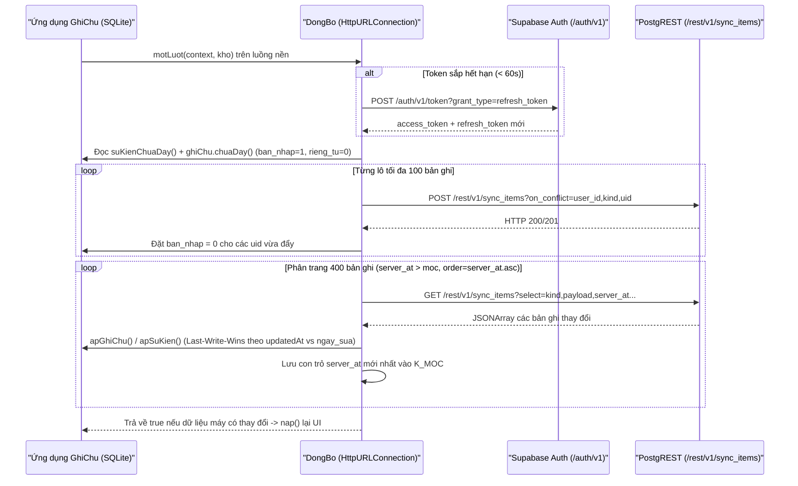
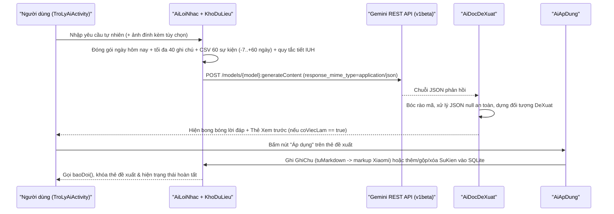
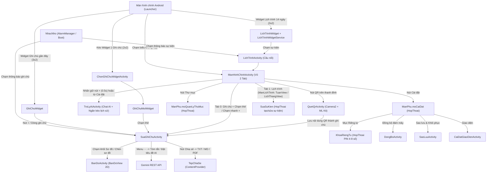

# Tài liệu Kiến trúc & Tham chiếu Mã nguồn Toàn diện — Dự án `GhiChu`

> **Định danh gói ứng dụng (`applicationId` / `namespace`)**: `com.ghichu`  
> **Tên hiển thị**: `Ghi chú`  
> **Đường dẫn gốc dự án**: `d:\Project\GhiChu`  
> **Hệ thống thiết kế hiện hành**: Bộ giao diện **v2 "Mực tím"** (vở ô ly & mực tím học trò, phông chữ `Be Vietnam Pro`)

---

## 1. Tổng quan Dự án (Project Overview)

### 1.1. Bài toán thực tế, Đối tượng sử dụng & Lịch sử Tiến hóa Kiến trúc

`GhiChu` là một ứng dụng Android độc lập tích hợp **Ghi chú đa phương tiện (Rich-Text Notes)**, **Lịch trình (Tuần/Tháng & Sự kiện lặp lại)**, **Trợ lý AI Gemini**, **Quét mã QR an toàn**, **Ghi chú Riêng tư mã hóa AES-256-GCM**, **Đồng bộ đám mây Local-First qua Supabase**, **Sao lưu/Khôi phục toàn phần qua tệp `.zip`**, và **Bộ 3 Tiện ích màn hình chính (AppWidgets)** — tất cả gói gọn trong một tệp APK siêu nhẹ (dưới `~3 MB`) **không phụ thuộc bất kỳ thư viện AndroidX / Jetpack / Google Play Services nào**.

Dự án ra đời từ nhu cầu cá nhân thực tế của tác giả (sinh viên Đại học Công nghiệp TP.HCM — IUH, sử dụng điện thoại chạy Xiaomi HyperOS 3) qua **3 giai đoạn tiến hóa kỹ thuật rõ rệt**:

1. **Giai đoạn 1 — Bản thử nghiệm Flutter (`D:\Project\Note`)**: Xây dựng mô hình dữ liệu ban đầu, bảng `sync_items` trên Supabase, bảng 8 màu sự kiện lịch và luồng Trợ lý AI đọc thời khóa biểu IUH (quy đổi tiết `T1..T16` sang khung giờ thực tế). Tuy nhiên, bản Flutter nặng và dùng định dạng văn bản Quill Delta JSON.
2. **Giai đoạn 2 — Bản Mod tiêm mã Smali vào ứng dụng Ghi chú Xiaomi MIUI `2.4.2.5` (`com.miui.notes`)**: Tác giả dịch ngược APK gốc của Xiaomi (lưu hồ sơ giải phẫu chi tiết dài 1.097 dòng tại `docs/SPEC-GOC.md`), viết các tính năng mở rộng bằng Kotlin thuần Android SDK rồi biên dịch sang smali để tiêm vào APK hệ thống. Hướng tiếp cận này buộc phải dừng lại vì lỗi hạ tầng hệ điều hành: APK hệ thống của Xiaomi khi đổi tên gói để cài đặt như ứng dụng thường (không có đặc quyền hệ thống) trên **HyperOS 3** luôn bị sập tầng native (`ICU` / bộ cấp phát bộ nhớ `Scudo`) sau khoảng `~9 giây` kể từ lúc mở, ngay cả khi chưa tiêm bất kỳ dòng mã nào.
3. **Giai đoạn 3 — Ứng dụng Android Kotlin độc lập (`com.ghichu`)**: Toàn bộ mã nguồn Kotlin không phụ thuộc AndroidX được tách thành một dự án Android độc lập, cài đặt được trên mọi thiết bị Android 11+ (`minSdk = 30`), đồng thời kế thừa:
   - Định dạng lưu trữ văn bản giàu định dạng **markup kiểu Xiaomi** (`<text indent="1">`, `<input type="checkbox" />`, `<b>`, `<i>`, `<audio />`, `<mind>`) và bộ đọc tương thích ngược với **Quill Delta JSON** từ bản Flutter cũ;
   - Hợp đồng đồng bộ đám mây `sync_items` trên Supabase chung với dự án cũ;
   - Tiến hóa giao diện từ **Bộ v1** (tái tạo sát thông số MIUI Notes `2.4.2.5` với thanh kính mờ `KinhMo`) sang **Bộ v2 "Mực tím"** (lấy cảm hứng từ trang giấy vở trắng ngả tím `#F5F5F8`, chữ đen mực `#16151B`, một màu nhấn duy nhất tím mực `#5B4BDB` / `#A197FF`, viền mảnh `1dp` thay đổ bóng, thanh điều hướng nổi "thỏi mực" `#16151B`, và phông chữ tiếng Việt chuyên biệt `Be Vietnam Pro`).

### 1.2. Bảng Tech Stack Chi tiết

Toàn bộ thông số công nghệ được trích xuất trực tiếp từ `settings.gradle.kts`, `gradle/wrapper/gradle-wrapper.properties`, `gradle.properties`, `app/build.gradle.kts` và `app/src/main/AndroidManifest.xml`:

| Thành phần | Công nghệ / Thư viện | Phiên bản / Cấu hình | Nguồn khai báo & Ghi chú kỹ thuật |
| :--- | :--- | :--- | :--- |
| **Ngôn ngữ chính** | Kotlin (JVM) | `2.3.20` (`JvmTarget.JVM_17`) | `settings.gradle.kts`, `app/build.gradle.kts` |
| **Công cụ kịch bản phụ trợ** | Python 3 | UTF-8 (`# -*- coding: utf-8 -*-`) | `tools/*.py` (8 script sinh icon & vá mã lịch sử) |
| **Hệ thống Build** | Gradle Wrapper | `9.1.0` (`bin`) | `gradle/wrapper/gradle-wrapper.properties` |
| **Android Gradle Plugin (AGP)** | `com.android.application` | `9.0.1` | `settings.gradle.kts` (AGP 9 tích hợp sẵn Kotlin, không apply plugin `kotlin.android` trong `app`) |
| **Java Toolchain** | JDK / Java Compatibility | `JavaVersion.VERSION_17` | `app/build.gradle.kts`, `-Xmx2g -Dfile.encoding=UTF-8` |
| **Android SDK** | `minSdk` / `targetSdk` / `compileSdk` | `30` (Android 11) / `36` / `36` | `app/build.gradle.kts` (dùng trực tiếp API `WindowInsets.Type` của API 30+) |
| **UI Framework** | Android Platform View & Canvas thuần | Zero AndroidX (`android.app.Activity`, `View`, `Canvas`) | Dựng 100% giao diện bằng mã Kotlin; XML chỉ dùng cho `RemoteViews` của AppWidget |
| **Phông chữ nhúng** | `Be Vietnam Pro` | Weights `400`, `500`, `600`, `700` (SIL OFL 1.1) | `app/src/main/res/font/be_vietnam_pro*.ttf`, `Chu.kt` |
| **Cơ sở dữ liệu nội bộ** | Android SQLite (`SQLiteOpenHelper`) | `ghichu.db` — Schema `PHIEN_BAN = 2` | `KhoDuLieu.kt` (5 bảng: `su_kien`, `ghi_chu`, `thu_muc`, `qr_lich_su`, `hoi_thoai`) |
| **Mã hóa bảo mật** | Java Cryptography (`javax.crypto`) | `PBKDF2WithHmacSHA256` (210.000 vòng) + `AES/GCM/NoPadding` (256-bit) | `MaHoa.kt`, `KhoaRiengTu.kt` (định dạng tiền tố `gc1:`) |
| **Mạng & Đám mây** | `java.net.HttpURLConnection` + `org.json` | Supabase Auth & PostgREST (`sync_items`) | `DongBo.kt` (không dùng OkHttp/Retrofit/Supabase SDK) |
| **Trí tuệ nhân tạo (AI)** | Google Gemini REST API (`v1beta`) | `gemini-3.5-flash` (mặc định), `gemini-3.1-flash-lite`, `gemini-flash-latest` | `Gemini.kt`, `AiLoiNhac.kt`, `AiDeXuat.kt`, `AiApDung.kt` |
| **Đa phương tiện & Phần cứng** | `Camera2` (`YUV_420_888`), `MediaRecorder`, `MediaPlayer`, `PdfDocument` | AAC/MPEG-4 `.m4a` (`64 kbps`, `22.05 kHz`), JPEG, PNG, PDF A4 (`595x842 pt`) | `QuetQrActivity.kt`, `KhoGhiAm.kt`, `KhoAnh.kt`, `XuatGhiChu.kt` |
| **Thư viện Runtime duy nhất** | ZXing Core (`com.google.zxing:core`) | `3.5.3` | `app/build.gradle.kts` (Java thuần, giải mã ma trận điểm sáng QR) |
| **Thư viện Kiểm thử JVM** | JUnit 4 + `org.json` thật | `junit:junit:4.13.2`, `org.json:json:20250107` | `app/build.gradle.kts` (`unitTests.isReturnDefaultValues = true`) |

### 1.3. Thông tin Kho mã nguồn Git & Trạng thái Hiện tại

- **Remote URL (`origin`)**: `https://github.com/Tthanh2k6/GhiChu.git`
- **Nhánh hiện tại**: `main`
- **Lịch sử các mốc commit gần đây (`git log -n 15 --oneline`)**:
  - `5f1a6f0` — `docs: update README`
  - `78a3862` — `Add note undo, backup sync and calendar widget improvements`
  - `7194ea5` — `Widget 2x2 ghim mot ghi chu duoc chi dinh`
  - `9ee5fea` — `Bo nut Mau giay (◐) o thanh tren man soan...`
  - `efc5337` — `Bang chon giao dien (theme) trong man soan: dai ngang mau + anh nen`
  - `781627d` — `Xoa han header cuon: thanh nav 56dp thanh DINH co dinh cua trang`
  - `c402f98` — `Sua kinh header cao dư...`
  - `ce50f09` — `Kinh header duc hon (0xF0)...`
  - `ff42132` — `Header: ca header troi theo cuon...`
  - `088816f` — `KinhMo: thanh tab kinh mo THAT bang RenderEffect (Android 12+)...`
  - `3026054` — `Thanh tab kieu kinh...`
  - `7d18fd2` — `Header thu gon that...`
  - `99b459b` — `Widget Lich trinh mo thang tab Lich trinh...`
  - `e1cf2f5` — `Thanh tab LUON hien: nhung Lich trinh vao man chinh, bo tab Tro ly`
  - `63fd62c` — `Thanh tab: chu duoi icon can giua...`
- **Trạng thái Cây làm việc hiện tại (`git status --short`)**:
  Kho mã nguồn đang có bản nâng cấp lớn chưa commit chuyển toàn bộ hệ thống giao diện từ bản v1 sang **Bộ thiết kế v2 "Mực tím"**:
  - **Đã xóa (`D`)**: `KinhMo.kt` (bỏ hiệu ứng kính mờ HyperOS để chuyển sang phong cách phẳng giấy & mực có dải mờ đáy + dock nổi), `ic_tick_da.xml`, `ic_tick_trong.xml` (ô tick trong bài chuyển sang vẽ trực tiếp bằng `Canvas` qua `TheOTick`).
  - **Tệp mới (`??`)**: `Chu.kt` (quản lý font `Be Vietnam Pro`), `ManPhu.kt` (khung chuẩn cho các màn cài đặt phụ), `res/font/be_vietnam_pro*` (4 tệp `.ttf` + 1 XML font-family), `docs/OFL-BeVietnamPro.txt`, `res/values/colors.xml`, và 12 icon vector nét tròn mới (`ic_an.xml`, `ic_bao_thuc.xml`, `ic_chia_se.xml`, `ic_chuyen.xml`, `ic_dong.xml`, `ic_gui.xml`, `ic_hoan_tac.xml`, `ic_khoa.xml`, `ic_lam_lai.xml`, `ic_menu.xml`, `ic_them_nua.xml`, `ic_tick.xml`).
  - **Đã chỉnh sửa (`M`)**: 25 tệp `.kt`, 24 tệp drawable XML, 5 layout widget XML, và `res/values/themes.xml` đồng bộ sang bảng màu & tỷ lệ của bộ v2 "Mực tím".

---

## 2. Kiến trúc Tổng thể & Luồng Dữ liệu (Architecture & End-to-End Data Flow)

### 2.1. Sơ đồ Kiến trúc Tổng thể

```mermaid
flowchart TD
    subgraph UI["Tầng Giao diện & Trình bày (100% Programmatic Android Views)"]
        MHC["ManHinhChinhActivity (Lưới Ghi chú + Tab Lịch trình)"]
        SGC["SuaGhiChuActivity (Trình soạn 1 EditText + Thanh công cụ)"]
        MLT["ManLichTrinh / LichTrinhActivity (TuanView + LichThangView + SuaSuKien)"]
        TLA["TroLyAiActivity (Chat AI + Ngăn kéo lịch sử + Thẻ đề xuất)"]
        BDA["BanDoActivity + BanDoView (Cây tư duy Canvas)"]
        QRA["QuetQrActivity (Camera2 YUV Preview + Lịch sử)"]
        SUB["Các màn phụ: DongBoActivity / SaoLuuActivity / CaiDatGiaoDienActivity"]
        COMP["Thành phần dùng chung: BangMau / Chu / HopThoai / MenuNoi / ManPhu / LuoiSoLe / TheGhiChu"]
    end

    subgraph DOMAIN["Tầng Nghiệp vụ Thuần Kotlin (Chạy độc lập trên JVM Unit Test)"]
        FMT["Markup & Văn bản: KhoiNoiDung / DinhDang / NoiDungGhiChu / SoanThao / BoHoanTac"]
        CAL["Lịch & Thời gian: SuKien / LichLapLai / HangMau / NgayVN"]
        AI["Lõi AI: AiLoiNhac / AiDocDeXuat / AiApDung / Gemini"]
        MM["Bố cục Bản đồ tư duy: Nut / OBanDo / XepBanDo"]
        SEC["Mã hóa & QR: MaHoa (PBKDF2 + AES-GCM) / QuetQr (ZXing)"]
    end

    subgraph DATA["Tầng Lưu trữ Nội bộ & Tệp tin (Single-Instance từ Ung.kt)"]
        UNG["Application: Ung (Giữ 1 kết nối KhoDuLieu duy nhất)"]
        KDL["KhoDuLieu (ghichu.db v2: su_kien, ghi_chu, thu_muc, qr_lich_su, hoi_thoai)"]
        KGC["KhoGhiChu (CRUD Ghi chú, Thư mục, Giải mã tự động, Thùng rác 30 ngày)"]
        MEDIA["KhoAnh (files/anh/*.jpg) & KhoGhiAm (files/ghiam/*.m4a)"]
        PREFS["6 tệp SharedPreferences (giao_dien, dongbo, ai, rieng_tu, lichtrinh, widget_mot)"]
        ZIP["SaoLuu (.zip toàn phần) & XuatGhiChu (PNG / PDF A4)"]
    end

    subgraph SYS["Tầng Tích hợp Hệ điều hành Android & Đám mây"]
        WDG["3 AppWidgets: GhiChuWidget / GhiChuMotWidget / LichTrinhWidget + LichTrinhWidgetService"]
        ALM["NhacNho + BaoThuc Receiver (AlarmManager Exact Alarm + Notification)"]
        PRV["ContentProvider: TepChiaSe (content://com.ghichu.tep/*)"]
        SUPA["Supabase Cloud (Auth JWT + PostgREST sync_items)"]
        GEM["Google Gemini API (v1beta generateContent)"]
    end

    MHC --> COMP
    SGC --> COMP
    SGC --> FMT
    MLT --> CAL
    TLA --> AI
    BDA --> MM
    QRA --> SEC
    SUB --> COMP

    MHC --> KGC
    SGC --> KGC
    SGC --> MEDIA
    SGC --> ZIP
    MLT --> KDL
    TLA --> KDL
    TLA --> KGC
    QRA --> KDL

    KGC --> KDL
    KGC --> SEC
    UNG --> KDL
    AI --> GEM
    SUB --> SUPA
    SUB --> ZIP

    KDL -- "baoDoi()" --> WDG
    KDL -- "baoDoi()" --> ALM
    ZIP --> PRV
```



### 2.2. Phân tích Các Tầng Kiến trúc & Cơ chế Giao tiếp

1. **Nguyên lý "Zero AndroidX" & Dựng UI bằng Mã nguồn**:
   - Toàn bộ 9 `Activity` kế thừa trực tiếp `android.app.Activity` của khung Android nền tảng, không có `AppCompatActivity`, `Fragment`, `RecyclerView`, `ConstraintLayout` hay `ViewModel` của Jetpack.
   - Mọi thành phần phức tạp đều được tác giả tự thiết kế gọn nhẹ bằng Kotlin: lưới 2 cột so le (`LuoiSoLe`), hộp thoại trượt đáy hỗ trợ kéo tay đóng (`HopThoai`), menu nổi neo theo nút (`MenuNoi`), ngăn kéo lịch sử chat (`TroLyAiActivity.dungNganKeo`), lịch tuần cuộn ngang vô tận + phóng to hai ngón (`TuanView`), sơ đồ tư duy đường cong Bezier (`BanDoView`), và bộ hoàn tác bảo toàn span (`BoHoanTac`).
2. **Tách biệt Lõi Thuần Kotlin (Pure-Kotlin Testable Core)**:
   - Mọi thuật toán dễ phát sinh lỗi dữ liệu — phân tích/sinh markup Xiaomi (`KhoiNoiDung`, `DinhDang`, `NoiDungGhiChu`), lịch lặp lại (`LichLapLai`), xoay vòng hàng màu (`HangMau`), tính giờ báo thức (`NhacNho.sapToi`), đóng gói yêu cầu & bóc JSON của Gemini (`Gemini.dungThan`, `Gemini.docTraLoi`, `AiLoiNhac`, `AiDocDeXuat`, `AiApDung.gop`), xếp cây tư duy (`XepBanDo`), mã hóa `AES-GCM` (`MaHoa`), và giải mã/kiểm tra tên miền QR (`QuetQr`) — đều **không gọi API Android UI** (hoặc nhận `ZoneId` / hàm đo chữ qua tham số). Nhờ đó 16 bộ kiểm thử JUnit 4 tại `app/src/test/` chạy trực tiếp trên JVM máy tính trong vài giây mà không cần máy ảo.
3. **Quản lý Kết nối CSDL Duy nhất & Cơ chế Phát tín hiệu Trung tâm (`KhoDuLieu.baoDoi()`)**:
   - Lớp `Ung : Application` khởi tạo **đúng một thực thể `KhoDuLieu`** (`by lazy`) cho toàn bộ vòng đời tiến trình (dùng chung cho cả `Activity`, `BroadcastReceiver`, `AppWidgetProvider`, và `RemoteViewsService`), tránh lỗi `database is locked` khi nhiều thành phần cùng ghi SQLite.
   - Mọi thao tác làm thay đổi sự kiện hoặc ghi chú trong `KhoDuLieu` và `KhoGhiChu` đều gọi `kho.baoDoi()` (sau khi đã đóng giao dịch SQLite). Hàm `baoDoi()` tập trung kích hoạt vẽ lại cả 3 loại widget (`LichTrinhWidget`, `GhiChuWidget`, `GhiChuMotWidget`) và tính lại báo thức kế tiếp gần nhất (`NhacNho.datLai(ung)`).
4. **Mô hình Đa luồng (Threading Model)**:
   - Không dùng Kotlin Coroutines để tránh kéo thư viện `kotlinx-coroutines` vào APK.
   - Các tác vụ tốn thời gian (gọi mạng Supabase/Gemini, dẫn xuất khóa PBKDF2 210.000 vòng, giải nén/thu nhỏ ảnh, kết xuất PNG/PDF, nén/giải nén `.zip`, dọn rác & tệp thừa lúc khởi động) chạy trên `Thread { ... }.start()` hoặc `Executors.newSingleThreadExecutor()`, sau đó đẩy kết quả về luồng giao diện qua `runOnUiThread` hoặc `Handler(Looper.getMainLooper()).post` kèm kiểm tra `!isFinishing && !isDestroyed`.

### 2.3. Vòng đời Khởi động (Startup Lifecycle)

Khi tiến trình `com.ghichu` được hệ thống khởi chạy (do người dùng chạm biểu tượng ứng dụng, do widget gọi `RemoteViewsService`, hoặc do `BaoThuc` nhận `BOOT_COMPLETED` / báo thức nổ):

1. **`Ung.onCreate()`** (`Ung.kt:23-32`):
   - `DongBo.khoiTao(this)`: Nạp cấu hình máy chủ, khóa công khai và token phiên đăng nhập từ `SharedPreferences("ghichu_dongbo")`.
   - `KhoaRiengTu.khoiTao(this)`: Nạp muối (`muoi`) và thẻ kiểm mật khẩu (`the`) từ `SharedPreferences("ghichu_rieng_tu")`; biến `khoaPhien` trong RAM khởi đầu bằng `null` (trạng thái khóa).
   - `DongBoTuDong.gan(this)`: Đăng ký `Application.ActivityLifecycleCallbacks` đếm số màn hình đang hiển thị (`dangHien`) để tự động đồng bộ khi người dùng thoát ra màn hình chính của điện thoại.
   - `NhacNho.datLai(this)`: Quét các sự kiện và ghi chú trong 30 ngày tới để đăng ký báo thức chính xác (`AlarmManager`) cho mốc gần nhất.
2. **`ManHinhChinhActivity.onCreate()`** (`ManHinhChinhActivity.kt:119-199`):
   - Giải chế độ Sáng/Tối qua `BangMau.cua(this)` và gọi `setTheme(mau.themeManHinh)` **trước** khi tạo View.
   - Thiết lập cửa sổ tràn viền (`statusBarColor = 0`, `navigationBarColor = 0`, màu nền cửa sổ `mau.nen`).
   - Dựng cây giao diện gồm: `thanhTren` (`56dp`), `hangTim` (`50dp` chứa viên thuốc `44dp`), `hangChip` (thư mục), `khungNoiDung` (chứa `khungGhiChu` với `LuoiSoLe`, và khởi tạo lười `ManLichTrinh` khi sang tab 1), lớp mờ đáy `lopMoDay`, thanh điều hướng nổi `dock` ("thỏi mực") và thanh hành động chọn nhiều `dockChon`.
   - Gắn `OnApplyWindowInsetsListener` tính toán lề trên theo `statusBar` và lề dưới `dock` cách thanh điều hướng `16dp`.
   - Nếu `Intent` có extra `KHOA_TAB == 1` (mở từ widget Lịch trình), tự động chuyển sang tab Lịch trình sau khi dựng bố cục (`nen.post { chuyenTab(1) }`).
   - Xin quyền `POST_NOTIFICATIONS` trên Android 13+ (`SDK_INT >= 33`).
   - Khởi chạy một luồng nền dọn dẹp định kỳ: xóa vĩnh viễn ghi chú nằm trong thùng rác quá 30 ngày (`kho.donRacQuaHan()`), xóa tệp ảnh mồ côi (`KhoAnh.donTepThua`), và xóa tệp ghi âm mồ côi (`KhoGhiAm.donTepThua`).
3. **`ManHinhChinhActivity.onResume()`**:
   - Kiểm tra nếu cài đặt Sáng/Tối đã đổi thì gọi `recreate()` để dựng lại toàn bộ bảng màu.
   - Nạp danh sách ghi chú (`nap()`) hoặc lịch trình (`manLich?.nap()`).
   - Kích hoạt đồng bộ ngầm `dongBoNgam()` nếu đã đăng nhập Supabase và cách lần đồng bộ trước tối thiểu `2 phút` (`CACH_DONG_BO_MS = 120_000L`).

### 2.4. Toàn bộ Các Luồng Nghiệp vụ Chính (End-to-End Business Flows)

#### Luồng 1: Tạo mới, Soạn thảo Giàu Định dạng, Hoàn tác & Tự động Lưu Ghi chú
1. Tại `ManHinhChinhActivity` (Tab `0`), người dùng chạm nhanh nút `+` trên `dock` hoặc chạm vào một thẻ `TheGhiChu`.
2. Ứng dụng mở `SuaGhiChuActivity` kèm hiệu ứng phóng mở từ vị trí nút/thẻ (`ActivityOptions.makeScaleUpAnimation`), truyền `id` (nếu sửa) và `thu_muc` đang xem.
3. `SuaGhiChuActivity` đọc bản ghi qua `KhoGhiChu.theoId(id)`:
   - Nếu ghi chú riêng tư và `KhoaRiengTu.dangMo == true`, `KhoGhiChu.doc()` giải mã `tieu_de` và `noi_dung` bằng `MaHoa.giaiMa`.
   - `SoanThao.doc(noiDung)` chuyển chuỗi markup Xiaomi thành `SpannableStringBuilder` cho một `EditText` duy nhất (`oThan`): khối `<input type="checkbox">` biến thành tiền tố `"☐ "` / `"☑ "`, `<hr />` thành `"───────────"`, `<audio>` thành nhãn `"🎙 Ghi âm · ..."` gắn span `TheGhiAm`, `<mind>` thành nhãn `"🧠 Bản đồ tư duy · N nhánh"` gắn span `TheBanDo`, `` thành ký tự `"\u263A"` gắn `TheAnh` (sau đó `veAnh()` phủ `ImageSpan` theo đúng bề rộng thật của `oThan`).
   - `trangTriOTick()` phủ `ReplacementSpan` `TheOTick` vẽ hộp vuông bo góc bằng `Canvas` đè lên 2 ký tự đầu dòng và phủ `MoChuTick` (chữ mờ + gạch ngang) cho dòng đã hoàn thành.
   - `BoHoanTac(oThan)` bắt đầu theo dõi thao tác sửa văn bản, gộp các phím gõ cách nhau dưới `500ms` thành một mốc hoàn tác, giữ tối đa `100` bản chụp `SpannableStringBuilder` (bảo toàn mọi span định dạng, ảnh, ghi âm, bản đồ).
4. Khi bàn phím bật (`WindowInsets.Type.ime().bottom > 0`), thanh trên tự động ẩn cụm nút Xem (`Chia sẻ`, `⋯`) và hiện cụm nút Soạn (`Hoàn tác`, `Làm lại`, `Xong` tím mực).
5. Khi người dùng rời màn hình (`onPause()`), `luu()` tự động chạy:
   - Bỏ qua nếu là ghi chú mới (`id == 0L`) mà cả tiêu đề lẫn thân bài đều trống.
   - Chuyển `Spannable` ngược về markup Xiaomi qua `SoanThao.ghi(than)` (tách từng dòng, gom các span liền kề cùng kiểu thành thẻ `<b>`, `<i>`, `<u>`, `<strike>`, `<size>`, `<font color="...">`, bảo toàn ``, `<audio />`, `<mind>`).
   - So sánh với bản gốc qua `daDoi(cu, moi)`: nếu không có trường nào thay đổi thì **không ghi CSDL** (tránh nhảy `ngay_sua` và tránh đẩy đồng bộ thừa).
   - Nếu có thay đổi, `KhoGhiChu.luu(moi)` sinh `chu_tron` (hoặc mã hóa AES-GCM và xóa sạch `chu_tron = ""` nếu `riengTu == true`), đặt `ban_nhap = 1`, lưu SQLite và gọi `kho.baoDoi()` để cập nhật 3 widget cùng bộ hẹn giờ báo thức.

#### Luồng 2: Mã hóa Ghi chú Riêng tư & Tự động Khóa (`KhoaRiengTu` + `MaHoa`)
1. Người dùng mở `Thư mục` -> `Riêng tư`. Nếu chưa đặt mật khẩu, hộp thoại hiện cảnh báo rõ ràng (quên mật khẩu sẽ mất vĩnh viễn dữ liệu vì không gửi khóa lên máy chủ) và yêu cầu mật khẩu tối thiểu 4 ký tự.
2. Trên luồng nền, `KhoaRiengTu.dat(mk)` sinh 16 byte muối ngẫu nhiên (`SecureRandom`), chạy `PBKDF2WithHmacSHA256` `210.000` vòng tạo khóa AES 256-bit, mã hóa chuỗi kiểm chứng `"ghi chu rieng tu"` thành thẻ `the` (`gc1:...`), lưu `muoi` + `the` vào `SharedPreferences("ghichu_rieng_tu")`, và giữ `SecretKey` duy nhất trong biến `@Volatile khoaPhien` trên RAM.
3. Khi ẩn một ghi chú vào Riêng tư (`anDaChon()` ở màn chính hoặc `doiRiengTu()` ở màn soạn), cả `tieu_de` và `noi_dung` đều được mã hóa bằng `AES/GCM/NoPadding` với IV 12 byte ngẫu nhiên mới mỗi lần lưu (`"gc1:" + Base64(iv + ciphertext + tag128)`), đồng thời cột `chu_tron` bị xóa rỗng `""` để không lộ qua tìm kiếm SQLite.
4. Ghi chú có `rieng_tu = 1` tuyệt đối **không** đưa vào danh sách đẩy lên Supabase (`chuaDay()` lọc `rieng_tu = 0`), **không** gửi trong ngữ cảnh hệ thống của Gemini (`banGon()` lọc `rieng_tu = 0`), và **không** hiển thị trên bất kỳ AppWidget nào.
5. Ngay khi người dùng thoát ứng dụng hoặc tắt màn hình (`ManHinhChinhActivity.onStop()` khi `!isChangingConfigurations || isFinishing`), `KhoaRiengTu.khoaLai()` xóa `khoaPhien = null` và thoát khỏi chế độ xem Riêng tư.

#### Luồng 3: Lịch trình Tuần/Tháng, Mở rộng Sự kiện Lặp lại & Hàng đợi Màu
1. Tại Tab `1` (`ManLichTrinh`) hoặc `LichTrinhActivity`, người dùng chuyển đổi giữa chế độ **Tuần** (`TuanView`) và **Tháng** (`LichThangView`) qua công tắc `Tuần | Tháng` gắn trên thanh tiêu đề.
2. `TuanView` hiển thị khung giờ `06:00 -> 24:00`, hỗ trợ cuộn ngang liên tục theo từng ngày (với đà quán tính `OverScroller`), chụm hai ngón tay để phóng to/thu nhỏ chiều cao mỗi giờ, tự động chia cột song song cho các sự kiện trùng giờ và hiển thị vạch đỏ chỉ thời gian hiện tại.
3. Khi nạp dữ liệu cho khoảng `[tu, den)`, `KhoDuLieu.trongKhoang(tu, den)` lấy mọi sự kiện chưa xóa có `lap_lai != 0` hoặc giao với khoảng xem, sau đó `LichLapLai.moRong()` trải từng sự kiện lặp (`Hằng ngày`, `Hằng tuần`, `Hằng tháng`, `Hằng năm`) thành danh sách `LanHien`, tôn trọng mốc dừng lặp `lapDen` (so sánh theo **ngày** địa phương chứ không so theo mili-giây).
4. Khi tạo sự kiện mới qua hộp thoại trượt đáy `SuaSuKien` (hoặc qua AI), nếu người dùng không tự bấm chọn màu, `HangMau` tự động lấy màu đầu hàng đợi trong `SharedPreferences("ghichu_lichtrinh")` rồi đẩy màu đó xuống cuối hàng để 8 màu sự kiện luôn luân phiên đều đặn.

#### Luồng 4: Đồng bộ Đám mây Local-First với Supabase (`DongBo` + `DongBoTuDong`)



#### Luồng 5: Trợ lý AI Gemini & Cơ chế "Xem trước — Xác nhận mới Áp dụng"



#### Luồng 6: Sao lưu & Khôi phục Toàn phần Tệp `.zip` (`SaoLuu`)
- **Sao lưu (`SaoLuu.xuat`)**: Chạy `PRAGMA wal_checkpoint(TRUNCATE)` để dồn sạch dữ liệu từ tệp `-wal` vào `ghichu.db`, sau đó nén `db/ghichu.db` cùng toàn bộ tệp trong `files/anh/*` và `files/ghiam/*` ra luồng `OutputStream` do người dùng chọn qua SAF (`ACTION_CREATE_DOCUMENT`). Bản sao lưu bao gồm cả ghi chú riêng tư (vẫn ở dạng mã hóa `gc1:`), lịch sử QR và lịch sử hội thoại AI.
- **Khôi phục (`SaoLuu.nhap`)**: Kiểm tra tệp `.zip` phải có mục `db/ghichu.db`, chặn tấn công **Zip-Slip** bằng kiểm tra `canonicalPath`, đóng `KhoDuLieu`, xóa sạch tệp `-wal`/`-shm` cũ và thư mục media cũ, chép dữ liệu mới vào, rồi khởi động lại tiến trình ứng dụng (`FLAG_ACTIVITY_NEW_TASK | FLAG_ACTIVITY_CLEAR_TASK` + `Runtime.getRuntime().exit(0)`) để kết nối SQLite mới hoàn toàn.

#### Luồng 7: Quét Mã QR An toàn (`QuetQrActivity` + `QuetQr`)
- Mở luồng xem trước `Camera2` (`TEMPLATE_PREVIEW`) với hai bề mặt nhận hình đồng thời: `TextureView` (hiển thị mượt trên màn hình kèm biến đổi ma trận chống méo tỷ lệ) và `ImageReader` (`YUV_420_888`, `1280x720`, tối đa 2 khung đệm).
- Trích xuất mặt phẳng độ chói `Y` (`planes[0]`, xử lý đệm `rowStride > width`), đưa qua `MultiFormatReader` của ZXing (ép `DecodeHintType.CHARACTER_SET = "UTF-8"` để không hỏng dấu tiếng Việt).
- Khi bắt được mã: rung phản hồi xúc giác, lưu vào bảng `qr_lich_su` (gộp trùng nếu quét lại mã cũ), **tuyệt đối không tự mở trình duyệt**. Hộp kết quả phân loại mã (`LIEN_KET`, `WIFI`, `DIEN_THOAI`, `EMAIL`, `DANH_THIEP`, `CHU`); nếu là liên kết chỉ cho phép mở `http://` hoặc `https://` và trích xuất tên miền thật đứng **sau dấu `@`** (`QuetQr.tenMien`) để chống lừa đảo giả mạo tên miền.

#### Luồng 8: Chia sẻ & Xuất Ghi chú sang Văn bản / PNG / PDF (`XuatGhiChu` + `TepChiaSe`)
- Người dùng bấm nút `Chia sẻ` ở màn soạn và chọn 1 trong 3 định dạng:
  - **Văn bản**: Gửi `ACTION_SEND` kiểu `text/plain` trực tiếp.
  - **Ảnh PNG**: `XuatGhiChu.anh` dựng `LinearLayout` ẩn rộng `1080px` giữ nguyên `CharSequence` có định dạng (`Spanned`), đo và vẽ ra `Bitmap` (giới hạn chiều cao tối đa `12.000px` chống tràn bộ nhớ), ghi vào `cache/chiase/*.png`.
  - **Tài liệu PDF**: `XuatGhiChu.pdf` dùng `StaticLayout` đo toàn bài rồi cắt trang thông minh theo đúng ranh giới dòng (`getLineForVertical` + `getLineTop` để không bao giờ chẻ đôi hàng chữ ở mép trang) lên khổ A4 (`595 x 842 pt`), đánh số trang chân giấy và ghi vào `cache/chiase/*.pdf`.
- `TepChiaSe` (`ContentProvider` tại `content://com.ghichu.tep/<tên_tệp>`) cấp URI đọc tạm thời (`FLAG_GRANT_READ_URI_PERMISSION`) cho ứng dụng nhận chia sẻ.

---

## 3. Cấu trúc Thư mục & Bản đồ Toàn bộ Tệp nguồn (Complete Directory & File Map)

### 3.1. Cây Thư mục Trực quan

```text
d:\Project\GhiChu\
├── .gitignore
├── README.md
├── build.gradle.kts
├── settings.gradle.kts
├── gradle.properties
├── local.properties
├── gradlew
├── gradlew.bat
├── gradle/
│   └── wrapper/
│       ├── gradle-wrapper.jar
│       └── gradle-wrapper.properties
├── docs/
│   ├── OFL-BeVietnamPro.txt
│   ├── SPEC-GOC.md
│   ├── SPEC-GOC-chip.md
│   ├── SPEC-GOC-dot3.md
│   └── SPEC-GOC-hopthoai.md
├── tools/
│   ├── ghi_icon_goc.py
│   ├── va_bo_header.py
│   ├── va_dot3.py
│   ├── va_header.py
│   ├── va_header2.py
│   ├── va_sukien.py
│   ├── va_tab.py
│   └── va_theme.py
└── app/
    ├── build.gradle.kts
    └── src/
        ├── main/
        │   ├── AndroidManifest.xml
        │   ├── kotlin/com/ghichu/          (57 tệp mã nguồn .kt chính)
        │   └── res/
        │       ├── drawable/               (39 tệp vector & shape XML)
        │       ├── drawable-xxhdpi/        (3 tệp ảnh nền theme .webp)
        │       ├── font/                   (4 tệp .ttf Be Vietnam Pro + 1 XML họ font)
        │       ├── layout/                 (5 tệp bố cục RemoteViews cho AppWidget)
        │       ├── mipmap-anydpi-v26/      (1 tệp adaptive launcher icon XML)
        │       ├── values/                 (colors.xml, strings.xml, themes.xml)
        │       └── xml/                    (3 tệp cấu hình AppWidgetProviderInfo)
        └── test/
            └── kotlin/com/ghichu/          (16 tệp kiểm thử đơn vị JUnit 4 trên JVM)
```

### 3.2. Bảng Kê khai Đầy đủ Toàn bộ 157 Tệp của Dự án

#### A. Cấu hình Gốc, Gradle & Tài liệu Đặc tả (16 tệp)

| Đường dẫn tương đối | Số dòng / Kích thước | Vai trò chi tiết | Thành phần chính |
| :--- | :---: | :--- | :--- |
| `.gitignore` | 6 dòng | Loại trừ thư mục sinh tự động khỏi Git | `.gradle/`, `build/`, `app/build/`, `local.properties`, `.idea/`, `*.iml` |
| `README.md` | 90 dòng | Giới thiệu tổng quan dự án, cấu trúc thư mục, hướng dẫn build & test | Mô tả 7 nhóm tính năng chính và câu lệnh Gradle |
| `settings.gradle.kts` | 22 dòng | Khai báo kho tải plugin/thư viện, phiên bản AGP & Kotlin, module `:app` | `rootProject.name = "GhiChu"`, AGP `9.0.1`, Kotlin `2.3.20` |
| `build.gradle.kts` | 1 dòng | Tệp build mức gốc (để trống vì cấu hình tập trung ở `settings` và `:app`) | Ghi chú cấu hình nằm tại `app/build.gradle.kts` |
| `gradle.properties` | 8 dòng | Tham số JVM & cờ hành vi cho tiến trình Gradle | `-Xmx2g -Dfile.encoding=UTF-8`, `android.useAndroidX=false` |
| `local.properties` | 1 dòng | Đường dẫn Android SDK cục bộ trên máy phát triển Windows | `sdk.dir=D\:\\dev\\sdk\\android` |
| `gradlew` | 160 dòng | Kịch bản khởi chạy Gradle Wrapper trên môi trường Unix/macOS/Git Bash | Shell startup script gọi `GradleWrapperMain` |
| `gradlew.bat` | 90 dòng | Kịch bản khởi chạy Gradle Wrapper trên Windows CMD/PowerShell | Batch startup script gọi `GradleWrapperMain` |
| `gradle/wrapper/gradle-wrapper.properties` | 5 dòng | Khai báo phiên bản phân phối Gradle tải tự động | `gradle-9.1.0-bin.zip` |
| `gradle/wrapper/gradle-wrapper.jar` | Nhị phân (`53.636 B`) | Thư viện khởi chạy tải và xác thực Gradle Wrapper | `org.gradle.wrapper.GradleWrapperMain` |
| `app/build.gradle.kts` | 74 dòng | Cấu hình biên dịch ứng dụng Android `:app` và danh sách phụ thuộc | `namespace = "com.ghichu"`, SDK `30/36`, `zxing:core:3.5.3`, `junit`, `org.json` |
| `docs/OFL-BeVietnamPro.txt` | 93 dòng | Giấy phép mã nguồn mở SIL Open Font License 1.1 của phông chữ | Bản quyền thuộc The Be Vietnam Pro Project Authors |
| `docs/SPEC-GOC.md` | 1.097 dòng | Hồ sơ dịch ngược toàn diện APK Ghi chú Xiaomi `2.4.2.5` (tham chiếu gốc) | CSDL `note.db`, markup rich-text, màu giấy, bố cục, hoạt ảnh MIUI |
| `docs/SPEC-GOC-chip.md` | 50 dòng | Đặc tả chi tiết hàng chip thư mục từ ứng dụng gốc | Kích thước, padding, bo góc và màu trạng thái chip |
| `docs/SPEC-GOC-dot3.md` | 37 dòng | Đặc tả đợt tinh chỉnh 3: popup menu `⋯`, chọn nhiều, chế độ tìm kiếm | Thông số `ImmersionListPopupWindow`, `ActionMode`, `SearchActionMode` |
| `docs/SPEC-GOC-hopthoai.md` | 40 dòng | Đặc tả chi tiết hộp thoại neo đáy kiểu MIUI (`AlertDialog`) | Bán kính bo `28.4dp`, danh sách mục chọn, nút bấm và hoạt ảnh |

#### B. Mã nguồn Kotlin Chính `app/src/main/kotlin/com/ghichu/` (57 tệp — Tổng 13.739 dòng)

| Đường dẫn tương đối | Số dòng | Vai trò chi tiết | Các lớp / đối tượng / hàm xuất ra chính |
| :--- | :---: | :--- | :--- |
| `app/src/main/kotlin/com/ghichu/Ung.kt` | 39 | Lớp `Application` giữ kết nối SQLite duy nhất và khởi tạo nền tảng | `class Ung` (`kho: KhoDuLieu`, `ghiChu: KhoGhiChu`, `Ung.cua(context)`) |
| `app/src/main/kotlin/com/ghichu/Uid.kt` | 28 | Sinh khóa định danh toàn cục ngẫu nhiên dạng hex 128-bit | `object Uid` (`moi(): String` — 32 ký tự hex) |
| `app/src/main/kotlin/com/ghichu/Chu.kt` | 36 | Bộ nạp & lưu đệm (cache) 4 độ đậm của phông chữ `Be Vietnam Pro` | `object Chu` (`thuong`, `vua`, `dam`, `dat`) |
| `app/src/main/kotlin/com/ghichu/NgayVN.kt` | 127 | Tiện ích định dạng ngày giờ tiếng Việt thống nhất toàn ứng dụng | `object NgayVN` (`thuNgan`, `thuDay`, `gioPhut`, `ngayThang`, `nhanDanhSach`, `ngayCua`, `mocCua`) |
| `app/src/main/kotlin/com/ghichu/GhiChu.kt` | 45 | Mô hình dữ liệu bất biến của một ghi chú | `data class GhiChu` (`rong`, `tieuDeHien()`, `xemTruoc()`) |
| `app/src/main/kotlin/com/ghichu/Khoi.kt` | 115 | Phân tích & xuất từng dòng khối nội dung markup Xiaomi | `data class Khoi`, `object KhoiNoiDung` (`doc`, `ghi`) |
| `app/src/main/kotlin/com/ghichu/DinhDang.kt` | 259 | Bộ đọc/ghi thẻ định dạng chữ nội dòng (`<b>`, `<i>`, `<u>`, `<font>`, ``…) | `data class Doan`, `object DinhDang` (`doc`, `ghi`, `thoat`, `boThoat`, `mau`) |
| `app/src/main/kotlin/com/ghichu/NoiDungGhiChu.kt` | 166 | Chuyển đổi qua lại giữa Markup Xiaomi, chữ trơn, Markdown AI và Quill Delta cũ | `object NoiDungGhiChu` (`chuTron`, `tuMarkdown`, `doc`) |
| `app/src/main/kotlin/com/ghichu/SoanThao.kt` | 332 | Cầu nối hai chiều giữa `Spannable` trong `EditText` và Markup Xiaomi | `object SoanThao` (`TheAnh`, `TheGhiAm`, `TheBanDo`, `doc`, `ghi`, `doiKieu`, `phuKin`, `datMauChu`) |
| `app/src/main/kotlin/com/ghichu/BoHoanTac.kt` | 100 | Ngăn xếp Hoàn tác / Làm lại bảo toàn mọi span cho `EditText` | `class BoHoanTac` (`coLui`, `coToiLai`, `lui()`, `toiLai()`, `xoaSach()`) |
| `app/src/main/kotlin/com/ghichu/KhoDuLieu.kt` | 509 | Quản lý SQLite `ghichu.db` (5 bảng), CRUD sự kiện, QR, hội thoại AI & đồng bộ sự kiện | `class KhoDuLieu` (`baoDoi()`, `trongKhoang`, `luu`, `xoa`, `suKienChuaDay`, `apSuKien`, `luuHoiThoai`, `themQuet`) |
| `app/src/main/kotlin/com/ghichu/KhoGhiChu.kt` | 476 | Kho truy vấn & ghi Ghi chú, Thư mục, Thùng rác 30 ngày, Mã hóa tự động & Đồng bộ ghi chú | `class KhoGhiChu` (`danhSach`, `theoId`, `luu`, `boVaoThungRac`, `khoiPhuc`, `xoaHan`, `donRacQuaHan`, `chuaDay`, `apGhiChu`, `maHoaLaiTatCa`) |
| `app/src/main/kotlin/com/ghichu/KhoAnh.kt` | 165 | Nhập, nén JPEG, vẽ bo góc và dọn tệp ảnh đính kèm trong `files/anh/` | `data class Anh`, `object KhoAnh` (`them`, `tep`, `anhVe`, `choAi`, `donTepThua`) |
| `app/src/main/kotlin/com/ghichu/KhoGhiAm.kt` | 169 | Thu âm AAC `.m4a`, phát lại `MediaPlayer` và dọn tệp thừa trong `files/ghiam/` | `object KhoGhiAm`, `class Phien` (`bat`, `dung`, `bo`, `phat`, `doDai`, `donTepThua`) |
| `app/src/main/kotlin/com/ghichu/MaHoa.kt` | 118 | Thuật toán mật mã thuần JVM: dẫn xuất khóa `PBKDF2` & mã hóa xác thực `AES-256-GCM` | `class LoiMaHoa`, `object MaHoa` (`muoiMoi`, `khoa`, `maHoa`, `giaiMa`, `daMaHoa`, `theKiem`, `dungMatKhau`) |
| `app/src/main/kotlin/com/ghichu/KhoaRiengTu.kt` | 139 | Quản lý mật khẩu, thẻ kiểm chứng và khóa phiên trên RAM cho mục Riêng tư | `object KhoaRiengTu` (`daDatMatKhau`, `dangMo`, `khoaLai`, `dat`, `mo`, `doiMatKhau`, `khoaDangMo`) |
| `app/src/main/kotlin/com/ghichu/SuKien.kt` | 181 | Mô hình sự kiện lịch, bảng 8 màu khối sự kiện và bộ trải sự kiện lặp lại | `data class SuKien`, `data class LanHien`, `object MauSuKien`, `object LichLapLai` (`moRong`) |
| `app/src/main/kotlin/com/ghichu/HangMau.kt` | 85 | Hàng đợi xoay vòng màu tự động cho sự kiện lịch mới | `object HangMau` (`dinh`, `daDung`, `layTiep`, `hangDau`, `dayXuongCuoi`, `docHang`) |
| `app/src/main/kotlin/com/ghichu/NhacNho.kt` | 213 | Tính mốc nhắc kế tiếp, đặt `AlarmManager` chính xác và `BroadcastReceiver` phát thông báo | `data class LanNhac`, `object NhacNho` (`sapToi`, `datLai`, `hienThongBao`), `class BaoThuc` |
| `app/src/main/kotlin/com/ghichu/BangMau.kt` | 209 | Bảng token màu sắc Sáng/Tối của hệ thống thiết kế v2 "Mực tím" | `class BangMau` (`cua`, `laToi`, `kieu`, `datKieu`, `pha`, `mauMo`, `nenKhoi`, `chuKhoi`) |
| `app/src/main/kotlin/com/ghichu/MauGhiChu.kt` | 47 | Bảng 8 màu giấy nền đơn sắc (`0..7`) cho thẻ & màn soạn ghi chú | `object MauGhiChu` (`TEN`, `soMau`, `nen`, `xemTruoc`) |
| `app/src/main/kotlin/com/ghichu/Theme.kt` | 168 | Bộ 5 giao diện nền nâng cao (`id 8..12`: bầu trời sao, gradient, ảnh góc, ảnh lát) | `class Theme`, `object BoTheme` (`NGUONG_ANH`, `DANH_SACH`, `theo`, `laThemeAnh`) |
| `app/src/main/kotlin/com/ghichu/ManPhu.kt` | 246 | Khung bố cục và các thành phần dựng sẵn chuẩn v2 cho các màn cài đặt phụ | `object ManPhu` (`Khung`, `dungKhung`, `the`, `vach`, `nhanMuc`, `oNhap`, `nutChinh`, `nutPhu`, `nutNguyHiem`, `hangChon`) |
| `app/src/main/kotlin/com/ghichu/HopThoai.kt` | 545 | Hộp thoại tấm trượt đáy (Bottom Sheet Dialog) bo góc `28dp` hỗ trợ vuốt tay đóng | `class HopThoai` (`setTitle`, `setMessage`, `setView`, `setItems`, `setSingleChoiceItems`, `nguyHiem`, `giuMo`, `create`, `show`) |
| `app/src/main/kotlin/com/ghichu/MenuNoi.kt` | 157 | Thực đơn nổi (`PopupWindow`) bo góc `18dp` bung dưới nút neo | `class MenuNoi` (`them`, `hien`) |
| `app/src/main/kotlin/com/ghichu/LuoiSoLe.kt` | 122 | Khung cuộn lưới 2 cột so le (Staggered Masonry Grid) chia thẻ vào cột thấp hơn | `class LuoiSoLe` (`datDemDuoi`, `datThanhCuon`, `datThe`) |
| `app/src/main/kotlin/com/ghichu/TheGhiChu.kt` | 291 | Thẻ hiển thị ghi chú trên lưới (tiêu đề, 6 dòng xem trước, tô sáng từ khóa, huy hiệu, vòng chọn) | `class TheGhiChu` (`gan`), `class VongChon` |
| `app/src/main/kotlin/com/ghichu/ManHinhChinhActivity.kt` | 1.327 | Màn hình chính: lưới ghi chú, tìm kiếm, chip thư mục, chọn nhiều, khóa riêng tư, dock 2 tab | `class ManHinhChinhActivity` (`KHOA_TAB`) |
| `app/src/main/kotlin/com/ghichu/SuaGhiChuActivity.kt` | 1.608 | Màn hình xem & soạn thảo ghi chú giàu định dạng, ghi âm, đổi theme, AI trong bài, chia sẻ | `class SuaGhiChuActivity` (`KHOA_ID`, `KHOA_THU_MUC`, `TheOTick`, `MoChuTick`) |
| `app/src/main/kotlin/com/ghichu/CaiDatGiaoDienActivity.kt` | 70 | Màn hình chọn chế độ giao diện (`Theo hệ thống` / `Sáng` / `Tối`) | `class CaiDatGiaoDienActivity` |
| `app/src/main/kotlin/com/ghichu/TuanView.kt` | 726 | Custom `View` vẽ lưới lịch tuần `06:00-24:00`, cuộn ngang theo ngày, chụm phóng to | `class TuanView` (`datBangMau`, `datNgayTrai`, `datSuKien`, `cuonDenNgay`, `nhayDenGio`) |
| `app/src/main/kotlin/com/ghichu/LichThangView.kt` | 208 | Custom `View` vẽ lưới lịch tháng `7x6`, chấm màu sự kiện và vuốt đổi tháng | `class LichThangView` (`datBangMau`, `datThang`, `datSuKien`) |
| `app/src/main/kotlin/com/ghichu/ManLichTrinh.kt` | 501 | Bộ điều phối màn Lịch trình dùng chung (Tuần/Tháng, thẻ nổi "Tiếp theo", đồng bộ ngầm) | `class ManLichTrinh` (`taoView`, `taoChonCheDo`, `themSuKien`, `nap`, `dongBoNgam`, `dong`) |
| `app/src/main/kotlin/com/ghichu/LichTrinhActivity.kt` | 126 | `Activity` bọc độc lập cho `ManLichTrinh` (mở trực tiếp qua `Intent` / `adb`) | `class LichTrinhActivity` |
| `app/src/main/kotlin/com/ghichu/SuaSuKien.kt` | 547 | Hộp thoại tạo mới / chỉnh sửa / xóa sự kiện lịch trình (ngày, giờ, lặp lại, nhắc, màu) | `class SuaSuKien` (`hien()`) |
| `app/src/main/kotlin/com/ghichu/BanDoTuDuy.kt` | 171 | Cấu trúc cây `Nut`, thuật toán xếp tọa độ không đè nhánh và đọc/ghi JSON bản đồ tư duy | `class Nut`, `data class OBanDo`, `object XepBanDo` (`xep`, `ghiJson`, `docJson`) |
| `app/src/main/kotlin/com/ghichu/BanDoView.kt` | 242 | Custom `View` vẽ sơ đồ tư duy bằng nhánh cong Bezier, kéo & chụm thu phóng `0.25x..3x` | `class BanDoView` (`cay`, `dangChon`, `datLai()`, ` duaVaoGiua()`) |
| `app/src/main/kotlin/com/ghichu/BanDoActivity.kt` | 250 | Màn hình chỉnh sửa sơ đồ tư duy (thêm con, thêm anh em, đổi tên, xóa nhánh) | `class BanDoActivity` (`KHOA_JSON`, `KHOA_SO_NUT`) |
| `app/src/main/kotlin/com/ghichu/Gemini.kt` | 263 | Khách HTTP gọi trực tiếp Google Gemini REST API `v1beta` kèm quản lý khóa & model | `class LuotChat`, `class LoiGemini`, `object Gemini` (`khoiTao`, `khoa`, `model`, `sinh`, `dungThan`, `docTraLoi`, `bocJson`) |
| `app/src/main/kotlin/com/ghichu/AiLoiNhac.kt` | 190 | Xây dựng lời nhắc hệ thống (System Prompt) kèm ngữ cảnh ghi chú, CSV sự kiện & tiết học IUH | `object AiLoiNhac` (`GhiChuNgan`, `SuKienNgan`, `homNay`, `loiNhac`, `TRAN_GHI_CHU`, `TRAN_SU_KIEN`) |
| `app/src/main/kotlin/com/ghichu/AiDeXuat.kt` | 315 | Phân tích cú pháp phản hồi JSON của Gemini thành đề xuất có cấu trúc an toàn | `enum class YDinh`, `data class SuKienMoi`, `data class SuaSuKienOp`, `data class DeXuat`, `object AiDocDeXuat` |
| `app/src/main/kotlin/com/ghichu/AiApDung.kt` | 172 | Thực thi đề xuất của AI vào CSDL sau khi người dùng bấm xác nhận | `data class KetQuaAp`, `object AiApDung` (`ap`, `gop`, `bangSuKien`, `ngayCuoiCua`) |
| `app/src/main/kotlin/com/ghichu/TroLyAiActivity.kt` | 1.220 | Giao diện cửa sổ trò chuyện AI, ngăn kéo lịch sử hội thoại, đính kèm ảnh & thẻ xem trước đề xuất | `class TroLyAiActivity` |
| `app/src/main/kotlin/com/ghichu/DongBo.kt` | 447 | Lõi đồng bộ hai chiều Local-First với Supabase Auth & PostgREST `sync_items` | `class BanGhiDongBo`, `class LoiDongBo`, `object DongBo` (`khoiTao`, `dangKy`, `dangNhap`, `dangXuat`, `motLuot`) |
| `app/src/main/kotlin/com/ghichu/DongBoTuDong.kt` | 55 | Tự động chạy đồng bộ ngầm khi toàn bộ màn hình của ứng dụng vừa ẩn xuống nền | `object DongBoTuDong` (`gan`) |
| `app/src/main/kotlin/com/ghichu/DongBoActivity.kt` | 206 | Màn hình đăng nhập / đăng ký tài khoản đồng bộ Supabase và nút đồng bộ thủ công | `class DongBoActivity` |
| `app/src/main/kotlin/com/ghichu/SaoLuu.kt` | 128 | Đóng gói và giải nén tệp sao lưu toàn phần `.zip` (CSDL + ảnh + ghi âm) chống Zip-Slip | `class LoiSaoLuu`, `object SaoLuu` (`tenGoiY`, `xuat`, `nhap`) |
| `app/src/main/kotlin/com/ghichu/SaoLuuActivity.kt` | 208 | Màn hình xuất bản sao lưu `.zip` và khôi phục dữ liệu kèm khởi động lại tiến trình | `class SaoLuuActivity` |
| `app/src/main/kotlin/com/ghichu/XuatGhiChu.kt` | 195 | Kết xuất nội dung ghi chú ra tệp ảnh `.png` dài hoặc tài liệu `.pdf` khổ A4 nhiều trang | `object XuatGhiChu` (`anh`, `pdf`) |
| `app/src/main/kotlin/com/ghichu/TepChiaSe.kt` | 113 | `ContentProvider` nội bộ (`com.ghichu.tep`) chia sẻ tệp xuất trong `cache/chiase/` cho app khác | `class TepChiaSe` (`tepTam`, `uriCua`, `don`) |
| `app/src/main/kotlin/com/ghichu/QuetQr.kt` | 128 | Lõi giải mã ma trận điểm sáng QR bằng ZXing, phân loại nội dung và lọc tên miền an toàn | `object QuetQr` (`enum Loai`, `giaiMa`, `loaiCua`, `laLienKet`, `tenMien`, `rutGon`) |
| `app/src/main/kotlin/com/ghichu/QuetQrActivity.kt` | 666 | Màn hình máy ảnh `Camera2` quét mã QR trực tiếp, bật đèn pin, lưu lịch sử & hộp hành động | `class QuetQrActivity` |
| `app/src/main/kotlin/com/ghichu/GhiChuWidget.kt` | 136 | Tiện ích màn hình chính `3x2` hiển thị tối đa 8 ghi chú gần nhất (nền kính) | `class GhiChuWidget` (`capNhat`) |
| `app/src/main/kotlin/com/ghichu/GhiChuMotWidget.kt` | 122 | Tiện ích màn hình chính `2x2` ghim cố định đúng một ghi chú được chỉ định | `class GhiChuMotWidget` (`gan`, `capNhat`) |
| `app/src/main/kotlin/com/ghichu/ChonGhiChuWidgetActivity.kt` | 117 | Màn hình cấu hình (`APPWIDGET_CONFIGURE`) chọn ghi chú khi vừa kéo `GhiChuMotWidget` ra màn hình | `class ChonGhiChuWidgetActivity` |
| `app/src/main/kotlin/com/ghichu/LichTrinhWidget.kt` | 126 | Tiện ích màn hình chính `3x2` hiển thị danh sách cuộn các sự kiện sắp tới | `class LichTrinhWidget` (`capNhat`) |
| `app/src/main/kotlin/com/ghichu/LichTrinhWidgetService.kt` | 125 | `RemoteViewsService` cấp từng dòng sự kiện trong 60 ngày tới cho `ListView` của widget lịch | `class LichTrinhWidgetService` |

#### C. Bộ Kiểm thử Đơn vị trên JVM `app/src/test/kotlin/com/ghichu/` (16 tệp — Tổng 2.309 dòng)

| Đường dẫn tương đối | Số dòng | Vai trò kiểm thử chi tiết | Lớp / Mô-đun được kiểm chứng |
| :--- | :---: | :--- | :--- |
| `app/src/test/kotlin/com/ghichu/HaTangTest.kt` | 22 | Kiểm chứng thư viện `org.json` thật hoạt động trên JVM (không bị lỗi `Stub!`) | Hạ tầng chạy JUnit + `org.json` |
| `app/src/test/kotlin/com/ghichu/GhiChuTest.kt` | 84 | Kiểm thử tách dòng đầu làm tiêu đề (`tieuDeHien`, `xemTruoc`) và nhãn ngày `NgayVN.nhanDanhSach` | `GhiChu`, `NgayVN` |
| `app/src/test/kotlin/com/ghichu/DinhDangTest.kt` | 206 | Kiểm thử vòng tròn bất biến `markup -> Doan/Khoi -> markup`, thẻ đóng chéo, thoát thực thể, ghi âm | `DinhDang`, `KhoiNoiDung`, `KhoGhiAm.doDai` |
| `app/src/test/kotlin/com/ghichu/NoiDungGhiChuTest.kt` | 166 | Kiểm thử lột thẻ sang `chuTron`, chuyển Markdown AI sang markup Xiaomi và đọc Quill Delta cũ | `NoiDungGhiChu` |
| `app/src/test/kotlin/com/ghichu/MaHoaTest.kt` | 114 | Kiểm thử mã hóa/giải mã AES-GCM, tính ngẫu nhiên của IV, chống sửa đổi byte, tiếng Việt & emoji | `MaHoa` |
| `app/src/test/kotlin/com/ghichu/LichLapLaiTest.kt` | 128 | Kiểm thử trải sự kiện lặp lại, ranh giới ngày `lapDen`, nhảy nhanh từ năm trước | `LichLapLai` |
| `app/src/test/kotlin/com/ghichu/HangMauTest.kt` | 111 | Kiểm thử hàng đợi màu xoay vòng, tự phục hồi khi bảng màu nở ra/co lại hoặc dữ liệu hỏng | `HangMau` |
| `app/src/test/kotlin/com/ghichu/NhacNhoTest.kt` | 124 | Kiểm thử tính giờ nhắc sự kiện lặp lại dịch ngược khoảng thời gian nhắc trước, trộn ghi chú & lịch | `NhacNho.sapToi` |
| `app/src/test/kotlin/com/ghichu/BanDoTuDuyTest.kt` | 153 | Kiểm thử tọa độ xếp cây không đè nhánh, căn giữa cha theo con và vòng tròn JSON / `<mind>` | `Nut`, `XepBanDo`, `KhoiNoiDung` |
| `app/src/test/kotlin/com/ghichu/GeminiTest.kt` | 193 | Kiểm thử cấu trúc JSON gửi Gemini, thứ tự `inline_data`, bóc rào mã Markdown (`json`) và dịch mã lỗi HTTP | `Gemini` |
| `app/src/test/kotlin/com/ghichu/AiLoiNhacTest.kt` | 145 | Kiểm thử lời nhắc hệ thống: thứ/ngày tiếng Việt, bảng CSV sự kiện có `id`, trần 40 ghi chú, tiết IUH | `AiLoiNhac` |
| `app/src/test/kotlin/com/ghichu/AiBangSuKienTest.kt` | 131 | Kiểm thử cột `end_date` cho sự kiện nhiều ngày và sự kiện cả ngày (lùi `1ms` khỏi nửa đêm hôm sau) | `AiApDung.ngayCuoiCua`, `AiLoiNhac` |
| `app/src/test/kotlin/com/ghichu/AiDocDeXuatTest.kt` | 313 | Kiểm thử đọc toàn bộ 4 ý định AI (`chat`, `create_note`, `edit_note`, `update_calendar`) | `AiDocDeXuat` |
| `app/src/test/kotlin/com/ghichu/AiJsonNullTest.kt` | 133 | Kiểm thử bẫy `JSONObject.optString` với JSON `null` trên Android và truyền múi giờ `ZoneId` | `AiDocDeXuat.chuoi`, `docThaoTacSua` |
| `app/src/test/kotlin/com/ghichu/AiApDungTest.kt` | 119 | Kiểm thử gộp bản vá sửa sự kiện (`AiApDung.gop`): giữ nguyên mọi trường AI không gửi | `AiApDung.gop` |
| `app/src/test/kotlin/com/ghichu/QuetQrTest.kt` | 167 | Sinh mã QR thật trên JVM bằng `QRCodeWriter`, giải mã lại bằng `QuetQr.giaiMa`, chặn lược đồ độc hại | `QuetQr` |

#### D. Tệp Manifest & Tài nguyên Android `app/src/main/` (60 tệp)

| Đường dẫn tương đối | Số dòng / Kích thước | Vai trò chi tiết |
| :--- | :---: | :--- |
| `app/src/main/AndroidManifest.xml` | 183 dòng | Khai báo quyền, `Ung`, 10 Activity (9 màn + 1 màn cấu hình widget), `TepChiaSe`, `BaoThuc`, 3 Widget Receiver, `LichTrinhWidgetService` |
| `app/src/main/res/values/colors.xml` | 6 dòng | Hai màu nền cửa sổ XML (`nen_sang = #FFF5F5F8`, `nen_toi = #FF0E0D12`) |
| `app/src/main/res/values/strings.xml` | 4 dòng | Chuỗi tên ứng dụng `ten_app = "Ghi chú"` |
| `app/src/main/res/values/themes.xml` | 53 dòng | 5 style nền tảng không AndroidX: `ThemeGhiChu`, `ManHinhSang`, `ManHinhToi`, `HopThoaiSang`, `HopThoaiToi` (gắn font `@font/be_vietnam_pro` & màu nhấn tím mực) |
| `app/src/main/res/font/be_vietnam_pro.xml` | 12 dòng | Khai báo họ phông chữ `font-family` ánh xạ 4 trọng số `400`, `500`, `600`, `700` |
| `app/src/main/res/font/be_vietnam_pro_regular.ttf` | Nhị phân (`132.948 B`) | Phông chữ `Be Vietnam Pro` Regular (`400`) |
| `app/src/main/res/font/be_vietnam_pro_medium.ttf` | Nhị phân (`135.980 B`) | Phông chữ `Be Vietnam Pro` Medium (`500`) |
| `app/src/main/res/font/be_vietnam_pro_semibold.ttf` | Nhị phân (`136.736 B`) | Phông chữ `Be Vietnam Pro` SemiBold (`600`) |
| `app/src/main/res/font/be_vietnam_pro_bold.ttf` | Nhị phân (`140.300 B`) | Phông chữ `Be Vietnam Pro` Bold (`700`) |
| `app/src/main/res/mipmap-anydpi-v26/ic_launcher.xml` | 6 dòng | Biểu tượng thích ứng (Adaptive Icon) ghép nền `@drawable/ic_launcher_nen` và hình `@drawable/ic_launcher_hinh` |
| `app/src/main/res/layout/ghichu_widget_ghichu.xml` | 65 dòng | Bố cục `RemoteViews` cho `GhiChuWidget` (tiêu đề, nút `+`, vạch `TextView` 1dp, khung dọc `ghichu_gc_khung`) |
| `app/src/main/res/layout/ghichu_widget_ghichu_muc.xml` | 29 dòng | Bố cục một dòng ghi chú trong `GhiChuWidget` (`ghichu_gc_ten` + `ghichu_gc_phu`) |
| `app/src/main/res/layout/ghichu_widget_mot.xml` | 46 dòng | Bố cục `RemoteViews` cho `GhiChuMotWidget` 2x2 (`ghichu_mot_tieu_de`, `ghichu_mot_than` 6 dòng, `ghichu_mot_gio`) |
| `app/src/main/res/layout/ghichu_widget_lich.xml` | 74 dòng | Bố cục `RemoteViews` cho `LichTrinhWidget` (`ListView` cuộn `ghichu_widget_ds` + `ghichu_widget_trong`) |
| `app/src/main/res/layout/ghichu_widget_muc.xml` | 47 dòng | Bố cục một dòng sự kiện trong `LichTrinhWidget` (cột trái `46dp` thứ/ngày + cột phải tên/giờ) |
| `app/src/main/res/xml/ghichu_widget_ghichu_info.xml` | 18 dòng | Siêu dữ liệu `GhiChuWidget`: `3x2` ô (`180x110dp`), `updatePeriodMillis="0"`, cho phép co giãn |
| `app/src/main/res/xml/ghichu_widget_mot_info.xml` | 16 dòng | Siêu dữ liệu `GhiChuMotWidget`: `2x2` ô (`110x110dp`), `configure="com.ghichu.ChonGhiChuWidgetActivity"` |
| `app/src/main/res/xml/ghichu_widget_lich_info.xml` | 18 dòng | Siêu dữ liệu `LichTrinhWidget`: `3x2` ô (`180x110dp`), `updatePeriodMillis="1800000"` (30 phút) |
| `app/src/main/res/drawable-xxhdpi/nen_chiec_la.webp` | Nhị phân (`2.424 B`) | Ảnh trang trí góc dưới phải cho giao diện ghi chú `Chiếc lá` (`Theme id = 10`) |
| `app/src/main/res/drawable-xxhdpi/nen_mua_thu.webp` | Nhị phân (`55.394 B`) | Ảnh họa tiết giấy lát lặp (`REPEAT`) cho giao diện ghi chú `Mùa thu` (`Theme id = 11`) |
| `app/src/main/res/drawable-xxhdpi/nen_keo.webp` | Nhị phân (`16.422 B`) | Ảnh trang trí góc trên phải cho giao diện ghi chú `Kẹo` (`Theme id = 12`) |
| `app/src/main/res/drawable/ghichu_kinh_sang.xml` | 32 dòng | Nền giả kính bo góc `28dp` bản Sáng cho cả 3 AppWidget (`#E6FFFFFF -> #B3EEECF8`, viền sáng `1dp`) |
| `app/src/main/res/drawable/ghichu_kinh_toi.xml` | 46 dòng | Nền giả kính bo góc `28dp` bản Tối cho cả 3 AppWidget (`#B321202B -> #8C0E0D14`, viền tím nhạt `1dp`) |
| `app/src/main/res/drawable/ic_launcher_nen.xml` | 7 dòng | Vector nền biểu tượng ứng dụng màu tím mực `#FF5B4BDB` (`108x108dp`) |
| `app/src/main/res/drawable/ic_launcher_hinh.xml` | 16 dòng | Vector tiền cảnh biểu tượng Logo B "Trang giấy & tia sáng AI vàng `#FFFFD66B`" (`108x108dp`) |
| `app/src/main/res/drawable/ghichu_ic_qr.xml` | 18 dòng | Icon vector `24dp` quét mã QR (bộ v2 nét tròn `1.8`, tô màu bằng `setColorFilter`/`setTint`) |
| `app/src/main/res/drawable/ic_aa.xml` | 9 dòng | Icon vector `24dp` chữ `Aa` mở bảng định dạng văn bản (nét `1.9`) |
| `app/src/main/res/drawable/ic_ai.xml` | 7 dòng | Icon vector `24dp` hai ngôi sao tia sáng Trợ lý AI (tô đặc) |
| `app/src/main/res/drawable/ic_an.xml` | 12 dòng | Icon vector `24dp` con mắt gạch chéo — Ẩn/Bỏ ẩn vào mục Riêng tư (nét `1.8`) |
| `app/src/main/res/drawable/ic_anh.xml` | 15 dòng | Icon vector `24dp` khung bức ảnh đính kèm (nét `1.9`) |
| `app/src/main/res/drawable/ic_bao_thuc.xml` | 12 dòng | Icon vector `24dp` đồng hồ báo thức đặt nhắc nhở (nét `1.8`) |
| `app/src/main/res/drawable/ic_cai_dat.xml` | 15 dòng | Icon vector `24dp` hai thanh trượt cài đặt (nét `1.8`) |
| `app/src/main/res/drawable/ic_chia_se.xml` | 12 dòng | Icon vector `24dp` mũi tên hướng lên khỏi khay — Chia sẻ / Xuất (nét `1.8`) |
| `app/src/main/res/drawable/ic_chip_thu_muc.xml` | 9 dòng | Icon vector `15dp` thư mục nhỏ gắn đầu chip thư mục màn soạn (nét `2.4`) |
| `app/src/main/res/drawable/ic_chuyen.xml` | 12 dòng | Icon vector `24dp` thư mục kèm mũi tên sang phải — Chuyển tới thư mục (nét `1.8`) |
| `app/src/main/res/drawable/ic_dong.xml` | 9 dòng | Icon vector `24dp` dấu nhân `×` đóng / gỡ ảnh đính kèm (nét `1.8`) |
| `app/src/main/res/drawable/ic_dong_ho_nho.xml` | 12 dòng | Icon vector `13dp` đồng hồ nhỏ cho dòng thông tin phụ (nét `2.4`) |
| `app/src/main/res/drawable/ic_ghi_am.xml` | 9 dòng | Icon vector `24dp` 5 vạch sóng âm thanh trên thanh công cụ soạn (nét `1.9`) |
| `app/src/main/res/drawable/ic_ghi_chu.xml` | 12 dòng | Icon vector `24dp` trang giấy có dòng kẻ cho Tab Ghi chú (nét `1.9`) |
| `app/src/main/res/drawable/ic_ghim.xml` | 12 dòng | Icon vector `24dp` đinh ghim cho menu/thanh chọn nhiều (nét `1.8`) |
| `app/src/main/res/drawable/ic_giao_dien.xml` | 18 dòng | Icon vector `24dp` bảng pha màu họa sĩ — Chọn giao diện/theme ghi chú (nét `1.8`) |
| `app/src/main/res/drawable/ic_goc_ban_do.xml` | 18 dòng | Icon vector `14dp` huy hiệu sơ đồ tư duy trên thẻ ghi chú (nét `2.4`) |
| `app/src/main/res/drawable/ic_goc_dong_ho.xml` | 12 dòng | Icon vector `14dp` huy hiệu nhắc nhở trên thẻ ghi chú (nét `2.4`) |
| `app/src/main/res/drawable/ic_goc_ghi_am.xml` | 9 dòng | Icon vector `14dp` huy hiệu bản ghi âm trên thẻ ghi chú (nét `2.4`) |
| `app/src/main/res/drawable/ic_goc_ghim.xml` | 12 dòng | Icon vector `14dp` huy hiệu đinh ghim trên thẻ ghi chú (nét `2.4`) |
| `app/src/main/res/drawable/ic_gui.xml` | 9 dòng | Icon vector `24dp` mũi tên gửi tin nhắn lên trong màn Trợ lý AI (nét `2.2`) |
| `app/src/main/res/drawable/ic_hoan_tac.xml` | 12 dòng | Icon vector `24dp` mũi tên vòng trái — Hoàn tác (Undo) (nét `1.8`) |
| `app/src/main/res/drawable/ic_khoa.xml` | 12 dòng | Icon vector `24dp` ổ khóa mục Riêng tư / khóa API (nét `1.8`) |
| `app/src/main/res/drawable/ic_lam_lai.xml` | 12 dòng | Icon vector `24dp` mũi tên vòng phải — Làm lại (Redo) (nét `1.8`) |
| `app/src/main/res/drawable/ic_lich.xml` | 12 dòng | Icon vector `24dp` tờ lịch cho Tab Lịch trình (nét `1.9`) |
| `app/src/main/res/drawable/ic_menu.xml` | 9 dòng | Icon vector `24dp` 3 gạch ngang mở ngăn kéo lịch sử trò chuyện AI (nét `1.8`) |
| `app/src/main/res/drawable/ic_o_tick.xml` | 12 dòng | Icon vector `24dp` hộp kiểm có dấu tick trên thanh công cụ soạn (nét `1.9`) |
| `app/src/main/res/drawable/ic_quay_lai.xml` | 9 dòng | Icon vector `24dp` dấu ngoặc nhọn `<` quay lại màn trước (nét `1.8`) |
| `app/src/main/res/drawable/ic_them.xml` | 9 dòng | Icon vector `24dp` dấu cộng `+` tạo mới trên dock (nét `2.2`) |
| `app/src/main/res/drawable/ic_them_nua.xml` | 8 dòng | Icon vector `24dp` ba chấm tròn ngang `⋯` mở menu phụ màn soạn |
| `app/src/main/res/drawable/ic_thu_muc.xml` | 9 dòng | Icon vector `24dp` cặp thư mục trên thanh tiêu đề màn chính (nét `1.8`) |
| `app/src/main/res/drawable/ic_tick.xml` | 9 dòng | Icon vector `24dp` dấu kiểm `✓` hoàn tất soạn / đang chọn (nét `2.2`) |
| `app/src/main/res/drawable/ic_tim.xml` | 12 dòng | Icon vector `24dp` kính lúp trong ô tìm kiếm (nét `1.8`) |
| `app/src/main/res/drawable/ic_trong.xml` | 13 dòng | Icon vector `68dp` hình minh họa trạng thái danh sách rỗng |
| `app/src/main/res/drawable/ic_xoa.xml` | 9 dòng | Icon vector `24dp` thùng rác xóa mục (nét `1.8`) |

#### E. Công cụ Kịch bản Python Lịch sử `tools/` (8 tệp — Tổng 2.199 dòng)

| Đường dẫn tương đối | Số dòng | Vai trò lịch sử (CHỈ ĐỌC THAM KHẢO — KHÔNG CHẠY LẠI TRÊN BỘ V2) |
| :--- | :---: | :--- |
| `tools/ghi_icon_goc.py` | 110 | Sinh bộ 12 vector icon v1 trích nguyên bản từ APK Xiaomi `2.4.2.5` (nếu chạy lại sẽ ghi đè bộ icon nét tròn v2!) |
| `tools/va_tab.py` | 249 | Kịch bản vá mã đợt 1: nhúng `ManLichTrinh` vào Tab 2 của `ManHinhChinhActivity`, bỏ tab Trợ lý |
| `tools/va_dot3.py` | 344 | Kịch bản vá mã đợt 3: thêm `MenuNoi` cho nút `⋯`, hoàn thiện thanh chọn nhiều và chế độ tìm kiếm |
| `tools/va_sukien.py` | 162 | Kịch bản mở rộng `HopThoai` (`giuMo`, `setSingleChoiceItems`) và chuyển `SuaSuKien` sang `HopThoai` |
| `tools/va_header.py` | 323 | Kịch bản thử nghiệm tiêu đề lớn thu gọn trong `LuoiSoLe.dauTrang` và bỏ nút Ảnh/Bản đồ khỏi toolbar |
| `tools/va_header2.py` | 350 | Kịch bản thử nghiệm kính mờ thanh trên `kinhTren` và thanh tìm trong đầu trang cuộn |
| `tools/va_bo_header.py` | 472 | Kịch bản xóa bỏ hoàn toàn header cuộn để đưa thanh `56dp` thành đỉnh cố định của màn chính |
| `tools/va_theme.py` | 189 | Kịch bản gắn nút Giao diện và dải ngang chọn theme màu + ảnh (`dungDaiTheme`) vào `SuaGhiChuActivity` |

---

## 4. Phân tích Chi tiết Từng Module & Tệp Mã nguồn (Deep-Dive Source Reference)

Phần này phân tích chuyên sâu toàn bộ **57 tệp mã nguồn Kotlin chính**, **16 tệp kiểm thử đơn vị JVM**, **tài nguyên XML / `AndroidManifest.xml`**, và **8 kịch bản Python lịch sử** theo từng phân hệ kiến trúc.

---

### 4.1. Nhóm Khởi chạy Ứng dụng & Tiện ích Nền tảng (`Ung.kt`, `Uid.kt`, `NgayVN.kt`)

#### 4.1.1. `app/src/main/kotlin/com/ghichu/Ung.kt` (39 dòng)
- **Lớp chính**: `class Ung : Application()` — đăng ký tại `android:name=".Ung"` trong `AndroidManifest.xml`.
- **Chu trình `onCreate()`**:
  1. Gọi `NhacNho.taoKenh(this)` để khởi tạo sớm 2 kênh thông báo (`NotificationChannel`) cho Android 8.0+ (`ghichu_nhac_sk` và `ghichu_nhac_gc`).
  2. Gọi `DongBoTuDong.ganVao(this)` để gắn `ActivityLifecycleCallbacks` theo dõi trạng thái tiền cảnh (foreground) của toàn ứng dụng và lắng nghe `KhoDuLieu.dangKyNghe` nhằm đồng bộ ngầm.
  3. Khởi chạy một luồng nền định danh `Thread({ ... }, "ghichu-don-rac").apply { isDaemon = true; start() }` thực hiện tuần tự 3 tác vụ bảo trì mỗi lần mở tiến trình:
     - `KhoGhiChu.lay(applicationContext).donThungRacCu()`: xóa vĩnh viễn các ghi chú nằm trong thùng rác quá 30 ngày (`HAN_THUNG_RAC_MS`).
     - `KhoAnh.donRac(applicationContext, ds)`: quét toàn bộ cột `noi_dung` của mọi ghi chú trong bảng `ghi_chu` (kể cả ghi chú đang trong thùng rác để còn khôi phục được) thông qua `KhoGhiChu.tatCaNoiDung()`, đối chiếu với các tệp trong `<filesDir>/anh/` và xóa tệp ảnh mồ côi đã quá 1 giờ tuổi.
     - `KhoGhiAm.donRac(applicationContext, ds)`: tương tự cho thư mục `<filesDir>/am/`.
     - Bọc toàn bộ trong `try { ... } catch (_: Throwable) {}` để lỗi I/O dọn rác không bao giờ làm sập tiến trình khởi động.

#### 4.1.2. `app/src/main/kotlin/com/ghichu/Uid.kt` (28 dòng)
- **Đối tượng**: `object Uid` — bộ sinh định danh toàn cục duy nhất (UUID/Random Hex) phục vụ đồng bộ đám mây đa thiết bị và đặt tên tệp đính kèm.
- **Thuộc tính & Hằng số**:
  - `private val ngauNhien = SecureRandom()`: bộ sinh số ngẫu nhiên mật mã học an toàn đa luồng.
  - `private const val HEX = "0123456789abcdef"`.
- **Hàm xuất ra**:
  - `fun tao(): String`: sinh mảng `ByteArray(16)` (128 bit entropy từ `SecureRandom`), ánh xạ từng byte thành 2 ký tự hex thường, trả về chuỗi 32 ký tự hex (ví dụ `"4f8a9c12e03b7d64a129bc80ef341290"`). Dùng làm khóa nghiệp vụ `uid` trong `ghi_chu`, `su_kien`, bảng `sync_items` trên Supabase, cũng như tên tệp ảnh/ghi âm.

#### 4.1.3. `app/src/main/kotlin/com/ghichu/NgayVN.kt` (127 dòng)
- **Đối tượng**: `object NgayVN` — tiện ích xử lý lịch Dương và định dạng ngày/giờ tiếng Việt thuần `java.util.Calendar`, không phụ thuộc `java.time` để chạy đồng nhất mọi API level và JVM test.
- **Hằng số & Bảng nhãn**:
  - `MOT_NGAY = 86_400_000L` (`24 * 60 * 60 * 1000L`).
  - `THU_NGAN = arrayOf("CN", "T2", "T3", "T4", "T5", "T6", "T7")` (khớp chỉ số `Calendar.DAY_OF_WEEK - 1`).
  - `THU_DAY_DU = arrayOf("Chủ nhật", "Thứ hai", "Thứ ba", "Thứ tư", "Thứ năm", "Thứ sáu", "Thứ bảy")`.
- **Các hàm tính mốc thời gian**:
  - `dauNgay(ms: Long): Long`: đặt `HOUR_OF_DAY = 0`, `MINUTE = 0`, `SECOND = 0`, `MILLISECOND = 0`, trả về epoch ms `00:00:00.000` theo múi giờ máy.
  - `cuoiNgay(ms: Long): Long`: đặt `23:59:59.999` của ngày chứa `ms`.
  - `dauTuan(ms: Long): Long`: quy đổi tuần bắt đầu từ **Thứ Hai** (`Calendar.MONDAY`). Công thức độ lệch lùi: `lech = (Calendar.DAY_OF_WEEK + 5) % 7` (Thứ Hai `2 -> 0`, Chủ Nhật `1 -> 6`), sau đó gọi `congNgay(dauNgay(ms), -lech)`.
  - `congNgay(ms: Long, soNgay: Int): Long`: dùng `Calendar.add(Calendar.DAY_OF_MONTH, soNgay)` thay vì cộng `soNgay * MOT_NGAY` thô để an toàn qua các mốc đổi giờ DST.
  - `cungNgay(a: Long, b: Long): Boolean`: so sánh trực tiếp `YEAR` và `DAY_OF_YEAR`.
- **Các hàm định dạng hiển thị**:
  - `gioPhut(ms: Long): String`: `"HH:mm"` (24 giờ, ví dụ `"08:30"`).
  - `ngayThang(ms: Long): String`: `"dd/MM"` hoặc `"dd/MM/yyyy"` nếu khác năm hiện tại (`ngayGon`).
  - `thuNgayThang(ms: Long): String`: `"Thứ ba, 26/10/2026"`.
  - `nhanThangNam(nam: Int, thang0: Int): String`: `"Tháng ${thang0 + 1}, $nam"` (`thang0` tính từ `0..11`).
  - `thoiGianTuongDoi(ms: Long, nay: Long = System.currentTimeMillis()): String`: hiển thị thân thiện trên thẻ ghi chú: `< 60s` → `"Vừa xong"`, `< 60p` → `"X phút trước"`, cùng ngày → `"HH:mm"`, hôm qua → `"Hôm qua"`, cùng năm → `"dd thg M"`, khác năm → `"dd/MM/yyyy"`.

---

### 4.2. Nhóm Cơ sở Dữ liệu SQLite & Mô hình Nghiệp vụ (`KhoDuLieu.kt`, `KhoGhiChu.kt`, `GhiChu.kt`, `SuKien.kt`, `HangMau.kt`)

#### 4.2.1. `app/src/main/kotlin/com/ghichu/KhoDuLieu.kt` (509 dòng)
- **Lớp chính**: `class KhoDuLieu private constructor(context: Context) : SQLiteOpenHelper(context.applicationContext, TEN_TEP, null, PHIEN_BAN)`.
- **Singleton & Cơ chế Pub/Sub nội bộ**:
  - `TEN_TEP = "ghichu.db"`, `PHIEN_BAN = 2`.
  - `@Volatile private var theHien: KhoDuLieu? = null` với khóa kép `synchronized(this)` trong `KhoDuLieu.lay(context)`.
  - `private val dsNghe = CopyOnWriteArrayList<() -> Unit>()` lưu các callback đăng ký qua `dangKyNghe(f)` / `boNghe(f)`.
  - `baoDoi()`: khi dữ liệu thay đổi, gọi lần lượt mọi listener trong `dsNghe` (kích hoạt `ManHinhChinhActivity` tải lại UI và `DongBoTuDong` lên lịch đẩy ngầm), sau đó gọi:
    - `NhacNho.datLai(ungDung)` (đặt lại báo thức kế tiếp cho sự kiện & ghi chú)
    - `LichTrinhWidget.capNhatTatCa(ungDung)`
    - `GhiChuWidget.capNhatTatCa(ungDung)`
    - `GhiChuMotWidget.capNhatTatCa(ungDung)`
  - **Quy tắc sống còn**: Chỉ gọi `baoDoi()` **sau khi** `endTransaction()` đã hoàn tất; nếu gọi bên trong giao dịch chưa commit, luồng khác hoặc truy vấn đọc có thể nhìn thấy dữ liệu cũ hoặc khóa DB.
- **Vòng đời Schema (`onCreate` & `onUpgrade`)**:
  - `onCreate(db)` khởi tạo 5 bảng: `su_kien`, `ghi_chu`, `thu_muc`, `qr_lich_su`, `hoi_thoai` cùng các chỉ mục `idx_sk_batdau`, `idx_sk_uid`, `idx_gc_uid`, `idx_gc_sua`, `idx_gc_thumuc`, `idx_ht_sua` (xem chi tiết DDL tại Mục 5.1).
  - `onUpgrade(db, cu, moi)`: nếu `cu < 2`, gọi `taoBangHoiThoai(db)` (`CREATE TABLE IF NOT EXISTS hoi_thoai ...`) để nâng cấp mượt từ bản v1 không mất dữ liệu ghi chú/lịch trình.
- **Quản lý Sự kiện Lịch trình (`su_kien`)**:
  - `themSuKien(sk: SuKien): Long` và `capNhatSuKien(sk: SuKien)`: tự sinh `uid = Uid.tao()` nếu rỗng, cập nhật `ngay_sua = System.currentTimeMillis()`, ghi `ContentValues` rồi gọi `baoDoi()`.
  - `xoaSuKien(id: Long)`: **xóa mềm** (`UPDATE su_kien SET da_xoa = 1, ngay_sua = ? WHERE _id = ?`) để bản ghi xóa được đẩy lên Supabase báo cho các máy khác cùng xóa; sau đó hủy báo thức `NhacNho.huySuKien(ungDung, id)` và gọi `baoDoi()`.
  - `laySuKien(id: Long): SuKien?`, `laySuKienTheoUid(uid: String): SuKien?`.
  - **Thuật toán khai triển sự kiện lặp `suKienTrongKhoang(tuMs: Long, denMs: Long): List<SuKien>`**:
    1. Truy vấn mọi hàng có `da_xoa = 0 AND ban_nhap = 0 AND (ket_thuc >= tuMs OR lap_lai != 0) AND bat_dau <= denMs`.
    2. Gọi hàm thuần `locKhoang(nguon, tuMs, denMs)`:
       - Nếu `sk.lapLai == LapLai.KHONG` (`0`): kiểm tra giao khoảng `sk.ketThuc >= tuMs && sk.batDau <= denMs`.
       - Nếu sự kiện có lặp (`HANG_NGAY = 1`, `HANG_TUAN = 2`, `HANG_THANG = 3`, `HANG_NAM = 4`): giữ nguyên độ dài sự kiện `thoiLuong = (sk.ketThuc - sk.batDau).coerceAtLeast(0L)` và giới hạn trần `gioiHan = minOf(denMs, sk.lapDen ?: Long.MAX_VALUE)`.
       - Với lặp ngày/tuần: nhảy nhanh (fast-forward) qua các chu kỳ trước `tuMs` bằng phép chia bước `buoc = MOT_NGAY` hoặc `7 * MOT_NGAY` để đạt độ phức tạp `O(k)` theo số lần xuất hiện thực sự trong cửa sổ đang xem thay vì duyệt từ năm tạo sự kiện.
       - Với lặp tháng/năm: dùng `Calendar.add(Calendar.MONTH, 1)` hoặc `Calendar.add(Calendar.YEAR, 1)` từ gốc `sk.batDau` (giới hạn an toàn tối đa `2_000` bước lặp để chống vòng lặp vô tận nếu dữ liệu hỏng). Mỗi lần rơi vào `[tuMs, gioiHan]` sinh ra một bản sao `sk.copy(batDau = bd, ketThuc = kt)` vẫn giữ nguyên `sk.id` gốc để người dùng chạm vào sửa được chuỗi sự kiện gốc.
    3. Sắp xếp kết quả: sự kiện `caNgay` lên đầu, sau đó tăng dần theo `batDau`.
  - `suKienTrongNgay(ngayMs: Long)` = `suKienTrongKhoang(NgayVN.dauNgay(ngayMs), NgayVN.cuoiNgay(ngayMs))`.
  - `tapNgayCoSuKien(tuMs: Long, denMs: Long): Set<Long>`: trả về tập các mốc `NgayVN.dauNgay` có ít nhất một sự kiện trong khoảng (phục vụ vẽ chấm màu dưới các ô ngày của `LichThangView`).
  - `suKienSapNhac(tuMs: Long): List<Pair<SuKien, Long>>`: tính thời điểm kích hoạt báo thức tiếp theo (`thoiDiemNhac = lanBatDauTiepTheo - nhacTruoc * 60_000L > tuMs`) cho tất cả sự kiện có `nhacTruoc != null`.
- **Lịch sử Quét QR (`qr_lich_su`)**:
  - `luuQuetQr(noiDung: String)`: xóa bản ghi trùng `noi_dung` cũ (khử trùng lặp), chèn bản ghi mới với `luc = now`, và cắt đuôi giữ tối đa **50 mục gần nhất** (`DELETE FROM qr_lich_su WHERE _id NOT IN (SELECT _id FROM qr_lich_su ORDER BY luc DESC LIMIT 50)`).
  - `dsQuetQr(): List<Pair<String, Long>>` và `xoaLichSuQr()`.
- **Hợp đồng Đồng bộ Sự kiện**:
  - `suKienThayDoiSau(mocMs: Long): List<SuKien>`: lấy cả sự kiện đã xóa mềm (`da_xoa = 1`) có `ngay_sua > mocMs AND ban_nhap = 0` để đẩy lên mây.
  - `ghiDeSuKienTuMay(sk: SuKien)`: ghi đè theo `uid` mà giữ nguyên `ngay_sua` từ máy chủ và **không gọi `baoDoi()` từng dòng** (để `DongBo` gọi một lần sau khi kéo xong cả lô).

#### 4.2.2. `app/src/main/kotlin/com/ghichu/KhoGhiChu.kt` (476 dòng)
- **Lớp chính**: `class KhoGhiChu private constructor(private val ctx: Context)` — tầng truy cập dữ liệu chuyên biệt cho bảng `ghi_chu` và `thu_muc`, sử dụng chung kết nối `KhoDuLieu.lay(ctx)`.
- **Hằng số**: `HAN_THUNG_RAC_MS = 30L * 24L * 3600_000L` (30 ngày lưu thùng rác trước khi tự dọn).
- **Truy vấn & Tìm kiếm Tiếng Việt Không Dấu**:
  - `dsGhiChu(thuMuc: String? = null, riengTu: Boolean = false, thungRac: Boolean = false, tuKhoa: String = ""): List<GhiChu>`:
    - Khi `thungRac == true`: lọc `da_xoa = 1 AND rieng_tu = 0`, sắp xếp `xoa_luc DESC`.
    - Khi `riengTu == true`: lọc `da_xoa = 0 AND rieng_tu = 1`, sắp xếp `ghim DESC, ngay_sua DESC`.
    - Mặc định: lọc `da_xoa = 0 AND rieng_tu = 0`, nếu `thuMuc != null` lọc thêm `thu_muc = ?`, sắp xếp **`ghim DESC, ngay_sua DESC`** (ghi chú ghim luôn nổi lên đầu).
    - Nếu `tuKhoa.isNotBlank()`: lọc hậu kỳ trong bộ nhớ qua `khopTuKhoa(gc, tuKhoa)`.
  - **Thuật toán `boDau(s: String): String`**:
    1. Chuẩn hóa Unicode `Normalizer.normalize(s.lowercase(Locale.ROOT), Normalizer.Form.NFD)`.
    2. Loại bỏ toàn bộ dấu tổ hợp `Regex("\\p{InCombiningDiacriticalMarks}+")`.
    3. Chuyển riêng ký tự `'đ'` thành `'d'` (vì trong Unicode chữ `đ` là ký tự gạch ngang thân chứ không phải `d` + dấu tổ hợp).
    - Nhờ đó người dùng gõ `"hop sang thu hai"` khớp chính xác cả `"Họp sáng thứ hai"` trong `tieuDe`, `chuTron` (văn bản thuần đã bóc thẻ markup + chữ trong sơ đồ tư duy) và tên `thuMuc`.
- **Lưu & Tự động Bóc Văn bản Thuần (`luu`)**:
  - `luu(gc: GhiChu): GhiChu`:
    - Tự tính lại `chuTron = NoiDungGhiChu.tomTatThuan(gc.noiDung)` (gộp văn bản các khối chữ đã bóc thẻ định dạng `DinhDang.bo The` + toàn bộ chữ trong các nút `<mindmap>` qua `NoiDungGhiChu.trichChuSoDo`), đảm bảo chỉ mục tìm kiếm `chu_tron` luôn khớp 100% với nội dung thực.
    - Tự sinh `uid = Uid.tao()` nếu chưa có; nếu `thuMuc` khác rỗng thì gọi `damBaoThuMucTonTai(db, thuMuc)` tự tạo thư mục trong bảng `thu_muc` nếu chưa tồn tại.
    - Cập nhật `ngay_sua = System.currentTimeMillis()`, chèn mới (`id == 0L`) hoặc cập nhật (`id > 0L`), sau đó gọi `kho.baoDoi()`.
- **Thùng rác, Riêng tư, Ghim, Nhắc nhở & Thư mục**:
  - `chuyenVaoThungRac(ids: Collection<Long>)`: đặt `da_xoa = 1`, `xoa_luc = now`, `nhac_luc = null`, `ngay_sua = now`, đồng thời hủy báo thức `NhacNho.huyGhiChu`.
  - `khoiPhuc(ids: Collection<Long>)`: đặt `da_xoa = 0`, `xoa_luc = null`, `ngay_sua = now`.
  - `xoaHan(ids: Collection<Long>)` và `xoaTatCaThungRac()`: xóa vật lý hàng khỏi bảng `ghi_chu` (`DELETE FROM ghi_chu WHERE _id = ?`); tệp ảnh/ghi âm đính kèm sẽ được dọn tự động ở lần khởi chạy kế tiếp bởi `Ung`.
  - `datRiengTu(ids: Collection<Long>, riengTu: Boolean)`: bật/tắt cờ `rieng_tu = 1|0` và cập nhật `ngay_sua`. Lưu ý: khi chuyển sang `rieng_tu = 1`, `DongBo` sẽ **không bao giờ đẩy** ghi chú này lên Supabase.
  - `datGhim(ids: Collection<Long>, ghim: Boolean)`, `chuyenThuMuc(ids: Collection<Long>, thuMuc: String)`, `datNhac(id: Long, nhacLuc: Long?)`.
  - Quản lý `thu_muc`: `dsThuMuc(): List<Pair<String, Int>>` trả về danh sách tên thư mục kèm số lượng ghi chú đang hoạt động (`da_xoa = 0 AND rieng_tu = 0`) bằng truy vấn gộp `GROUP BY thu_muc`; `themThuMuc(ten)`, `doiTenThuMuc(cu, moi)` (cập nhật đồng thời cả bảng `thu_muc` lẫn cột `thu_muc` của `ghi_chu` trong 1 transaction), `xoaThuMuc(ten)` (gỡ nhãn `thu_muc = ''` khỏi các ghi chú thuộc thư mục đó, **không xóa ghi chú**).

#### 4.2.3. `app/src/main/kotlin/com/ghichu/GhiChu.kt` (45 dòng)
- **`data class GhiChu`**: mô hình bất biến đại diện cho một ghi chú:
  - `id: Long = 0L`, `uid: String = ""`, `tieuDe: String = ""`, `noiDung: String = ""` (định dạng thẻ khối Xiaomi `<input>`/``/`<sound>`/`<mindmap>`), `chuTron: String = ""` (bản chữ thuần tìm kiếm), `thuMuc: String = ""`, `ghim: Boolean = false`, `mau: Int = 0` (`0..7` là màu pastel `MauGhiChu`, `8..12` là giao diện nghệ thuật `Theme`), `riengTu: Boolean = false`, `nhacLuc: Long? = null`, `ngayTao: Long`, `ngaySua: Long`, `daXoa: Boolean = false`, `xoaLuc: Long? = null`, `banNhap: Boolean = false`.
- **Thuộc tính dẫn xuất tiện lợi**:
  - `coAnh: Boolean` (`noiDung.contains(":<Base64NoWrap(iv)>:<Base64NoWrap(banMa)>"`.
  - `giaiMa(goi: String, matKhau: String): String?`:
    - Kiểm tra tiền tố `"gc1:"`, tách đúng 4 phần ngăn bởi `':'`, giải mã Base64 và chạy `Cipher.DECRYPT_MODE`.
    - Nếu sai mật khẩu hoặc dữ liệu bị sửa đổi dù chỉ 1 bit, `AEADBadTagException` được bắt gọn và hàm trả về `null` (không bao giờ trả về dữ liệu rác).

#### 4.3.2. `app/src/main/kotlin/com/ghichu/KhoaRiengTu.kt` (139 dòng)
- **Đối tượng**: `object KhoaRiengTu` — quản lý mã PIN bảo vệ khu vực ghi chú **Riêng tư** (`rieng_tu = 1`).
- **Lưu trữ & Trạng thái phiên**:
  - Tệp `SharedPreferences("ghichu_rieng_tu", MODE_PRIVATE)` lưu 2 khóa:
    - `muoi`: muối ngẫu nhiên 16 byte mã hóa Base64.
    - `the`: bản mã `gc1:...` của hằng chuỗi kiểm chứng `CHUOI_KIEM = "ghi chu rieng tu"` được mã hóa bằng mã PIN người dùng. **Mã PIN gốc không bao giờ được lưu trên đĩa**.
  - `@Volatile var dangMo: Boolean = false` (private set): cờ phiên trong RAM. Tự động đặt lại `false` qua `khoaLai()` ngay khi `ManHinhChinhActivity.onStop()` chạy (trừ lúc xoay màn hình `isChangingConfigurations`).
- **Luồng giao diện hộp thoại (`HopThoai`)**:
  - `yeuCauMo(ctx: Context, khi ThanhCong: () -> Unit)`:
    - Nếu `dangMo == true`: gọi thẳng `khiThanhCong()`.
    - Nếu chưa từng đặt mã PIN (`!daDatMa(ctx)`): bật hộp thoại **"Đặt mã PIN riêng tư"** gồm 2 ô số ẩn (`InputType.TYPE_CLASS_NUMBER or InputType.TYPE_NUMBER_VARIATION_PASSWORD`, giới hạn **4–8 chữ số**), dùng `HopThoai.giuMo = true` để giữ hộp thoại mở kèm thông báo lỗi màu đỏ nếu PIN ngắn hơn 4 số hoặc 2 ô nhập lại không khớp.
    - Nếu đã có PIN: bật hộp thoại **"Nhập mã PIN riêng tư"**, kiểm tra bằng `kiemTraPin(ctx, pin)` (`MaHoa.giaiMa(the, pin) == CHUOI_KIEM`); nếu đúng đặt `dangMo = true` và gọi callback.
  - `doiMaPin(ctx: Context, khiXong: (() -> Unit)? = null)`: xác thực PIN hiện tại trước rồi cho đặt PIN mới.

---

### 4.4. Nhóm Lưu trữ Tệp Đính kèm & Chia sẻ An toàn (`KhoAnh.kt`, `KhoGhiAm.kt`, `TepChiaSe.kt`)

#### 4.4.1. `app/src/main/kotlin/com/ghichu/KhoAnh.kt` (165 dòng)
- **Đối tượng**: `object KhoAnh` — quản lý vòng đời ảnh đính kèm trong `<filesDir>/anh/<id>.jpg`.
- **Xử lý Ảnh chống Tràn Bộ nhớ (`OutOfMemoryError`)**:
  - `luuTuUri(ctx: Context, uri: Uri): String?`:
    1. Mở luồng lần 1 với `BitmapFactory.Options().apply { inJustDecodeBounds = true }` để đo kích thước ảnh gốc mà không cấp phát pixel.
    2. Tính `inSampleSize` lũy thừa 2 sao cho cạnh lớn tiến gần `CANH_TOI_DA = 1600` px.
    3. Mở luồng lần 2 giải mã `Bitmap`, sau đó đọc góc xoay EXIF (`docXoayExif` phân tích tag TIFF/EXIF JPEG hoặc `ExifInterface` nếu cần — ở đây đọc trực tiếp phân đoạn APP1 `0xFFE1` chuẩn TIFF `0x0112` Orientation `3->180°`, `6->90°`, `8->270°` thuần Kotlin không cần `androidx.exifinterface`!).
    4. Thu phóng chính xác cạnh dài nhất không vượt quá `1600px` kèm ma trận xoay `Matrix.postRotate`, nén `Bitmap.CompressFormat.JPEG` chất lượng `85` vào `<filesDir>/anh/<Uid.tao()>.jpg`, giải phóng `recycle()` bitmap trung gian.
  - `choAi(ctx: Context, uri: Uri): Pair<ByteArray, String>?`: nén ảnh đính kèm gửi cho Gemini xuống tối đa `1024px`, JPEG chất lượng `82`, trả về `(bytes, "image/jpeg")` để nhúng Base64 vào trường `inline_data`.
  - `tep(ctx: Context, id: String): File`: lọc sạch ký tự lạ chỉ giữ `[a-zA-Z0-9_-]` trước khi nối `<filesDir>/anh/<id>.jpg`.
  - `donRac(ctx: Context, dsNoiDung: List<String>)`: giữ lại mọi tệp có `id` xuất hiện trong `NoiDungGhiChu.trichIdDinhKem(nd).first` hoặc mới tạo dưới 1 giờ (`lastModified > now - 3_600_000L`).

#### 4.4.2. `app/src/main/kotlin/com/ghichu/KhoGhiAm.kt` (169 dòng)
- **Đối tượng**: `object KhoGhiAm` — quản lý thu âm giọng nói AAC/M4A trong `<filesDir>/am/<id>.m4a`.
- **`class Phien(val id: String, val tep: File, private val mr: MediaRecorder)`**:
  - `batDau(ctx: Context): Phien`: khởi tạo `MediaRecorder` với nguồn `AudioSource.MIC`, định dạng `OutputFormat.MPEG_4`, bộ mã hóa `AudioEncoder.AAC`, tần số lấy mẫu `44_100 Hz`, tốc độ bit `96_000 bps`, ghi vào `<filesDir>/am/<Uid.tao()>.m4a`.
  - `dung(): Pair<String, Int>?`: dừng `mr.stop()`, giải phóng `mr.release()`, tính thời lượng giây; nếu tệp rỗng hoặc lỗi thì tự xóa tệp nháp.
  - `huy()`: dừng và xóa ngay tệp nháp.
- **Đọc thời lượng & Dọn rác**:
  - `docDoDaiGiay(tep: File): Int`: dùng `MediaMetadataRetriever.METADATA_KEY_DURATION` chia `1000`, tối thiểu `1` giây.
  - `dinhDangGiay(giay: Int): String`: `"MM:SS"` (ví dụ `"01:25"`).
  - `donRac(ctx: Context, dsNoiDung: List<String>)`: đối chiếu với tập ID `<sound id="..."/>` trích bởi `NoiDungGhiChu.trichIdDinhKem(nd).second`.

#### 4.4.3. `app/src/main/kotlin/com/ghichu/TepChiaSe.kt` (113 dòng)
- **Lớp chính**: `class TepChiaSe : ContentProvider()` — giải pháp thuần Android SDK thay thế `androidx.core.content.FileProvider` để cấp `content://com.ghichu.tep/...` có cờ `FLAG_GRANT_READ_URI_PERMISSION` khi xuất PDF/TXT/MD hoặc chia sẻ ảnh/ghi âm qua `Intent.ACTION_SEND`.
- **Cơ chế Bảo vệ Chống Leo thang Đường dẫn (Path Traversal Guard)**:
  - Chỉ chấp nhận 3 thư mục con hợp lệ bên trong `context.filesDir`: `"anh"`, `"am"`, `"xuat"`.
  - Trong `timTep(uri: Uri): File?`: lấy `loai = pathSegments[0]` và `ten = pathSegments[1]`, kiểm tra `loai in setOf("anh", "am", "xuat")`, tạo `thuMuc = File(ctx.filesDir, loai).canonicalFile` và `tep = File(thuMuc, ten).canonicalFile`, bắt buộc kiểm tra **`tep.path.startsWith(thuMuc.path + File.separator)`** trước khi cho phép truy cập. Mọi URI chứa `..` thoát ra ngoài thư mục cho phép đều bị chặn bằng `SecurityException` / `FileNotFoundException`.
- **Phương thức triển khai**:
  - `uriCho(ctx: Context, loai: String, tenTep: String): Uri`: dựng `Uri.Builder().scheme("content").authority("${ctx.packageName}.tep").appendPath(loai).appendPath(tenTep).build()`.
  - `query(...)`: trả về `MatrixCursor` hỗ trợ chuẩn 2 cột `OpenableColumns.DISPLAY_NAME` (`_display_name`) và `OpenableColumns.SIZE` (`_size`) để các ứng dụng nhận chia sẻ (Zalo, Gmail, Telegram, Drive) hiển thị đúng tên và dung lượng tệp.
  - `getType(uri)`: suy đoán MIME từ đuôi tệp (`.pdf` → `application/pdf`, `.md` → `text/markdown`, `.txt` → `text/plain`, `.jpg`/`.jpeg` → `image/jpeg`, `.png` → `image/png`, `.m4a` → `audio/mp4`, `.zip` → `application/zip`).
  - `openFile(uri, mode)`: chỉ cho phép chế độ đọc `"r"` (`ParcelFileDescriptor.MODE_READ_ONLY`); mọi thao tác `insert`/`update`/`delete` ném `UnsupportedOperationException`.

---

### 4.5. Nhóm Hệ thống Thiết kế Giao diện v2 "Mực tím" (`BangMau.kt`, `Chu.kt`, `MauGhiChu.kt`, `Theme.kt`, `HopThoai.kt`, `MenuNoi.kt`, `CaiDatGiaoDienActivity.kt`)

#### 4.5.1. `app/src/main/kotlin/com/ghichu/BangMau.kt` (209 dòng)
- **Kiến trúc Token Màu (`class BoMau`)**: chứa toàn bộ 18 token màu ngữ nghĩa cho chế độ Sáng (`SAU_SANG`) và Tối (`SAU_TOI`), cùng tham chiếu `themeManHinh` (`R.style.Theme_GhiChu_Sang` hoặc `R.style.Theme_GhiChu_Toi`).
- **Quản lý Chế độ Sáng / Tối / Hệ thống**:
  - Hằng số trong `SharedPreferences("ghichu_giao_dien", MODE_PRIVATE)` khóa `kieu`: `"he_thong"` (`KIEU_HE_THONG` — mặc định), `"sang"` (`KIEU_SANG`), `"toi"` (`KIEU_TOI`).
  - `dangToi(ctx: Context): Boolean`: đọc `kieu`; nếu là `"he_thong"` thì kiểm tra `(ctx.resources.configuration.uiMode and Configuration.UI_MODE_NIGHT_MASK) == Configuration.UI_MODE_NIGHT_YES`.
  - `apDungChoActivity(act: Activity)`: gọi `act.setTheme(cua(act).themeManHinh)` **trước `setContentView`** và đồng bộ màu thanh trạng thái / thanh điều hướng hệ thống (`statusBarColor`, `navigationBarColor`, cùng cờ `APPEARANCE_LIGHT_STATUS_BARS` trên API 30+ hoặc `SYSTEM_UI_FLAG_LIGHT_STATUS_BAR` trên API 26–29).
- **Tiện ích Dựng Hình học & Cảm ứng (`View` Helpers)**:
  - `dp(ctx, v: Float): Int` và `dpF(ctx, v: Float): Float`: đổi `dp` sang `px` theo `displayMetrics.density`.
  - `taoHinh(nen: Int, boGocDp: Float, vienMau: Int = 0, vienDayDp: Float = 0f, ctx: Context): GradientDrawable`: nhà máy tạo nền bo góc chuẩn toàn ứng dụng.
  - `nhanSong(ctx: Context, nen: Drawable?, mauSong: Int, boGocDp: Float): RippleDrawable`: bọc hiệu ứng gợn sóng cảm ứng có mặt nạ bo góc khớp khít với hình nền.
  - `mauMo(mau: Int, tyLe: Float): Int`: nhân kênh alpha với `tyLe` (`0f..1f`).

#### 4.5.2. `app/src/main/kotlin/com/ghichu/Chu.kt` (36 dòng)
- **Đối tượng**: `object Chu` — bộ nạp và lưu đệm (`cache`) phông chữ `Be Vietnam Pro` từ `res/font/`.
- **4 cấp độ đậm chuẩn**:
  - `thuong(ctx)` → `R.font.be_vietnam_pro_regular` (`400`)
  - `vua(ctx)` → `R.font.be_vietnam_pro_medium` (`500`)
  - `hoiDam(ctx)` → `R.font.be_vietnam_pro_semibold` (`600`)
  - `dat(ctx)` → `R.font.be_vietnam_pro_bold` (`700`)
- Lưu đệm vào mảng `cache = arrayOfNulls<Typeface>(4)` để tránh gọi `context.resources.getFont(...)` lặp lại hàng trăm lần khi dựng danh sách thẻ; nếu thiết bị lỗi nạp font tài nguyên (hiếm gặp trên ROM tùy biến cũ), tự động lùi an toàn về `Typeface.create("sans-serif", style)`.

#### 4.5.3. `app/src/main/kotlin/com/ghichu/MauGhiChu.kt` (47 dòng)
- **Đối tượng**: `object MauGhiChu` — bảng 8 màu nền pastel `0..7` cho ghi chú (mỗi ô gồm cặp màu nền Sáng và màu nền Tối trầm tương ứng để không chói mắt ban đêm; chi tiết mã hex tại Mục 6.2).
- `layNen(ma: Int, toi: Boolean, macDinh: Int): Int`: nếu `ma == 0` hoặc ngoài khoảng `1..7` trả về `macDinh` (`mau.nenThe` trên thẻ hoặc `mau.nen` trên màn soạn).

#### 4.5.4. `app/src/main/kotlin/com/ghichu/Theme.kt` (168 dòng)
- **Đối tượng**: `object Theme` — hệ thống 5 giao diện nghệ thuật (`id = 8..12`) lấy cảm hứng từ bộ skin Xiaomi Notes, lưu chung vào cột số nguyên `ghi_chu.mau` (nhờ phân tách dải giá trị `0..7` cho màu đơn và `8..12` cho theme mà không phải thêm cột SQLite mới!).
- **Cấu trúc `data class BoTheme`**: `id: Int`, `ten: String`, `nenTren: Int`, `nenDuoi: Int`, `mauChu: Int`, `mauPhu: Int`, `anhNen: Int` (`@DrawableRes`), `kieuAnh: Int` (`0` = vẽ thủ tục Canvas, `1` = ảnh góc dưới phải, `2` = lát lặp `Shader.TileMode.REPEAT`, `3` = ảnh góc trên phải), `toi: Boolean` (cho biết nền tối như `Bầu trời đêm` để đổi màu icon thanh công cụ sang trắng).
- **Lớp `Drawable` tùy biến trong `taoNen(ctx: Context, bt: BoTheme, boGocPx: Float)`**:
  - Cắt khung bo góc bằng `Path.addRoundRect` trước khi vẽ.
  - Vẽ dải chuyển sắc dọc `LinearGradient(0, 0, 0, h, bt.nenTren, bt.nenDuoi)`.
  - Nếu `bt.id == 8` (**Bầu trời đêm**): dùng `Random(19082026L)` (hạt giống cố định để các ngôi sao không nhấp nháy nhảy vị trí khi cuộn) vẽ **70 ngôi sao** kích thước và độ mờ khác nhau ở nửa trên bầu trời.
  - Nếu `bt.kieuAnh == 2` (**Mùa thu**): nạp `nen_mua_thu.webp` vào `BitmapShader(bm, REPEAT, REPEAT)` phủ đều mặt giấy.
  - Nếu `bt.kieuAnh == 1` (**Chiếc lá**) hoặc `3` (**Kẹo**): vẽ bitmap trang trí neo gọn vào góc dưới phải hoặc góc trên phải với tỷ lệ co giãn theo `density`.

#### 4.5.5. `app/src/main/kotlin/com/ghichu/HopThoai.kt` (545 dòng)
- **Lớp chính**: `class HopThoai(private val ctx: Context)` — bộ khung hộp thoại bo góc `24dp` tự thiết kế thay thế hoàn toàn `android.app.AlertDialog.Builder` khô cứng của hệ thống, nhưng giữ nguyên chữ ký phương thức quen thuộc (`setTitle`, `setMessage`, `setView`, `setItems`, `setSingleChoiceItems`, `setPositiveButton`, `setNegativeButton`, `setNeutralButton`, `show`, `create`) để chuyển đổi toàn bộ ứng dụng mà không phá vỡ logic gọi hộp thoại.
- **Đặc trưng kỹ thuật nổi bật**:
  - Nền cửa sổ trong suốt (`ColorDrawable(Color.TRANSPARENT)`), khung thẻ chính dùng `mau.nenThe` bo góc `24dp`, viền `1dp` `mau.vienThe`, chiều rộng `min(88% màn hình, 380dp)`, làm mờ nền sau `dimAmount = 0.48f`.
  - Bọc phần nội dung tùy biến/danh sách trong `ScrollView` có giới hạn chiều cao tối đa `62%` màn hình để bàn phím ảo hoặc danh sách dài không bao giờ đẩy mất hàng nút bấm ở đáy.
  - Cờ **`var giuMo: Boolean = false`** kết hợp hàm `datNutChinh { hop -> ... }`: cho phép callback kiểm tra hợp lệ dữ liệu (ví dụ kiểm tra mã PIN, kiểm tra khóa API trống) và chỉ gọi `hop.dismiss()` khi hợp lệ, khắc phục điểm yếu cố hữu của `AlertDialog` chuẩn vốn luôn tự đóng ngay khi chạm nút Positive.
  - Hỗ trợ chế độ `nguyHiem = true` tự động tô nút xác nhận bằng màu đỏ cảnh báo `mau.nguyHiem` (dùng cho thao tác Xóa vĩnh viễn, Xóa thư mục, Đăng xuất).

#### 4.5.6. `app/src/main/kotlin/com/ghichu/MenuNoi.kt` (157 dòng)
- **Đối tượng**: `object MenuNoi` — thực đơn nổi (`PopupWindow`) bo góc `16dp` rộng `220dp`, đổ bóng `elevation = 14dp`, neo ngay bên dưới nút `⋯` ở góc phải thanh trên của `SuaGhiChuActivity`.
- **`data class Muc(val chu: String, val iconRes: Int = 0, val nguyHiem: Boolean = false, val chon: () -> Unit)`**:
  - Tự động tính toán vị trí hiển thị `showAsDropDown(neo, lechX, lechY)` sao cho mép phải menu thẳng hàng với mép phải nút `⋯` và cách lề màn hình tối thiểu `12dp`.
  - Mỗi dòng cao `46dp`, có biểu tượng `20dp` tô màu `mau.chuChinh` (hoặc `mau.nguyHiem` cho dòng `Xóa`), ngăn cách các nhóm bằng đường kẻ mảnh `1px` `mau.vienThe`.

#### 4.5.7. `app/src/main/kotlin/com/ghichu/CaiDatGiaoDienActivity.kt` (70 dòng)
- **Lớp chính**: `class CaiDatGiaoDienActivity : Activity()` — màn chọn giao diện Sáng / Tối / Theo hệ thống độc lập (cũng có thể đổi trực tiếp ngay trong `ManPhu` của màn chính). Hiển thị 3 thẻ radio trực quan, lưu vào `BangMau.datKieu(this, kieu)` và gọi `recreate()` áp dụng tức thời.

---

### 4.6. Nhóm Động cơ Văn bản Giàu Định dạng, Nội dung Khối & Sơ đồ Tư duy (`NoiDungGhiChu.kt`, `Khoi.kt`, `DinhDang.kt`, `SoanThao.kt`, `BoHoanTac.kt`, `SuaGhiChuActivity.kt`, `BanDoTuDuy.kt`, `BanDoView.kt`, `BanDoActivity.kt`, `XuatGhiChu.kt`)

#### 4.6.1. `app/src/main/kotlin/com/ghichu/NoiDungGhiChu.kt` (166 dòng)
- **Đối tượng**: `object NoiDungGhiChu` — bộ phân tích (parser) và tuần tự hóa (serializer) định dạng lưu trữ nội dung ghi chú đa phương tiện dạng thẻ khối kiểu Xiaomi Notes.
- **Hệ phân cấp `sealed class KhoiNoiDung`**:
  - `data class VanBan(val markup: String)`: đoạn văn bản chứa markup nội dòng (`<b>`, `<i>`, `<u>`, `<del>`, `<mark>`, `<h1>`, `<c hex="...">`, `<center/>`, `<right/>`, cùng tiền tố dòng `☐ ` / `☑ `).
  - `data class Anh(val id: String)`: khối ảnh `"/>`.
  - `data class GhiAm(val id: String, val giay: Int)`: khối ghi âm `<sound id="<id>" dur="<giay>"/>`.
  - `data class BanDo(val json: String)`: khối sơ đồ tư duy `<mindmap data="<Base64(UTF8(json))>"/>`.
- **Biểu thức chính quy trung tâm (`MAU_KHOI`)**:
  - Quét các thẻ tự đóng ``, `<sound id="..." dur="..."/>`, `<mindmap data="..."/>` (cùng thẻ tương thích cũ `<input type="checkbox" checked="..."/>` nếu nhập dữ liệu cũ, tự chuyển thành tiền tố dòng `"☐ "` / `"☑ "`).
  - `tach(raw: String): List<KhoiNoiDung>`: tách chuỗi `noiDung` thành danh sách tuần tự các khối `VanBan`, `Anh`, `GhiAm`, `BanDo`; nếu `raw` là định dạng Quill Delta JSON cũ (`raw.trimStart().startsWith("{")`), tự động chuyển đổi sang văn bản markup qua `DinhDang.tuLuuTru` trước khi tách!
  - `gop(ds: List<KhoiNoiDung>): String`: đóng gói ngược danh sách khối về chuỗi thẻ chuẩn để lưu vào cột `ghi_chu.noi_dung`.
  - `tomTatThuan(raw: String): String`: bóc sạch mọi thẻ định dạng, trích văn bản thuần từ các khối `VanBan` và đệ quy lấy cả chữ từ các nút trong khối `BanDo` (`trichChuSoDo`) để phục vụ tìm kiếm toàn văn (`chu_tron`) và hiển thị tóm tắt trên thẻ.
  - `trichIdDinhKem(raw: String): Pair<Set<String>, Set<String>>`: trả về `(tapIdAnh, tapIdGhiAm)` phục vụ trình dọn rác `KhoAnh.donRac` / `KhoGhiAm.donRac` và trình đóng gói sao lưu `SaoLuu`.

#### 4.6.2. `app/src/main/kotlin/com/ghichu/Khoi.kt` (115 dòng)
- Mô hình hỗ trợ tách/chuyển đổi danh sách khối nội dung cấp cao (`Khoi`) dùng trong trình xuất tài liệu (`XuatGhiChu`) và kiểm thử tương thích dữ liệu khối giữa văn bản, hộp kiểm, ảnh, ghi âm, sơ đồ tư duy.

#### 4.6.3. `app/src/main/kotlin/com/ghichu/DinhDang.kt` (259 dòng)
- **Đối tượng**: `object DinhDang` — động cơ chuyển đổi hai chiều không suy hao giữa `Spanned` / `Editable` của Android (`StyleSpan`, `UnderlineSpan`, `StrikethroughSpan`, `BackgroundColorSpan`, `ForegroundColorSpan`, `RelativeSizeSpan`, `AlignmentSpan.Standard`) và chuỗi thẻ đánh dấu gọn nhẹ lưu trong SQLite / đồng bộ đám mây.
- **Bảng ánh xạ Thẻ Đánh dấu ↔ Android Spans**:
  - `<b>...</b>` ↔ `StyleSpan(Typeface.BOLD)`
  - `<i>...</i>` ↔ `StyleSpan(Typeface.ITALIC)`
  - `<u>...</u>` ↔ `UnderlineSpan()`
  - `<del>...</del>` ↔ `StrikethroughSpan()`
  - `<mark>...</mark>` ↔ `DanhDauSpan(mauNen)` (kế thừa `BackgroundColorSpan` để phân biệt với highlight tìm kiếm tạm thời)
  - `<h1>...</h1>` ↔ `TieuDeSpan()` (`RelativeSizeSpan(1.32f)` + in đậm dòng tiêu đề mục)
  - `<c hex="#RRGGBB">...</c>` ↔ `ForegroundColorSpan(Color.parseColor(hex))` (5 màu chữ chuẩn trong `MAU_CHU`: `#E05252`, `#E8A33D`, `#34A853`, `#4A90D9`, `#9B6DD6`)
  - `<center/>` hoặc `<right/>` ở đầu dòng ↔ `AlignmentSpan.Standard(Layout.Alignment.ALIGN_CENTER / ALIGN_OPPOSITE)`
- **Tương thích Ngược Định dạng Quill Delta JSON (`docDelta`)**:
  - Nếu chuỗi lưu trữ bắt đầu bằng `{"ops":[` (dữ liệu từ phiên bản sơ khai của dự án), `tuLuuTru(raw, mauDanhDau)` tự động gọi `docDelta` đọc mảng `ops` (`insert` + `attributes`: `bold`, `italic`, `underline`, `strike`, `background`, `color`, `header`, `align`) dựng thẳng thành `SpannableStringBuilder` rồi lưu lại sang chuẩn thẻ mới ở lần sửa kế tiếp.
- **Tô sáng Từ khóa Tìm kiếm**:
  - `toMauTuTim(chu: CharSequence, tuKhoa: String, mauNen: Int): CharSequence`: đối chiếu không dấu (`KhoGhiChu.boDau`) từng ký tự để gắn `BackgroundColorSpan(mauNen)` chính xác lên đoạn chữ có dấu gốc trên `TheGhiChu` (ví dụ tìm `" ha noi "` vẫn tô vàng đúng chữ `"Hà Nội"`).

#### 4.6.4. `app/src/main/kotlin/com/ghichu/SoanThao.kt` (332 dòng)
- **Lớp chính**: `class BoSoanThao(private val oNhap: EditText, private val mauDanhDau: () -> Int, private val khiDoiTrangThai: () -> Unit)` — bộ điều khiển định dạng trực tiếp (WYSIWYG) trên `EditText` nội dung của `SuaGhiChuActivity`.
- **Hai chế độ áp dụng định dạng thông minh**:
  1. **Khi đang bôi đen vùng chọn (`selStart < selEnd`)**: `batTatDam()`, `batTatNghieng()`, `batTatGachChan()`, `batTatGachNgang()`, `batTatDanhDau()`, `datMauChu(mau)` kiểm tra nếu toàn bộ vùng chọn đã có kiểu đó thì gỡ bỏ (xử lý cắt phần thừa đầu/cuối span nếu span gốc rộng hơn vùng chọn!), ngược lại áp span mới `SPAN_EXCLUSIVE_EXCLUSIVE`.
  2. **Khi con trỏ đứng tại 1 điểm (`selStart == selEnd` — Typing Toggle Mode)**: bật/tắt cờ trạng thái gõ chờ (`choDam`, `choNghieng`, `choGachChan`, `choGachNgang`, `choDanhDau`, `choMauChu`) và trong `TextWatcher.onTextChanged` tự động gắn span `SPAN_EXCLUSIVE_INCLUSIVE` lên các ký tự vừa gõ vào!
- **Định dạng Cấp dòng (Paragraph-level)**:
  - `batTatTieuDeMuc()`: bật/tắt `TieuDeSpan` trên toàn bộ dòng hiện tại.
  - `datCanLe(align: Layout.Alignment)`: đặt căn Trái / Giữa / Phải cho tất cả các dòng giao với vùng chọn.
  - `batTatOTick()`: nếu đầu dòng chưa có `"☐ "` / `"☑ "` thì chèn `"☐ "`; nếu đã có thì gỡ bỏ tiền tố `2` ký tự đầu dòng.
  - **Tự động nối tiếp danh sách ô tick khi nhấn Enter**: khi người dùng gõ `\n` cuối dòng đang bắt đầu bằng `"☐ "` (và dòng có nội dung chữ), tự động chèn `"☐ "` cho dòng mới; nếu dòng hiện tại chỉ có `"☐ "` rỗng mà nhấn Enter lần nữa thì tự xóa `"☐ "` thoát khỏi chế độ danh sách việc cần làm (chuẩn hành vi Apple Notes / Xiaomi Notes).

#### 4.6.5. `app/src/main/kotlin/com/ghichu/BoHoanTac.kt` (100 dòng)
- **Lớp chính**: `class BoHoanTac(private val gioiHan: Int = 50)` — ngăn xếp Hoàn tác / Làm lại (Undo / Redo) bảo toàn cả văn bản markup, khối đính kèm lẫn vị trí con trỏ.
- **`data class BanChup(val tieuDe: String, val noiDungMarkup: String, val viTriConTro: Int, val oTieuDe: Boolean, val luc: Long)`**:
  - Chống tràn ngăn xếp khi gõ liên tục bằng cơ chế gộp ảnh chụp theo ngưỡng thời gian **`NGUONG_GOP_MS = 350L`**: nếu 2 lần gõ liên tiếp cách nhau dưới `350ms` trên cùng một ô nhập, ghi đè đỉnh ngăn xếp thay vì đẩy bản mới; giữ tối đa `50` mốc lịch sử.
  - Cờ `var dangKhoiPhuc: Boolean = false` ngăn `TextWatcher` ghi đè lại ngăn xếp Redo trong lúc đang thực thi `hoanTac()` hoặc `lamLai()`.

#### 4.6.6. `app/src/main/kotlin/com/ghichu/SuaGhiChuActivity.kt` (1.608 dòng)
- **Vai trò**: Màn hình trung tâm phức tạp nhất của ứng dụng — trình xem và soạn thảo ghi chú giàu định dạng hợp nhất trong một `EditText` liền mạch duy nhất (`oThan`), tích hợp hộp kiểm tương tác trên Canvas, ảnh nội dòng, ghi âm/phát âm thanh, sơ đồ tư duy nhúng, bảng định dạng `Aa`, dải chọn 13 màu/theme và trợ lý AI.
- **Tham số `Intent` đầu vào**:
  - `EXTRA_ID = "id"` (`Long`, `0L` nếu tạo mới), `EXTRA_THU_MUC = "thu_muc"` (`String`), `EXTRA_RIENG_TU = "rieng_tu"` (`Boolean`), `EXTRA_MO_GHI_AM = "mo_ghi_am"` (`Boolean`), `EXTRA_CHEN_VAN_BAN = "chen_van_ban"` (`String` — nhận từ màn Quét QR).
- **Chuyển đổi Thanh trên Tự động theo Bàn phím Ảo (`WindowInsets.Type.ime()`)**:
  - Lắng nghe `OnApplyWindowInsetsListener`:
    - **Khi bàn phím đóng (Chế độ Xem)**: góc phải hiện `nhomXem` gồm nút `Chia sẻ` (`hienHopChiaSe`: Chia sẻ văn bản nhanh / Xuất TXT / Xuất Markdown / Xuất PDF) và nút `⋯` mở `MenuNoi`.
    - **Khi bàn phím mở (Chế độ Soạn)**: góc phải tự động chuyển sang `nhomSoan` gồm nút `Hoàn tác`, `Làm lại` (mờ `alpha = 0.32f` khi hết lịch sử) và nút tròn tím `Xong` (`✓`) để đóng bàn phím + lưu ngay.
- **Chip Thư mục & Dòng Thông tin Phụ**:
  - Ngay dưới thanh trên là chip thư mục nhỏ (`ic_chip_thu_muc` + tên thư mục hiện tại hoặc `"Chưa phân loại"`): chạm vào mở hộp thoại chọn thư mục hoặc `"+ Tạo thư mục mới"`.
  - Dưới ô `oTieuDe` (`22sp` Bold) là dòng thông tin phụ hiển thị ngày giờ sửa cuối + số ký tự + nhãn báo thức nhắc nhở (nếu có, chạm vào để sửa/gỡ giờ nhắc).
- **5 Lớp `Span` Tùy biến Vẽ Trực tiếp trong `oThan`**:
  1. `TheOTick(val daTick: Boolean, ...)` (`ReplacementSpan`): thay thế 2 ký tự đầu dòng `"☐ "` / `"☑ "` bằng ô vuông bo góc `5dp` kích thước `18dp` vẽ mượt trên Canvas (khi `daTick == true` tô nền `mau.nhan` tím và vẽ nét kiểm `✓` trắng).
  2. `MoChuTick(val mauMo: Int)` (`CharacterStyle`): tự động gắn lên phần chữ còn lại của dòng `"☑ ..."` để gạch ngang (`isStrikeThruText = true`) và làm dịu màu chữ **chỉ ở tầng hiển thị**, không ghi thẻ `<del>` giả vào dữ liệu lưu trữ!
  3. `TheAnh(val id: String, val bitmap: Bitmap, ...)` (`ReplacementSpan`): gắn lên ký tự giữ chỗ `\uFFFC` để hiển thị ảnh đính kèm bo góc `14dp` rộng hết chiều ngang `oThan`.
  4. `TheGhiAm(val id: String, val giay: Int, var dangPhat: Boolean, ...)` (`ReplacementSpan`): vẽ thẻ trình phát âm thanh bo góc `14dp` cao `52dp` ngay trong dòng văn bản (nút tam giác Play / hai vạch Pause tròn tím + nhãn `"Bản ghi âm"` + thời lượng `"MM:SS"`).
  5. `TheBanDo(var json: String, var anhXemTruoc: Bitmap, ...)` (`ReplacementSpan`): dựng hình thu nhỏ sơ đồ tư duy trực tiếp từ `BanDoView.xuatAnh` nhúng ngay giữa ghi chú!
- **Xử lý Chạm Thông minh trên Văn bản (`chamVaoThan`)**:
  - Tính tọa độ `(x, y)` tương đối trong `oThan.layout`, xác định dòng `line = layout.getLineForVertical(y)` và vị trí ký tự `off = layout.getOffsetForHorizontal(line, x)`:
    - Nếu dòng bắt đầu bằng `"☐ "` / `"☑ "` và người dùng chạm vào vùng lề trái `< 36dp`: đảo trạng thái `"☐ "` ↔ `"☑ "` ngay lập tức mà **không bật bàn phím ảo**!
    - Nếu chạm trúng `TheGhiAm`: phát hoặc tạm dừng `MediaPlayer` cho tệp `<filesDir>/am/<id>.m4a`.
    - Nếu chạm trúng `TheBanDo`: mở `BanDoActivity` truyền `json` hiện tại, khi quay về cập nhật lại `TheBanDo` tại chỗ.
    - Nếu chạm giữ hoặc chạm trúng `TheAnh`: cho phép xem / xóa khối ảnh.
- **Thanh Công cụ Đáy 5 Nút & Hai Ngăn Mở rộng (`thanhCongCu`)**:
  - 5 nút chính: `AI` (gợi ý nhanh / mở `TroLyAiActivity`), `Ghi âm` (xin quyền `RECORD_AUDIO` và mở hộp thoại thu âm trực tiếp có đồng hồ đếm giây), `Ô tick` (`boSoanThao.batTatOTick()`), `Giao diện` (bật/tắt dải ngang `dungDaiTheme` gồm 8 màu `MauGhiChu` + 5 theme `Theme`), `Aa` (bật/tắt bảng định dạng văn bản gồm `B`, `I`, `U`, `S`, `Mark`, `H1`, căn Trái/Giữa/Phải và 6 nút màu chữ).
- **Menu Nổi `⋯` & Tự động Lưu Thông minh (`luu`)**:
  - Menu `⋯` gồm: `Ghim / Bỏ ghim`, `Nhắc nhở / Bỏ nhắc nhở`, `Ẩn vào Riêng tư / Bỏ ẩn` (yêu cầu xác thực `KhoaRiengTu.yeuCauMo` và gọi `luu()` trước khi đổi cờ `riengTu`), `Tóm tắt bằng AI` (`hienTomTat` gọi `Gemini` chế độ tóm tắt và cho phép chèn bản tóm tắt vào đầu ghi chú), `Gợi ý tiêu đề (AI)` (`hienGoiYTieuDe`), `Chuyển tới thư mục`, `Xóa` (khi xóa gán `id = 0L; goc = null` trước `finish()` để `onPause()` không lưu phục hồi lại ghi chú vừa xóa!).
  - Trong `onPause()`, `luu()` bỏ qua ghi chú mới hoàn toàn rỗng, và với ghi chú cũ sẽ chạy hàm so sánh `daDoi(cu, moi)` (đối chiếu `tieuDe`, `noiDung`, `thuMuc`, `ghim`, `mau`, `riengTu`, `nhacLuc`): nếu người dùng chỉ mở xem rồi thoát ra mà không sửa gì, **không ghi DB** để bảo toàn nguyên vẹn `ngay_sua` và tránh kích hoạt đồng bộ thừa.

#### 4.6.7. `app/src/main/kotlin/com/ghichu/BanDoTuDuy.kt` (171 dòng)
- **Mô hình cây**: `data class NutBanDo(val id: String, var chu: String, val con: MutableList<NutBanDo> = mutableListOf())`.
- **Đối tượng `BanDoTuDuy`**:
  - `taoMoi(chuGoc: String = "Ý chính"): NutBanDo`: tạo cây mặc định có gốc và 2 nhánh con khởi đầu.
  - `tuJson(raw: String): NutBanDo` và `sangJson(goc: NutBanDo): String`: tuần tự hóa đệ quy sang JSON gọn `{"id":"...","t":"...","c":[...]}`.
  - Các phép biến đổi cây bảo toàn cấu trúc: `timNut(goc, id)`, `timCha(goc, idCon)`, `themCon(goc, idCha, chu)`, `themAnhEm(goc, idNut, chu)`, `doiChu(goc, id, chuMoi)`, `xoaNut(goc, id)` (không cho phép xóa nút gốc `goc.id == id`), `tatCaChu(goc)` (trích toàn bộ văn bản các nút phục vụ tìm kiếm).

#### 4.6.8. `app/src/main/kotlin/com/ghichu/BanDoView.kt` (242 dòng) & `BanDoActivity.kt` (250 dòng)
- **`BanDoView` (`class BanDoView : View`)**:
  - **Thuật toán dàn trang cây tự động 2 lượt**:
    1. Lượt dưới lên (`doCaoCay(nut)`): tính tổng chiều cao không gian cần thiết của từng cây con dựa trên chiều cao hộp nút + khoảng cách dọc `KHOANG_DOC`, đảm bảo không bao giờ có 2 nhánh con đè lên nhau dù cây sâu bao nhiêu cấp.
    2. Lượt trên xuống (`datViTri(nut, x, tamY)`): đặt gốc ở bên trái, các cấp con tỏa dần sang phải cách nhau `KHOANG_NGANG`, lưu hình chữ nhật `RectF` của từng nút vào `bangKhung: Map<String, RectF>` để bắt chạm (`nutTai(xManHinh, yManHinh)`).
  - **Đường nối cong Bézier**: vẽ đường cong bậc ba `Path.cubicTo(x1 + dx, y1, x2 - dx, y2, x2, y2)` mềm mại nối từ mép phải nút cha sang mép trái từng nút con, tô màu nhánh theo bảng màu sự kiện sinh động.
  - **Điều hướng Kéo & Thu phóng Đa điểm**: tích hợp `ScaleGestureDetector` (`tyLe` giới hạn `0.4f..2.5f`) và kéo 1 ngón (`dichX`, `dichY`), kèm hàm `canGiua()` đưa gốc về giữa khung nhìn và `xuatAnh( ctx, goc, rongPx)` kết xuất cây ra `Bitmap` sắc nét để nhúng vào `SuaGhiChuActivity`.
- **`BanDoActivity`**: màn hình chỉnh sửa sơ đồ tư duy toàn màn hình với thanh công cụ dưới cùng (`+ Nhánh con`, `+ Anh em`, `Sửa chữ`, `Xóa nhánh`, `Căn giữa`) và nút `Lưu` trả JSON kết quả qua `Intent` `EXTRA_JSON`.

#### 4.6.9. `app/src/main/kotlin/com/ghichu/XuatGhiChu.kt` (195 dòng)
- **Đối tượng**: `object XuatGhiChu` — xuất một `GhiChu` ra tệp vật lý trong `<filesDir>/xuat/` và trả về `Uri` qua `TepChiaSe.uriCho(ctx, "xuat", tenTep)` để mở hộp thoại Chia sẻ hệ thống.
- **3 Định dạng Xuất**:
  1. **Văn bản thuần (`.txt` — `sangTxt`)**: ghép tiêu đề, thời gian cập nhật, các đoạn văn bản đã bóc thẻ, giữ nguyên ký hiệu `☐` / `☑`, ghi chú vị trí `[Ảnh]`, `[Ghi âm MM:SS]` và in cây sơ đồ tư duy thụt lề phân cấp.
  2. **Markdown chuẩn GFM (`.md` — `sangMarkdown`)**: chuyển `<h1>` → `## `, `<b>` → `**...**`, `<i>` → `*...*`, `<del>` → `~~...~~`, `"☐ "` → `- [ ] `, `"☑ "` → `- [x] `, và sơ đồ tư duy thành danh sách gạch đầu dòng lồng nhau (`  - `).
  3. **Tài liệu PDF Đa trang Khổ A4 (`.pdf` — `xuatPdf`)**: sử dụng `android.graphics.pdf.PdfDocument` thuần SDK dựng trang chuẩn A4 (`595 x 842 pt`, lề `42pt`), ngắt dòng tự động bằng `StaticLayout`, nhúng trực tiếp hình ảnh đính kèm đã co giãn vừa chiều rộng cột nội dung và hình kết xuất sơ đồ tư duy, tự động ngắt sang trang mới (`pdf.finishPage` → `pdf.startPage`) khi con trỏ dọc `y` chạm lề dưới!

---

### 4.7. Nhóm Màn hình Chính, Lưới Thác nước & Quản lý Thư mục (`ManHinhChinhActivity.kt`, `LuoiSoLe.kt`, `TheGhiChu.kt`, `ManPhu.kt`)

#### 4.7.1. `app/src/main/kotlin/com/ghichu/ManHinhChinhActivity.kt` (1.327 dòng)
- **Vai trò**: Vỏ điều hướng trung tâm của ứng dụng, hợp nhất Tab 0 (**Ghi chú**) và Tab 1 (**Lịch trình** — nhúng trực tiếp `ManLichTrinh`) dưới cùng một thanh tiêu đề cố định `56dp` và thanh neo nổi đáy **"thỏi mực"** (`dock`).
- **Cấu trúc Phân lớp Giao diện (`FrameLayout` gốc)**:
  1. **Lớp nội dung chính**:
     - `thanhTren` (`56dp`): bên trái là tiêu đề `"Ghi chú"` (`30sp` Bold, `letterSpacing = -0.02f`) + nhãn phụ `oNam` (`16sp` Medium, chỉ hiện ở Tab Lịch trình để báo `"Tháng M, YYYY"`); bên phải ở Tab Ghi chú là 3 nút tròn `40dp` (`nutQr` quét QR, `nutThuMuc` quản lý thư mục, `nutCaiDat` mở bảng cài đặt `ManPhu`), còn ở Tab Lịch trình tự động đổi thành cụm công tắc `chonCheDo` (`Tuần | Tháng`). Khi đang chọn nhiều thẻ, `thanhChon` phủ lên `hangTieuDe` hiển thị nút `Đóng (×)`, `"Đã chọn N"` và nút `Chọn tất cả`.
     - **Tab 0 (`khungGhiChu`)**: gồm viên thuốc tìm kiếm `vienTim` (`44dp`, bo tròn `22dp`, gợi ý động `"Tìm trong N ghi chú"`), dải cuộn ngang chip thư mục `hangChip` (`Tất cả`, các thư mục người dùng, `Thùng rác`, và chip `Riêng tư` khi đang mở), cùng lưới 2 cột `luoi` (`LuoiSoLe`) và khung trạng thái rỗng `khungTrong`.
     - **Tab 1 (`manLichTrinh`)**: khung lịch trình nhúng đầy đủ (Tuần / Tháng / Mẫu nhanh / Danh sách sự kiện ngày).
  2. **Lớp mờ tìm kiếm (`lopMoTim`)**: phủ màu nền mờ `80%` lên danh sách khi vừa chạm vào ô tìm kiếm nhưng chưa gõ chữ; chạm vào vùng mờ lập tức thoát chế độ tìm.
  3. **Lớp chuyển sắc chân trang (`lopMoDay`)**: cao `96dp` chuyển từ trong suốt sang `mau.nen` để các thẻ ghi chú trôi mượt xuống dưới thanh dock nổi.
  4. **Thanh neo nổi đáy (`dock` — "thỏi mực")**: nền tối `mau.nenDock` (`#16151B` bản Sáng / `#26252E` bản Tối), cao `64dp`, bo tròn `32dp`, đổ bóng `12dp`, chứa 2 viên thuốc tab (`Ghi chú`, `Lịch trình`) và nút tròn tím `+` `48dp` (`nutThem`).
  5. **Thanh tác vụ chọn nhiều (`dockChon`)**: thay thế `dock` khi `dangChonNhieu == true`, hiển thị `Ẩn` / `Bỏ ẩn`, `Ghim`, `Chuyển tới`, `Xóa` (hoặc `Khôi phục` + `Xóa hẳn` khi đang ở trong `Thùng rác`).
- **3 Cơ chế Tương tác Tinh tế Đặc trưng**:
  1. **Chống tự bật bàn phím khi mở ứng dụng**: `oTim` mặc định `isFocusable = false; isFocusableInTouchMode = false`. Chỉ khi người dùng chủ động chạm vào `vienTim`, `vaoCheDoTim()` mới bật focus, ẩn `thanhTren` + `hangChip`, trượt `dock` xuống đáy và trượt nút `"Hủy"` từ phải vào bằng `ViewPropertyAnimator` `180ms`.
  2. **Cử chỉ kép trên nút `+` (`dungNutThem`)**: gắn `OnTouchListener` kết hợp `Handler(Looper.getMainLooper()).postDelayed(..., 500L)`:
     - Chạm nhả nhanh `< 500ms`: nếu ở Tab 0 mở `SuaGhiChuActivity` tạo ghi chú mới (kèm hiệu ứng phóng từ tâm nút `ActivityOptions.makeScaleUpAnimation`); nếu ở Tab 1 mở hộp thoại `SuaSuKien` tạo sự kiện mới vào ngày đang chọn.
     - **Nhấn giữ đủ `500ms` (`0.5s`)**: kích hoạt rung xúc giác `HapticFeedbackConstants.LONG_PRESS` và mở ngay màn **Trợ lý AI (`TroLyAiActivity`)** từ bất kỳ tab nào!
  3. **Khóa tự động khu vực Riêng tư & Phím Back nhiều tầng**:
     - `onStop()`: nếu `isFinishing || !isChangingConfigurations`, gọi `KhoaRiengTu.khoaLai()` và nếu đang đứng ở bộ lọc `riengTu` thì tự động quay về `Tất cả` để người khác cầm máy mở lại đa nhiệm không nhìn thấy ghi chú mật.
     - `onBackPressed()`: bóc tách từng lớp trạng thái theo thứ tự ưu tiên: Thoát chọn nhiều → Thoát chế độ tìm kiếm → Từ Tab Lịch trình quay về Tab Ghi chú → Xóa từ khóa tìm → Từ Thư mục con / Thùng rác / Riêng tư quay về Tất cả → Thoát ứng dụng.

#### 4.7.2. `app/src/main/kotlin/com/ghichu/LuoiSoLe.kt` (122 dòng)
- **Lớp chính**: `class LuoiSoLe(context: Context) : ScrollView(context)` — lưới thác nước 2 cột so le (Staggered Waterfall Grid) viết thuần `ScrollView` + `LinearLayout` ngang gồm `cotTrai` và `cotPhai` (`weight = 1f` mỗi cột, khoảng cách giữa 2 cột `10dp`), không cần `RecyclerView` + `StaggeredGridLayoutManager` của AndroidX!
- **Thuật toán phân bổ cân bằng chiều cao ước lượng**:
  - Duyệt tuần tự danh sách thẻ và chiều cao ước lượng của từng thẻ (`uocLuongCao`), luôn chèn thẻ tiếp theo vào cột đang có tổng chiều cao tích lũy nhỏ hơn hoặc bằng (`if (caoTrai <= caoPhai)` chèn vào `cotTrai`, ngược lại chèn vào `cotPhai`), giúp 2 cột luôn cân đối tự nhiên dù xen kẽ thẻ ngắn 2 dòng với thẻ có ảnh hoặc danh sách dài.

#### 4.7.3. `app/src/main/kotlin/com/ghichu/TheGhiChu.kt` (291 dòng)
- **Đối tượng**: `object TheGhiChu` — nhà máy dựng `View` cho một thẻ ghi chú trên lưới `LuoiSoLe`.
- **Chi tiết kết xuất Thẻ**:
  - Áp dụng nền theo `gc.mau`: nếu `gc.mau >= 8` dùng `Theme.taoNen` (kèm màu chữ riêng của theme), nếu `1..7` dùng `MauGhiChu.layNen`, nếu `0` dùng `mau.nenThe` kèm viền mảnh `1dp` `mau.vienThe`, bo góc `18dp`.
  - Khi thẻ đang được tích chọn trong chế độ chọn nhiều (`dangChon == true`): phủ lớp viền nhấn `2dp` màu tím `mau.nhan` và lớp nền `mau.lopPhuChon`, kèm huy hiệu tròn dấu `✓` góc trên phải.
  - Hiển thị tối đa `2` dòng tiêu đề (`16sp` SemiBold), tối đa `6` dòng nội dung xem trước (giữ nguyên định dạng đậm/nghiêng/màu chữ, vẽ cả ô vuông `TheOTick` thu nhỏ cho các dòng việc cần làm và tô sáng từ khóa `tuKhoa` bằng `DinhDang.toMauTuTim`!).
  - Nếu ghi chú có ảnh đính kèm hoặc sơ đồ tư duy: hiển thị ảnh thu nhỏ bo góc `12dp` cao `110dp` (`ImageView.ScaleType.CENTER_CROP`) ngay trong thẻ.
  - Chân thẻ: bên trái là thời gian tương đối (`NgayVN.thoiGianTuongDoi`), bên phải là dải huy hiệu biểu tượng `14dp` báo hiệu trạng thái: đinh ghim (`ic_goc_ghim` tô tím `mau.nhan`), đồng hồ nhắc nhở (`ic_goc_dong_ho`), bản ghi âm (`ic_goc_ghi_am`), sơ đồ tư duy (`ic_goc_ban_do`).

#### 4.7.4. `app/src/main/kotlin/com/ghichu/ManPhu.kt` (246 dòng)
- **Đối tượng**: `object ManPhu` — tập hợp các hộp thoại điều hướng phụ mở từ thanh trên của `ManHinhChinhActivity`:
  - `moCaiDat(...)`: bảng cài đặt tổng hợp gồm: chọn Giao diện (`Theo hệ thống / Sáng / Tối`), mở màn `Trợ lý AI`, mở khu vực `Riêng tư` (kèm mục `Đổi mã PIN riêng tư` nếu đã đặt PIN), mở `Đồng bộ đám mây` (`DongBoActivity`), mở `Sao lưu & Khôi phục tệp ZIP` (`SaoLuuActivity`), và mở `Thùng rác`.
  - `moQuanLyThuMuc(...)`: liệt kê toàn bộ thư mục kèm số lượng ghi chú, cho phép `+ Tạo thư mục mới`, chạm để lọc, hoặc sửa tên / xóa thư mục.

---

### 4.8. Nhóm Lịch trình Tuần / Tháng & Sự kiện (`ManLichTrinh.kt`, `TuanView.kt`, `LichThangView.kt`, `SuaSuKien.kt`, `LichTrinhActivity.kt`)

#### 4.8.1. `app/src/main/kotlin/com/ghichu/ManLichTrinh.kt` (501 dòng)
- **Lớp chính**: `class ManLichTrinh(context: Context) : LinearLayout(context)` — bộ điều phối Tab Lịch trình nhúng trực tiếp trong `ManHinhChinhActivity`.
- **Thành phần giao diện & Luồng tương tác**:
  - Hỗ trợ 2 chế độ nhìn chuyển đổi tức thời qua `datCheDo(cheDoTuan: Boolean)`:
    1. **Chế độ Tuần (`CHE_DO_TUAN = 0`)**: hiển thị lưới thời gian 24 giờ × 7 ngày `TuanView` chiếm toàn bộ vùng chính, kèm dải chip mẫu tạo nhanh `HangMau` ở trên (chạm vào một chip mẫu như `"Họp"` hay `"Tập thể dục"` sẽ mở hộp thoại `SuaSuKien` đã điền sẵn tên, giờ mặc định, thời lượng và màu sắc vào đúng ngày đang chọn; nút `"Tùy chỉnh"` cuối dải cho phép bật/tắt các chip mẫu).
    2. **Chế độ Tháng (`CHE_DO_THANG = 1`)**: nửa trên là bàn lịch tháng `LichThangView`, nửa dưới là danh sách sự kiện chi tiết của ngày đang chọn (kèm nút `"Hôm nay"` quay nhanh về ngày hiện tại khi đang lướt sang tháng/tuần khác).

#### 4.8.2. `app/src/main/kotlin/com/ghichu/TuanView.kt` (726 dòng)
- **Lớp chính**: `class TuanView(context: Context) : View(context)` — thành phần đồ họa 2D tùy biến phức tạp vẽ toàn bộ lịch tuần từ Thứ Hai đến Chủ Nhật theo trục dọc 24 giờ (`00:00` – `24:00`).
- **Thông số Hình học & Cuộn Mượt**:
  - Cột giờ bên trái rộng `46dp`, tiêu đề thứ/ngày trên cùng cao `54dp`, hàng sự kiện `"Cả ngày"` co giãn động phía dưới tiêu đề, phần lưới giờ bên dưới có chiều cao mỗi giờ `caoGio = 52dp` (tổng 24 giờ = `1.248dp`), cuộn dọc mượt có quán tính (`OverScroller` + `VelocityTracker`) và tự động cuộn tới khung `07:00` sáng khi mở lần đầu.
  - Vuốt ngang vượt ngưỡng `TouchSlop` chuyển sang tuần trước / tuần kế tiếp (`doiTuan(-1 / +1)`).
- **Thuật toán Xếp Cột Sự kiện Trùng Giờ (`xepCot`)**:
  - Với mỗi ngày trong tuần, các sự kiện có giờ (`!sk.caNgay`) được sắp xếp tăng dần theo `batDau`, rồi gom thành các cụm giao nhau liên thông (connected overlap clusters).
  - Trong mỗi cụm giao nhau, thuật toán tham lam gán từng sự kiện vào cột trống đầu tiên có `ketThuc <= sk.batDau`; nếu mọi cột đều đang bận thì mở thêm cột mới. Chiều rộng cột ngày được chia đều cho tổng số cột của cụm (`rongCot / soCot`), đảm bảo 2–3 cuộc họp trùng giờ nằm cạnh nhau rõ ràng, không bao giờ đè khuất chữ của nhau!
- **Chỉ báo Giờ Hiện tại & Bắt chạm**:
  - Vẽ vạch ngang màu đỏ cam kèm chấm tròn tại đúng tọa độ phút hiện tại (`(gio * 60 + phut) / 60f * caoGio`) trên cột ngày hôm nay.
  - Chạm trúng khối sự kiện → gọi `khiChonSuKien(sk)` mở hộp thoại sửa/xóa; chạm vào ô giờ trống bất kỳ → tính ra `(ngay, gio)` tại điểm chạm và gọi `khiChamOTrong(thoiDiemMs)` mở hộp thoại tạo sự kiện mới điền sẵn đúng khung giờ đó!

#### 4.8.3. `app/src/main/kotlin/com/ghichu/LichThangView.kt` (208 dòng)
- **Lớp chính**: `class LichThangView(context: Context) : View(context)` — bàn lịch tháng 7 cột (T2 → CN) × 6 hàng vẽ trên Canvas.
- Đánh dấu ngày hôm nay bằng vòng tròn nhấn màu tím `mau.nhan`, ngày đang chọn bằng nền tròn `mau.nhanNhat`, và vẽ tối đa **3 chấm màu nhỏ** bên dưới số ngày nếu ngày đó nằm trong tập `tapNgayCoSuKien`; hỗ trợ chạm chọn ngày và vuốt ngang chuyển tháng trước/sau.

#### 4.8.4. `app/src/main/kotlin/com/ghichu/SuaSuKien.kt` (547 dòng) & `LichTrinhActivity.kt` (126 dòng)
- **`object SuaSuKien`**: hộp thoại tạo mới / chỉnh sửa sự kiện hoàn chỉnh dựng trên `HopThoai`:
  - Nhập tiêu đề, địa điểm, ghi chú, công tắc `"Cả ngày"`, chọn ngày/giờ bắt đầu & kết thúc qua `DatePickerDialog` / `TimePickerDialog` (tự động đẩy `ketThuc` lùi theo nếu người dùng chọn `batDau > ketThuc`), chọn 1 trong 8 chấm màu `MauSuKien`, chọn chu kỳ lặp `LapLai` (nếu có lặp sẽ hiện thêm mục chọn ngày kết thúc lặp `lapDen`), chọn mức báo thức `NhacTruoc`, và nút `Xóa` màu đỏ (khi sửa sự kiện đã có).
- **`class LichTrinhActivity : Activity()`**: màn cầu nối mỏng (`exported="true"` cho AppWidget Lịch trình và thông báo báo thức sự kiện): nhận `EXTRA_NGAY` / `EXTRA_SU_KIEN_ID` rồi chuyển tiếp mở `ManHinhChinhActivity` ở Tab 1 (`EXTRA_TAB = 1`) hoặc mở sửa sự kiện tương ứng.

---

### 4.9. Nhóm Báo thức Nhắc nhở & Quét Mã QR (`NhacNho.kt`, `QuetQr.kt`, `QuetQrActivity.kt`)

#### 4.9.1. `app/src/main/kotlin/com/ghichu/NhacNho.kt` (213 dòng)
- **Lớp chính**: `class NhacNho : BroadcastReceiver()` — trung tâm lập lịch báo thức chính xác (`AlarmManager`) và hiển thị thông báo cho cả Sự kiện lịch trình lẫn Ghi chú.
- **2 Kênh Thông báo & Tách Không gian Mã `PendingIntent`**:
  - Kênh `KENH_SU_KIEN = "ghichu_nhac_sk"` (`"Nhắc lịch trình"`, độ ưu tiên `IMPORTANCE_HIGH`) và `KENH_GHI_CHU = "ghichu_nhac_gc"` (`"Nhắc ghi chú"`, `IMPORTANCE_HIGH`).
  - Phân tách hoàn toàn không gian `requestCode` của `PendingIntent` để ID sự kiện và ID ghi chú không bao giờ đè lên nhau:
    - Sự kiện: `maPendingSuKien(id) = (id and 0x0FFFFFFFL).toInt()`
    - Ghi chú: `maPendingGhiChu(id) = 0x20000000 or (id and 0x0FFFFFFFL).toInt()` (hoặc bù `CO_GHI_CHU` riêng biệt).
- **Cơ chế Đặt Báo thức Thích ứng Android 12+ (`datHenChinhXac`)**:
  - Trên Android 12+ (`API 31+`), kiểm tra `alarmManager.canScheduleExactAlarms()`: nếu được cấp quyền gọi `setExactAndAllowWhileIdle(RTC_WAKEUP, luc, pi)`, nếu người dùng tắt quyền exact alarm trong Cài đặt hệ thống thì tự động lùi an toàn về `setAndAllowWhileIdle(RTC_WAKEUP, luc, pi)` thay vì ném `SecurityException`!
- **Xử lý `onReceive(context, intent)`**:
  - Nếu nhận `BOOT_COMPLETED`, `TIME_SET`, hoặc `TIMEZONE_CHANGED`: gọi `datLai(context)` quét lại toàn bộ sự kiện sắp nhắc (`KhoDuLieu.suKienSapNhac(now)`) và toàn bộ ghi chú có `nhac_luc > now` (`KhoGhiChu.dsSapNhac(now)`) để khôi phục mọi báo thức sau khi khởi động lại máy.
  - Nếu nhận `HANH_DONG_NHAC_SU_KIEN`: dựng `Notification` mở `LichTrinhActivity` (truyền `EXTRA_SU_KIEN_ID`), phát thông báo nếu có quyền `POST_NOTIFICATIONS` (Android 13+), rồi gọi `datLai(context)` để tự động đặt tiếp chu kỳ sau nếu đó là sự kiện lặp lại!
  - Nếu nhận `HANH_DONG_NHAC_GHI_CHU`: dựng `Notification` mở thẳng `SuaGhiChuActivity` tại đúng `EXTRA_ID` của ghi chú (nếu là ghi chú `riengTu`, ẩn nội dung nhạy cảm trên màn hình khóa bằng dòng `"Ghi chú riêng tư — chạm để mở"`), đồng thời xóa mốc `nhac_luc = null` đã kêu xong.

#### 4.9.2. `app/src/main/kotlin/com/ghichu/QuetQr.kt` (128 dòng) & `QuetQrActivity.kt` (666 dòng)
- **`object QuetQr` & `sealed class KetQuaQr`**:
  - Phân tích chuỗi thô quét được thành 7 loại dữ liệu có cấu trúc (`phanTich(raw)`):
    1. `Wifi(ssid, matKhau, baoMat, an)`: giải mã cú pháp chuẩn `WIFI:T:WPA;S:TenMang;P:MatKhau;H:true;;` (xử lý đúng các ký tự escape `\ semicolon`, `\:`, `\\`).
    2. `LienKet(url)`: nhận diện `http://`, `https://`.
    3. `LienHe(ten, dienThoai, email, toChuc, goc)`: bóc tách thẻ danh thiếp `BEGIN:VCARD ... END:VCARD` (`FN:`, `TEL`, `EMAIL`, `ORG:`).
    4. `DienThoai(so)`: tiền tố `tel:`.
    5. `ThuDienTu(email, chuDe, noiDung)`: tiền tố `mailto:`.
    6. `ViTri(viDo, kinhDo, nhan)`: tiền tố `geo:`.
    7. `VanBan(chu)`: mọi nội dung văn bản khác.
- **`class QuetQrActivity : Activity()`**:
  - **Đường ống Camera2 thuần SDK kết hợp Google ML Kit Barcode Scanning**:
    - Sử dụng `TextureView` để hiển thị luồng xem trước mượt từ `CameraManager` (`LENS_FACING_BACK`) kết hợp `ImageReader.newInstance(1280, 720, ImageFormat.YUV_420_888, 2)` chạy trên `HandlerThread("ghichu-qr-cam")`.
    - Điều tiết tốc độ phân tích khung hình (**throttle `280ms` / khung** + cờ `dangPhanTich` nguyên tử) đưa `InputImage.fromMediaImage(image, gocXoay)` vào `BarcodeScanning.getClient()`, luôn đảm bảo `image.close()` trong `addOnCompleteListener` để không bao giờ nghẽn hàng đợi bộ đệm Camera2.
  - **Tiện ích đi kèm trên màn quét**:
    - Khung ngắm vuông vẽ trên Canvas có vạch quét chuyển động và 4 góc bo màu tím nhấn, nút bật/tắt **Đèn pin (Torch)** (`CaptureRequest.FLASH_MODE_TORCH`), nút **Chọn ảnh từ thư viện** (`Intent.ACTION_GET_CONTENT` giải mã QR trực tiếp từ ảnh chụp màn hình!), và nút **Lịch sử quét** (`KhoDuLieu.dsQuetQr()`).
    - Khi phát hiện mã: rung nhẹ xác nhận, lưu vào `qr_lich_su`, hiện hộp thoại kết quả thông minh tùy theo loại mã (`Mở trình duyệt`, `Sao chép mật khẩu Wi-Fi`, `Gọi điện`, `Lưu vào Ghi chú mới` qua `SuaGhiChuActivity`).

---

### 4.10. Nhóm Trợ lý AI Gemini (`Gemini.kt`, `AiLoiNhac.kt`, `AiDeXuat.kt`, `AiApDung.kt`, `TroLyAiActivity.kt`)

#### 4.10.1. `app/src/main/kotlin/com/ghichu/Gemini.kt` (263 dòng)
- **Đối tượng**: `object Gemini` — trình khách HTTPS thuần `HttpURLConnection` giao tiếp với Google Gemini REST API `v1beta`.
- **Quản lý Khóa & Mô hình (`SharedPreferences("ghichu_ai", MODE_PRIVATE)`)**:
  - Khóa `gemini_api_key` (chuỗi khóa API cá nhân do người dùng nhập từ Google AI Studio) và `gemini_model`.
  - Danh sách mô hình hợp lệ `DS_MODEL`:
    1. `"gemini-3.5-flash"` (mặc định — tốc độ cao, suy luận tốt)
    2. `"gemini-3.1-flash-lite"` (nhẹ, tiết kiệm hạn ngạch)
    3. `"gemini-flash-latest"` (bản ổn định mới nhất từ Google)
  - Nếu cấu hình cũ chứa tên model lạ không còn nằm trong `DS_MODEL`, `docModel(ctx)` tự động chuẩn hóa về `"gemini-3.5-flash"`.
- **Giao thức Gọi Mạng & Bóc JSON Chịu Lỗi**:
  - Điểm cuối: `POST https://generativelanguage.googleapis.com/v1beta/models/{model}:generateContent` với khóa truyền qua header **`x-goog-api-key: <apiKey>`** (không lộ API key trên chuỗi query URL log!).
  - Thân yêu cầu JSON gồm `system_instruction`, mảng hội thoại nhiều lượt `contents` (`role: "user" | "model"`, hỗ trợ đính kèm ảnh đa phương thức qua `inline_data: { mime_type, data: Base64 }`), và `generationConfig` ép `responseMimeType = "application/json"`, `temperature = 0.25`.
  - `catJson(raw: String): String`: bộ bóc tách đối tượng JSON cân bằng ngoặc nhọn `{ ... }` có nhận biết chuỗi ngoặc kép `"` và ký tự thoát `\`, giúp bóc sạch JSON ngay cả khi mô hình bọc kết quả trong khối rào mã Markdown (`json`) hay thêm lời dẫn thừa.
  - Ánh xạ mã lỗi HTTP sang thông báo tiếng Việt rõ nghĩa (`400` khóa/yêu cầu không hợp lệ, `401/403` sai khóa API, `429` vượt hạn ngạch miễn phí, `500/503` máy chủ Gemini quá tải, lỗi mất mạng `IOException`).

#### 4.10.2. `app/src/main/kotlin/com/ghichu/AiLoiNhac.kt` (190 dòng)
- **Đối tượng**: `object AiLoiNhac` — bộ kiến tạo lời nhắc hệ thống (System Prompt Engineering) cung cấp ngữ cảnh thời gian thực cho Gemini.
- **`taoLoiNhacHeThong(nayMs, dsThuMuc, dsGhiChu, dsSuKien): String`**:
  - Tiêm thời gian hiện tại chính xác theo giờ Việt Nam (`thuNgayThang` + `HH:mm`), kèm **bảng tra cứu sẵn 7 ngày tới** (ví dụ `"Hôm nay (Thứ hai): 2026-10-26"`, `"Ngày mai (Thứ ba): 2026-10-27"`, ...) để AI không bao giờ tính nhầm ngày khi người dùng nói *"thứ Sáu tuần này"* hay *"sáng mai"*.
  - Đính kèm danh sách thư mục hiện có, tối đa **25 ghi chú gần nhất** (chỉ các ghi chú công khai `!gc.riengTu && !gc.daXoa`: tiêu đề, thư mục, tóm tắt ngắn 120 ký tự — **tuyệt đối không gửi ghi chú Riêng tư cho AI!**) và tối đa **25 sự kiện sắp tới** để AI có thể trả lời câu hỏi tra cứu hoặc tìm đúng đối tượng cần sửa/xóa.
  - Quy định nghiêm ngặt lược đồ JSON trả về gồm `"tra_loi"` (câu phản hồi tự nhiên tiếng Việt) và mảng `"hanh_dong"` thuộc 7 loại lệnh chuẩn.
- **`loiNhacTomTat(noiDung)` & `loiNhacTieuDe(noiDung)`**: lời nhắc chuyên biệt cho 2 tính năng AI một chạm ngay trong màn soạn thảo `SuaGhiChuActivity`.

#### 4.10.3. `app/src/main/kotlin/com/ghichu/AiDeXuat.kt` (315 dòng)
- **Hệ phân cấp `sealed class LenhAi`** (7 tác vụ được kiểm chứng kiểu chặt chẽ):
  1. `TaoGhiChu(tieuDe, noiDung, dsViec, thuMuc, mau, ghim, nhacLuc)`
  2. `SuaGhiChu(mucTieuTieuDe, tieuDeMoi, noiDungThem, thayNoiDung, thuMucMoi, ghim)`
  3. `XoaGhiChu(mucTieuTieuDe)`
  4. `TaoSuKien(tieuDe, batDau, ketThuc, caNgay, diaDiem, ghiChu, mau, lapLai, nhacTruoc)`
  5. `SuaSuKien(mucTieuTieuDe, ngayGoc, tieuDeMoi, batDauMoi, ketThucMoi, diaDiemMoi, ghiChuMoi)`
  6. `XoaSuKien(mucTieuTieuDe, ngayGoc)`
  7. `TaoThuMuc(ten)`
- **`data class DeXuatAi(val traLoi: String, val hanhDong: List<LenhAi>)`**.
- **Bộ Phân tích Chịu Lỗi `docDeXuat(rawJson: String, nayMs: Long): DeXuatAi`**:
  - Sử dụng hàm an toàn **`chuHoacNull(obj, key)`**: luôn kiểm tra `if (!obj.has(key) || obj.isNull(key)) return null` trước khi đọc chuỗi! Đây là chốt chặn quan trọng vì trên Android thật, `JSONObject.optString(key)` trả về chuỗi 4 ký tự `"null"` khi gặp giá trị JSON `null`, khác hẳn `org.json` trên JVM trả về `""` (đã có `AiJsonNullTest.kt` khóa chặt hành vi này).
  - Hỗ trợ đọc linh hoạt định dạng ngày giờ ISO (`"yyyy-MM-dd HH:mm"`, `"yyyy-MM-dd'T'HH:mm"`, `"yyyy-MM-dd"`) cũng như epoch milliseconds.
  - Cung cấp 2 hàm khớp mờ tiêu đề `khopGhiChu(ds, tenMucTieu)` và `khopSuKien(ds, tenMucTieu, ngayGoc)` (ưu tiên khớp chính xác không phân biệt hoa thường → khớp không dấu `KhoGhiChu.boDau` → khớp chứa chuỗi con).

#### 4.10.4. `app/src/main/kotlin/com/ghichu/AiApDung.kt` (172 dòng)
- **Đối tượng**: `object AiApDung` — bộ thực thi danh sách `LenhAi` xuống `KhoGhiChu` và `KhoDuLieu` **chỉ sau khi người dùng bấm xác nhận nút `"Áp dụng"`**.
- Với `TaoGhiChu` có `dsViec` (danh sách việc cần làm), tự động ghép từng mục thành dòng `"☐ <việc>"` để hiển thị ngay thành hộp kiểm tương tác khi mở ghi chú! Trả về danh sách chuỗi kết quả từng lệnh (ví dụ `"✓ Đã tạo ghi chú: Mua đồ cuối tuần"`, `"✓ Đã thêm lịch: Họp nhóm (09:00 27/10)"`, hoặc `"⚠ Không tìm thấy ghi chú: ..."`).

#### 4.10.5. `app/src/main/kotlin/com/ghichu/TroLyAiActivity.kt` (1.220 dòng)
- **Vai trò**: Giao diện trò chuyện đa lượt (Multi-turn Chat) với Trợ lý AI kết hợp lịch sử hội thoại lưu cục bộ trong bảng SQLite `hoi_thoai`.
- **Kiến trúc Giao diện & Trạng thái**:
  - **Thanh tiêu đề**: nút `☰` (`ic_menu`) mở ngăn kéo lịch sử bên trái, tiêu đề cuộc trò chuyện hiện tại, nút `+` tạo cuộc trò chuyện mới, và nút `⚙` (`ic_khoa` / cài đặt) mở hộp thoại nhập `gemini_api_key` + chọn mô hình Gemini.
  - **Ngăn kéo lịch sử trượt từ cạnh trái (`dungNganKeo`)**: rộng `min(82% màn hình, 320dp)`, lớp phủ mờ nền sau, liệt kê mọi cuộc trò chuyện trong bảng `hoi_thoai` xếp mới nhất lên đầu (`ngay_sua DESC`); chạm để chuyển cuộc trò chuyện, nhấn giữ để xóa cuộc trò chuyện.
  - **Lưu trữ Cuộc trò chuyện Cục bộ (`hoi_thoai`)**:
    - Mỗi lượt chat lưu mảng JSON các tin nhắn (vai trò `nguoi` / `ai`, nội dung văn bản, danh sách đề xuất `LenhAi` và cờ `daApDung: Boolean`), giới hạn tối đa **`TRAN_LUOT = 30`** lượt gần nhất mỗi hội thoại để không vượt cửa sổ ngữ cảnh và giữ DB gọn nhẹ. Tự đặt tiêu đề hội thoại theo câu hỏi đầu tiên của người dùng (cắt gọn tối đa 60 ký tự). Bảng `hoi_thoai` **không bao giờ đẩy lên đám mây**.
  - **Thẻ Xem trước Tác vụ (`hienTheXemTruoc`)**:
    - Khi câu trả lời của Gemini có `hanhDong.isNotEmpty()`, bên dưới bong bóng tin nhắn AI hiển thị thẻ xem trước nền `mau.nhanNhat` liệt kê tối đa `TRAN_MUC_XEM = 6` mục đề xuất kèm biểu tượng loại tác vụ và nút tím **`"Áp dụng (N mục)"`**. Khi người dùng bấm `"Áp dụng"`, thực thi `AiApDung.ap(...)` trên `SingleThreadExecutor`, đổi nút thành trạng thái `"Đã áp dụng ✓"` (vô hiệu hóa bấm đúp) và ghi nhận kết quả vào lịch sử.
  - **Viên thuốc Nhập liệu Nổi (`vungNhap`)**: hỗ trợ đính kèm 1 bức ảnh (`KhoAnh.choAi`, hiện ảnh thu nhỏ kèm nút `×` gỡ ảnh trước khi gửi) — cho phép chụp ảnh thời khóa biểu, hóa đơn, bảng trắng trên lớp rồi nhờ AI chuyển thẳng thành hàng loạt sự kiện lịch trình hoặc ghi chú danh sách việc cần làm!

---

### 4.11. Nhóm Đồng bộ Đám mây Supabase & Sao lưu Tệp ZIP (`DongBo.kt`, `DongBoTuDong.kt`, `DongBoActivity.kt`, `SaoLuu.kt`, `SaoLuuActivity.kt`)

#### 4.11.1. `app/src/main/kotlin/com/ghichu/DongBo.kt` (447 dòng)
- **Đối tượng**: `object DongBo` — động cơ đồng bộ 2 chiều gia tăng (Incremental Bidirectional Sync) với Supabase Auth (GoTrue) và PostgREST trên bảng `public.sync_items`.
- **Quản lý Phiên Đăng nhập & Làm mới Token Tự động**:
  - Lưu cấu hình và phiên trong `SharedPreferences("ghichu_dongbo", MODE_PRIVATE)` (xem bảng khóa chi tiết tại Mục 5.2; có sẵn URL & Publishable Key dự phòng trỏ tới dự án Supabase mặc định nếu người dùng không tự nhập máy chủ riêng).
  - Hỗ trợ `dangKy(ctx, email, matKhau)`, `dangNhap(ctx, email, matKhau)`, `dangXuat(ctx)`.
  - Trước mỗi phiên đồng bộ, `damBaoToken(ctx)` kiểm tra `System.currentTimeMillis() >= het_han - 60_000L`: nếu sắp hoặc đã hết hạn thì tự động gọi `POST /auth/v1/token?grant_type=refresh_token` lấy cặp `access_token` + `refresh_token` mới trong suốt với người dùng.
- **Thuật toán Đồng bộ 2 Chiều `dongBoNgay(ctx: Context): KetQuaDongBo`**:
  - Sử dụng khóa đồng bộ hóa `@Volatile private var dangChay = false` kết hợp `synchronized(khoaChay)` để đảm bảo tại mọi thời điểm chỉ có tối đa 1 luồng đồng bộ đang chạy.
  - **Bước 1 — Kéo thay đổi từ máy chủ về (`keoVe`)**:
    - Gọi `GET /rest/v1/sync_items?user_id=eq.<uid>&server_at=gt.<moc>&order=server_at.asc&limit=500` (lặp phân trang theo mốc `server_at` của phần tử cuối cho tới khi nhận dưới 500 bản ghi).
    - Với từng bản ghi `kind == "note"` hoặc `"event"`:
      - Tìm bản ghi cục bộ theo `uid`.
      - **Quy tắc Giải quyết Xung đột Last-Write-Wins (LWW)**: chỉ ghi đè bản cục bộ nếu bản cục bộ chưa tồn tại **hoặc** `mayUpdatedAt >= cucBo.ngaySua`.
      - Bảo vệ tuyệt đối ghi chú mật: nếu bản cục bộ đang là ghi chú riêng tư (`cucBo.riengTu == true`), bỏ qua không cho bản đám mây ghi đè!
      - Nếu máy chủ báo `deleted == true`: chuyển ghi chú cục bộ vào thùng rác / đánh dấu `da_xoa = 1` cho sự kiện.
  - **Bước 2 — Đẩy thay đổi cục bộ lên máy chủ (`dayLen`)**:
    - Lấy danh sách ghi chú thay đổi sau `lan_cuoi` qua `KhoGhiChu.dsCanDongBo(lanCuoi)` — hàm này lọc cứng **`WHERE rieng_tu = 0`** nên ghi chú ẩn tuyệt đối không bao giờ rời khỏi máy!
    - Lấy danh sách sự kiện thay đổi sau `lan_cuoi` qua `KhoDuLieu.suKienThayDoiSau(lanCuoi)`.
    - Chia thành từng lô tối đa **`CO_LO = 50`** phần tử, gửi `POST /rest/v1/sync_items?on_conflict=user_id,kind,uid` với header `Prefer: resolution=merge-duplicates,return=minimal`.
  - **Bước 3 — Cập nhật Mốc & Thông báo Giao diện**:
    - Lưu mốc `moc` (`server_at` mới nhất) và `lan_cuoi = batDauMs`, nếu có bản ghi kéo về thì gọi `KhoDuLieu.lay(ctx).baoDoi()` cập nhật toàn bộ màn hình, báo thức và AppWidget.

#### 4.11.2. `app/src/main/kotlin/com/ghichu/DongBoTuDong.kt` (55 dòng) & `DongBoActivity.kt` (206 dòng)
- **`object DongBoTuDong`**:
  - Đếm số màn hình đang hiển thị (`demManHinh`): mỗi khi người dùng mở lại ứng dụng từ nền (`0 -> 1`) và đã quá **`CHU_KY_MO_APP_MS = 5 * 60_000L` (5 phút)** kể từ lần đồng bộ cuối, tự động chạy `DongBo.dongBoNgay` trên luồng nền.
  - Khi người dùng vừa tạo/sửa/xóa ghi chú hoặc sự kiện (`KhoDuLieu.dangKyNghe`), đặt bộ trễ chống dội **`TRE_SAU_SUA_MS = 3_000L` (3 giây)**: gom nhiều chỉnh sửa liên tiếp thành đúng 1 lần đẩy ngầm duy nhất.
- **`class DongBoActivity : Activity()`**: màn hình cấu hình & quản lý tài khoản đồng bộ Supabase (cho phép đăng nhập / đăng ký bằng Email + Mật khẩu, bấm `"Đồng bộ ngay"`, xem thời điểm đồng bộ gần nhất, đăng xuất, và mục nâng cao đổi URL / Publishable Key máy chủ Supabase riêng).

#### 4.11.3. `app/src/main/kotlin/com/ghichu/SaoLuu.kt` (128 dòng) & `SaoLuuActivity.kt` (208 dòng)
- **`object SaoLuu`**:
  - `xuatZip(ctx: Context, out: OutputStream): ThongKe`: nén toàn bộ dữ liệu ứng dụng vào một luồng `ZipOutputStream` chuẩn gồm:
    - Mục gốc `ghichu.json` (`version = 1`, `exportedAt`, mảng `thu_muc`, mảng toàn bộ `ghi_chu` chưa xóa vĩnh viễn, mảng `su_kien`).
    - Toàn bộ các tệp ảnh thực sự đang được tham chiếu vào `anh/<id>.jpg` và tệp ghi âm vào `am/<id>.m4a`.
  - `nhapZip(ctx: Context, inp: InputStream): ThongKe`:
    - Đọc từng `ZipEntry`, **chặn tấn công Zip-Slip** bằng kiểm tra `if (ten.contains("..")) continue` trước khi giải nén các mục `anh/` và `am/` vào `filesDir`, và nạp `ghichu.json` hợp nhất theo `uid` (giữ bản có `ngay_sua` mới hơn, không làm mất dữ liệu hiện có trên máy!).
- **`class SaoLuuActivity : Activity()`**: sử dụng Storage Access Framework (`Intent.ACTION_CREATE_DOCUMENT` tên mặc định `"ghichu-saoluu-yyyyMMdd-HHmm.zip"` và `Intent.ACTION_OPEN_DOCUMENT` kiểu `"application/zip"`) nên hoạt động hoàn toàn không cần quyền truy cập bộ nhớ ngoài `WRITE_EXTERNAL_STORAGE`.

---

### 4.12. Nhóm 3 Tiện ích Màn hình Chính (AppWidgets) (`GhiChuWidget.kt`, `GhiChuMotWidget.kt`, `ChonGhiChuWidgetActivity.kt`, `LichTrinhWidget.kt`, `LichTrinhWidgetService.kt`)

#### 4.12.1. `app/src/main/kotlin/com/ghichu/GhiChuWidget.kt` (136 dòng)
- **Tiện ích Danh sách Ghi chú Gần đây (`3x2`)**:
  - Đọc tối đa `5` ghi chú công khai mới nhất (`!riengTu && !daXoa`), dựng danh sách dòng `RemoteViews(pkg, R.layout.ghichu_widget_ghichu_muc)` nhét vào `LinearLayout` `R.id.ghichu_gc_khung`.
  - Tự đổi nền kính mờ Sáng (`ghichu_kinh_sang`) / Tối (`ghichu_kinh_toi`) theo `BangMau.dangToi(ctx)`. Nút `+` mở thẳng `SuaGhiChuActivity` tạo mới; chạm từng dòng mở đúng ghi chú đó.

#### 4.12.2. `app/src/main/kotlin/com/ghichu/GhiChuMotWidget.kt` (122 dòng) & `ChonGhiChuWidgetActivity.kt` (117 dòng)
- **Tiện ích Ghim 1 Ghi chú Cố định (`2x2`)**:
  - Khi người dùng kéo tiện ích ra màn hình chính Android, hệ thống tự động mở `ChonGhiChuWidgetActivity` (`android:configure="com.ghichu.ChonGhiChuWidgetActivity"`): hiển thị danh sách ghi chú công khai để chọn, lưu ánh xạ `"wm_$appWidgetId" -> gc.id` vào `SharedPreferences("ghichu_widget_mot")`, cập nhật tiện ích và trả về `RESULT_OK` kèm `EXTRA_APPWIDGET_ID`.
  - Nếu ghi chú được ghim bị xóa hoặc chuyển sang Riêng tư, tiện ích tự ẩn nội dung và báo `"Ghi chú không còn khả dụng"`. Khi gỡ tiện ích khỏi màn hình chính (`onDeleted`), tự dọn khóa `"wm_$id"`.

#### 4.12.3. `app/src/main/kotlin/com/ghichu/LichTrinhWidget.kt` (126 dòng) & `LichTrinhWidgetService.kt` (125 dòng)
- **Tiện ích Lịch trình 14 Ngày Tới (`3x2`, hỗ trợ `ListView` cuộn thực sự trên Launcher)**:
  - `LichTrinhWidget` gắn `RemoteViews.setRemoteAdapter(R.id.ghichu_widget_ds, Intent(ctx, LichTrinhWidgetService::class.java))` cùng `setPendingIntentTemplate` mở `LichTrinhActivity`, và gọi `appWidgetManager.notifyAppWidgetViewDataChanged(ids, R.id.ghichu_widget_ds)` mỗi khi `KhoDuLieu.baoDoi()` kích hoạt.
  - `LichTrinhWidgetService` trả về `RemoteViewsFactory` truy vấn `KhoDuLieu.lay(ctx).suKienTrongKhoang(nay, nay + 14 * MOT_NGAY)` trong `onDataSetChanged()`, kết xuất cột trái thứ/ngày nổi bật màu nhấn nếu rơi vào hôm nay, cột phải hiển thị tên sự kiện và khung giờ (`"Cả ngày"` hoặc `"HH:mm – HH:mm"`).

---

### 4.13. Phân tích Bộ Kiểm thử Đơn vị JVM (`app/src/test/kotlin/com/ghichu/` — 16 tệp, 2.309 dòng)

Toàn bộ 16 tệp kiểm thử chạy siêu tốc trực tiếp trên máy ảo JVM cục bộ (`.\gradlew.bat testDebugUnitTest` hoàn tất trong vài giây, không cần máy ảo Android hay thiết bị thật) nhờ thiết kế tách biệt triệt để các thuật toán thuần ra khỏi `Context` của Android:

| Tệp kiểm thử | Khía cạnh thuật toán & các ca biên được khóa chặt |
| :--- | :--- |
| `HaTangTest.kt` | Kiểm tra dây chuyền JUnit 4 và tính duy nhất / độ dài 32 ký tự hex của `Uid.tao()` trên hàng nghìn lần gọi. |
| `GhiChuTest.kt` | Kiểm thử `KhoGhiChu.boDau` với toàn bộ bảng nguyên âm có dấu tiếng Việt và `đ/Đ`, khớp từ khóa không dấu, cùng các cờ dẫn xuất `coAnh`, `coGhiAm`, `coBanDo`, `coOTick`, `rong`. |
| `NoiDungGhiChuTest.kt` | Kiểm thử vòng khép kín `tach` ↔ `gop` cho văn bản trộn lẫn ``, `<sound/>`, `<mindmap/>`, chuyển đổi `<input type="checkbox"/>` cũ, `tomTatThuan` và `trichIdDinhKem`. |
| `DinhDangTest.kt` | Kiểm thử chuyển đổi thẻ đánh dấu lồng nhau (`<b>`, `<i>`, `<u>`, `<del>`, `<mark>`, `<h1>`, `<c hex>`, `<center/>`, `<right/>`) và bộ giải mã tương thích ngược Quill Delta JSON `docDelta`. |
| `BanDoTuDuyTest.kt` | Kiểm thử tuần tự hóa JSON đệ quy của `NutBanDo`, thêm con, thêm anh em, đổi chữ, bảo vệ chống xóa nút gốc, và trích văn bản toàn cây. |
| `MaHoaTest.kt` | Kiểm thử mã hóa/giải mã tiếng Việt Unicode dài bằng `MaHoa` (`AES-256-GCM` + `PBKDF2` 120.000 vòng), tính ngẫu nhiên IV (2 lần mã hóa cùng bản rõ cho 2 bản mã khác nhau), từ chối sai mật khẩu và từ chối gói tin bị sửa đổi 1 ký tự. |
| `LichLapLaiTest.kt` | Kiểm thử `KhoDuLieu.locKhoang` khai triển sự kiện lặp hàng ngày, hàng tuần, hàng tháng (kể cả biên ngày 31 sang tháng thiếu), hàng năm và giới hạn trần `lapDen`. |
| `HangMauTest.kt` | Kiểm thử đóng gói / phân tích chuỗi CSV cấu hình `HangMau`, lọc bỏ mã âm/ngoài phạm vi và khử trùng lặp. |
| `NhacNhoTest.kt` | Kiểm thử tính mốc nhắc nhở kế tiếp của sự kiện đơn & sự kiện lặp, cùng tính không giao nhau giữa không gian mã `PendingIntent` sự kiện và ghi chú. |
| `QuetQrTest.kt` | Kiểm thử phân tích đầy đủ 7 định dạng QR (`WIFI:` có ký tự escape, `https://`, `VCARD`, `tel:`, `mailto:`, `geo:`, văn bản thuần). |
| `GeminiTest.kt` | Kiểm thử `Gemini.catJson` khi mô hình bọc JSON trong markdown fence, có ngoặc nhọn `{}` nằm bên trong chuỗi văn bản có dấu ngoặc kép thoát `\"`, và chuẩn hóa danh sách model. |
| `AiLoiNhacTest.kt` | Kiểm thử `AiLoiNhac.taoLoiNhacHeThong` tiêm đúng ngày giờ, bảng 7 ngày tới, danh sách thư mục và đảm bảo ghi chú `riengTu = true` bị loại trừ hoàn toàn khỏi lời nhắc gửi đi. |
| `AiDocDeXuatTest.kt` | Kiểm thử toàn diện `AiDeXuat.docDeXuat` cho cả 7 loại `LenhAi`, khớp mờ tiêu đề tiếng Việt không dấu `khopGhiChu` / `khopSuKien`, xử lý JSON thiếu trường hoặc định dạng giờ đa dạng. |
| `AiJsonNullTest.kt` | Mô phỏng sự khác biệt giữa Android `JSONObject` và `org.json` trên JVM khi trường mang giá trị `JSONObject.NULL`, khóa chặt hàm `chuHoacNull` không bao giờ biến `null` thành chuỗi `"null"`. |
| `AiBangSuKienTest.kt` | Kiểm thử kịch bản thực tế AI đọc thời khóa biểu / danh sách lịch tuần sinh ra hàng loạt lệnh `TaoSuKien` liên tiếp. |
| `AiApDungTest.kt` | Kiểm thử định dạng danh sách việc cần làm thành dòng `"☐ ..."` và tổng hợp báo cáo kết quả thực thi của `AiApDung`. |

---

### 4.14. Phân tích `AndroidManifest.xml`, Tài nguyên XML (`res/`) & Công cụ Lịch sử (`tools/`)

- **`app/src/main/AndroidManifest.xml` (183 dòng)**:
  - **7 Quyền khai báo**: `INTERNET` (Gemini AI + Supabase Sync), `CAMERA` (quét QR trực tiếp), `RECORD_AUDIO` (ghi âm giọng nói trong ghi chú), `RECEIVE_BOOT_COMPLETED` (đặt lại báo thức sau khi bật máy), `POST_NOTIFICATIONS` (thông báo nhắc nhở Android 13+), `SCHEDULE_EXACT_ALARM` (báo thức chính xác đúng phút), `VIBRATE` (phản hồi xúc giác khi nhấn giữ mở AI / quét trúng QR). Đánh dấu `<uses-feature android:name="android.hardware.camera" android:required="false"/>` và `microphone` `required="false"` để máy tính bảng không có mic/cam vẫn cài đặt bình thường.
  - **Cờ quan trọng trên `<application>`**: `android:name=".Ung"`, `android:allowBackup="false"` (tránh Google Auto Backup sao lưu nhầm cơ sở dữ liệu ghi chú riêng tư chưa mã hóa toàn tệp lên Google Drive ngoài ý muốn), `android:enableOnBackInvokedCallback="false"` (giữ tương thích ổn định cho `onBackPressed()` nhiều tầng trên Android 13–16).
  - **9 `Activity` + 1 `activity-alias` (`.MainActivity` → `.ManHinhChinhActivity`) + 4 `receiver` (`NhacNho`, `GhiChuWidget`, `GhiChuMotWidget`, `LichTrinhWidget`) + 1 `service` (`LichTrinhWidgetService` bảo vệ bởi `android.permission.BIND_REMOTEVIEWS`) + 1 `provider` (`TepChiaSe` với `exported="false"` và `grantUriPermissions="true"`)**.
- **Quy tắc Bố cục XML cho AppWidget (`res/layout/ghichu_widget_*.xml`)**:
  - Toàn bộ 5 tệp XML layout chỉ phục vụ `RemoteViews` của AppWidget (giao diện bên trong ứng dụng được dựng 100% bằng mã Kotlin thuần).
  - **Bất biến sống còn của `RemoteViews`**: Tuyệt đối không dùng thẻ `<View>` trần để vẽ đường kẻ ngăn cách vì `RemoteViews` không hỗ trợ `<View>` và sẽ ném `RemoteViews$ActionException` làm hỏng tiện ích với dòng chữ *"Không thể tải tiện ích"*; toàn bộ đường kẻ `1dp` trong `ghichu_widget_ghichu.xml` và `ghichu_widget_lich.xml` đều được làm bằng `<TextView android:layout_width="match_parent" android:layout_height="1dp" ... />`.
- **Thư mục `tools/*.py` (8 kịch bản Python lịch sử)**:
  - Đây là các công cụ tự động hóa do tác giả viết trong giai đoạn chuyển đổi từ bản v1 (nhái sát Xiaomi Notes 2.4.2.5) qua các đợt nâng cấp tính năng (gộp tab Lịch trình, thêm `MenuNoi` `⋯`, thử nghiệm header cuộn rồi chốt header cố định `56dp`, gắn dải theme). Hiện tại mã nguồn đã tiến lên thiết kế **v2 "Mực tím"** với bộ icon nét tròn mới và cấu trúc neo mới; do đó các tệp trong `tools/` được giữ lại làm tư liệu lịch sử kỹ thuật, **không được chạy đè lên mã nguồn hiện tại**.

---

## 5. Mô hình Dữ liệu, Lưu trữ & Giao thức / API (Data Schemas, Storage & Protocols)

### 5.1. Lược đồ Cơ sở Dữ liệu SQLite (`ghichu.db` — `PHIEN_BAN = 2`)

Tệp cơ sở dữ liệu nằm tại `/data/data/com.ghichu/databases/ghichu.db`, quản lý bởi `KhoDuLieu` (`app/src/main/kotlin/com/ghichu/KhoDuLieu.kt`).

#### Bảng 1: `su_kien` (Sự kiện Lịch trình)
| Cột | Kiểu SQLite | Ràng buộc / Mặc định | Ý nghĩa nghiệp vụ |
| :--- | :---: | :--- | :--- |
| `_id` | `INTEGER` | `PRIMARY KEY AUTOINCREMENT` | Khóa chính cục bộ |
| `tieu_de` | `TEXT` | `NOT NULL` | Tên sự kiện |
| `ghi_chu` | `TEXT` | `NOT NULL DEFAULT ''` | Mô tả / ghi chú chi tiết của sự kiện |
| `bat_dau` | `INTEGER` | `NOT NULL` | Thời điểm bắt đầu (epoch milliseconds) |
| `ket_thuc` | `INTEGER` | `NOT NULL` | Thời điểm kết thúc (epoch milliseconds) |
| `ca_ngay` | `INTEGER` | `NOT NULL DEFAULT 0` | `1` = sự kiện cả ngày, `0` = sự kiện có khung giờ |
| `mau` | `INTEGER` | `NOT NULL DEFAULT 0` | Chỉ số màu `0..7` trong `MauSuKien` |
| `lap_lai` | `INTEGER` | `NOT NULL DEFAULT 0` | `0` Không lặp, `1` Hàng ngày, `2` Hàng tuần, `3` Hàng tháng, `4` Hàng năm |
| `nhac_truoc` | `INTEGER` | `NULL` | Số phút báo thức trước giờ `bat_dau` (`NULL` = tắt nhắc) |
| `dia_diem` | `TEXT` | `NOT NULL DEFAULT ''` | Địa điểm diễn ra |
| `ngay_tao` | `INTEGER` | `NOT NULL` | Thời điểm tạo (epoch ms) |
| `ngay_sua` | `INTEGER` | `NOT NULL` | Thời điểm sửa cuối (epoch ms — dùng cho LWW Sync) |
| `da_xoa` | `INTEGER` | `NOT NULL DEFAULT 0` | `1` = đã xóa mềm (để đồng bộ trạng thái xóa lên mây) |
| `uid` | `TEXT` | `NOT NULL DEFAULT ''` | Mã định danh toàn cục 32 ký tự hex (`Uid.tao()`) |
| `ban_nhap` | `INTEGER` | `NOT NULL DEFAULT 0` | `1` = bản nháp tạm chưa hoàn tất |
| `lap_den` | `INTEGER` | `NULL` | Giới hạn ngày kết thúc lặp (epoch ms cuối ngày, `NULL` = lặp vô hạn) |

- **Chỉ mục**: `idx_sk_batdau ON su_kien(bat_dau)`, `idx_sk_uid ON su_kien(uid)`.

#### Bảng 2: `ghi_chu` (Ghi chú Đa phương tiện)
| Cột | Kiểu SQLite | Ràng buộc / Mặc định | Ý nghĩa nghiệp vụ |
| :--- | :---: | :--- | :--- |
| `_id` | `INTEGER` | `PRIMARY KEY AUTOINCREMENT` | Khóa chính cục bộ |
| `uid` | `TEXT` | `NOT NULL DEFAULT ''` | Mã định danh toàn cục 32 ký tự hex (`Uid.tao()`) |
| `tieu_de` | `TEXT` | `NOT NULL DEFAULT ''` | Tiêu đề ghi chú |
| `noi_dung` | `TEXT` | `NOT NULL DEFAULT ''` | Nội dung giàu định dạng kèm thẻ ``, `<sound/>`, `<mindmap/>` |
| `chu_tron` | `TEXT` | `NOT NULL DEFAULT ''` | Văn bản thuần đã bóc sạch thẻ + chữ sơ đồ tư duy (phục vụ tìm kiếm) |
| `thu_muc` | `TEXT` | `NOT NULL DEFAULT ''` | Tên thư mục phân loại (`''` = chưa phân loại) |
| `ghim` | `INTEGER` | `NOT NULL DEFAULT 0` | `1` = ghim lên đầu danh sách |
| `mau` | `INTEGER` | `NOT NULL DEFAULT 0` | `0..7` màu pastel `MauGhiChu`, `8..12` giao diện nghệ thuật `Theme` |
| `rieng_tu` | `INTEGER` | `NOT NULL DEFAULT 0` | `1` = ẩn trong khu vực khóa PIN (**tuyệt đối không đồng bộ mây & không gửi AI**) |
| `nhac_luc` | `INTEGER` | `NULL` | Thời điểm báo thức nhắc ghi chú (epoch ms, `NULL` = không nhắc) |
| `ngay_tao` | `INTEGER` | `NOT NULL` | Thời điểm tạo (epoch ms) |
| `ngay_sua` | `INTEGER` | `NOT NULL` | Thời điểm sửa cuối (epoch ms — dùng cho LWW Sync & sắp xếp) |
| `da_xoa` | `INTEGER` | `NOT NULL DEFAULT 0` | `1` = đang nằm trong Thùng rác |
| `xoa_luc` | `INTEGER` | `NULL` | Thời điểm đưa vào Thùng rác (quá 30 ngày tự xóa hẳn) |
| `ban_nhap` | `INTEGER` | `NOT NULL DEFAULT 0` | `1` = bản nháp tạm |

- **Chỉ mục**: `idx_gc_uid ON ghi_chu(uid)`, `idx_gc_sua ON ghi_chu(ngay_sua DESC)`, `idx_gc_thumuc ON ghi_chu(thu_muc)`.

#### Bảng 3: `thu_muc` (Thư mục Phân loại Ghi chú)
| Cột | Kiểu SQLite | Ràng buộc / Mặc định | Ý nghĩa nghiệp vụ |
| :--- | :---: | :--- | :--- |
| `_id` | `INTEGER` | `PRIMARY KEY AUTOINCREMENT` | Khóa chính cục bộ |
| `ten` | `TEXT` | `NOT NULL UNIQUE` | Tên thư mục duy nhất |
| `thu_tu` | `INTEGER` | `NOT NULL DEFAULT 0` | Thứ tự sắp xếp hiển thị |
| `ngay_tao` | `INTEGER` | `NOT NULL` | Thời điểm tạo (epoch ms) |

#### Bảng 4: `qr_lich_su` (Lịch sử Quét Mã QR — Giữ tối đa 50 mục)
| Cột | Kiểu SQLite | Ràng buộc / Mặc định | Ý nghĩa nghiệp vụ |
| :--- | :---: | :--- | :--- |
| `_id` | `INTEGER` | `PRIMARY KEY AUTOINCREMENT` | Khóa chính cục bộ |
| `noi_dung` | `TEXT` | `NOT NULL` | Chuỗi nguyên bản giải mã từ mã QR / mã vạch |
| `luc` | `INTEGER` | `NOT NULL` | Thời điểm quét (epoch ms) |

#### Bảng 5: `hoi_thoai` (Lịch sử Trò chuyện Trợ lý AI — Bổ sung ở `PHIEN_BAN = 2`)
| Cột | Kiểu SQLite | Ràng buộc / Mặc định | Ý nghĩa nghiệp vụ |
| :--- | :---: | :--- | :--- |
| `_id` | `INTEGER` | `PRIMARY KEY AUTOINCREMENT` | Mã cuộc trò chuyện |
| `tieu_de` | `TEXT` | `NOT NULL DEFAULT ''` | Tiêu đề rút trích từ câu hỏi đầu tiên (tối đa 60 ký tự) |
| `luot` | `TEXT` | `NOT NULL DEFAULT '[]'` | Chuỗi JSON mảng các lượt tin nhắn & đề xuất (giới hạn 30 lượt cuối) |
| `ngay_sua` | `INTEGER` | `NOT NULL` | Thời điểm tương tác cuối (epoch ms) |

- **Chỉ mục & Migration**: `idx_ht_sua ON hoi_thoai(ngay_sua DESC)`. Khi nâng cấp từ DB `v1` lên `v2`, `onUpgrade` chạy `CREATE TABLE IF NOT EXISTS hoi_thoai (...)` và tạo `idx_ht_sua` không chạm tới dữ liệu 4 bảng cũ.

---

### 5.2. Toàn bộ 6 Tệp `SharedPreferences` & Khóa Lưu trữ

| Tên tệp `SharedPreferences` | Tệp quản lý | Tên khóa (`Key`) | Kiểu | Giá trị mặc định | Mô tả chi tiết |
| :--- | :--- | :--- | :---: | :--- | :--- |
| `ghichu_giao_dien` | `BangMau.kt` | `kieu` | `String` | `"he_thong"` | Chế độ màu: `"he_thong"` \| `"sang"` \| `"toi"` |
| `ghichu_dongbo` | `DongBo.kt` | `dia_chi` | `String` | URL Supabase dự phòng | Địa chỉ gốc máy chủ Supabase (`https://<ref>.supabase.co`) |
| `ghichu_dongbo` | `DongBo.kt` | `khoa` | `String` | Publishable Key dự phòng | Khóa công khai `apikey` gọi Supabase Auth / PostgREST |
| `ghichu_dongbo` | `DongBo.kt` | `token_truy_cap` | `String` | `""` | JWT `access_token` của phiên người dùng |
| `ghichu_dongbo` | `DongBo.kt` | `token_lam_moi` | `String` | `""` | Chuỗi `refresh_token` để gia hạn JWT tự động |
| `ghichu_dongbo` | `DongBo.kt` | `email` | `String` | `""` | Địa chỉ email tài khoản đang đăng nhập |
| `ghichu_dongbo` | `DongBo.kt` | `nguoi_dung` | `String` | `""` | UUID `user.id` trên Supabase Auth |
| `ghichu_dongbo` | `DongBo.kt` | `het_han` | `Long` | `0L` | Thời điểm hết hạn `access_token` (epoch ms) |
| `ghichu_dongbo` | `DongBo.kt` | `moc` | `String` | `"1970-01-01T00:00:00Z"` | Con trỏ `server_at` ISO-8601 cao nhất đã kéo về từ `sync_items` |
| `ghichu_dongbo` | `DongBo.kt` | `lan_cuoi` | `Long` | `0L` | Mốc thời gian đồng bộ thành công gần nhất (epoch ms) |
| `ghichu_ai` | `Gemini.kt` | `gemini_api_key` | `String` | `""` | Khóa API Google AI Studio cá nhân của người dùng |
| `ghichu_ai` | `Gemini.kt` | `gemini_model` | `String` | `"gemini-3.5-flash"` | Mô hình Gemini đang chọn (`"gemini-3.5-flash"`, `"gemini-3.1-flash-lite"`, `"gemini-flash-latest"`) |
| `ghichu_rieng_tu` | `KhoaRiengTu.kt` | `muoi` | `String` | `""` | Muối 16 byte mã hóa Base64 cho mã PIN riêng tư |
| `ghichu_rieng_tu` | `KhoaRiengTu.kt` | `the` | `String` | `""` | Gói `gc1:...` mã hóa hằng `"ghi chu rieng tu"` dùng xác thực mã PIN |
| `ghichu_lichtrinh` | `HangMau.kt` | `hang_mau` | `String` | `"0,1,2,3,4,5,6,7"` | Chuỗi CSV danh sách mã chip mẫu tạo nhanh đang hiển thị |
| `ghichu_widget_mot` | `GhiChuMotWidget.kt` | `"wm_<widgetId>"` | `Long` | `-1L` | Ánh xạ `appWidgetId` sang `ghi_chu._id` được ghim trên màn hình chính |

---

### 5.3. Định dạng Lưu trữ Tệp Cục bộ & Chuỗi Nội dung

1. **Định dạng Nội dung Ghi chú (`ghi_chu.noi_dung`)**:
   ```xml
   <h1>Kế hoạch tuần</h1>
   ☐ <b>Gửi báo cáo</b> cho <c hex="#4A90D9">nhóm sản phẩm</c>
   ☑ <mark>Đặt phòng họp</mark> tầng 3
   
   <sound id="91ab30ce88124ef09c7120ab5519ef02" dur="42"/>
   <mindmap data="eyJpZCI6ImdvYyIsInQiOiLÝIGNow61uaCIsImMiOltdfQ=="/>
   ```
2. **Định dạng Cây Sơ đồ Tư duy (`BanDoTuDuy` JSON trước khi Base64)**:
   ```json
   {
     "id": "goc",
     "t": "Ý chính",
     "c": [
       { "id": "n1", "t": "Nhánh 1", "c": [] },
       { "id": "n2", "t": "Nhánh 2", "c": [] }
     ]
   }
   ```
3. **Định dạng Gói Mã hóa (`MaHoa` — tiền tố `gc1:`)**:
   - Cú pháp: `gc1:<Base64NoWrap(Salt 16B)>:<Base64NoWrap(IV 12B)>:<Base64NoWrap(Ciphertext + GCM Tag 16B)>`.
4. **Cấu trúc Hệ thống Tệp Nội bộ (`context.filesDir`) & Tệp Sao lưu `.zip`**:
   - `<filesDir>/anh/<uid>.jpg`: ảnh JPEG nén tối đa `1600px`.
   - `<filesDir>/am/<uid>.m4a`: ghi âm AAC `44.1kHz` `96kbps`.
   - `<filesDir>/xuat/<ten-tep>.(txt|md|pdf)`: tệp xuất tạm chia sẻ qua `content://com.ghichu.tep/xuat/...`.
   - Tệp sao lưu `.zip` (`SaoLuu`): gồm `ghichu.json` (`{"version":1,"exportedAt":...,"thu_muc":[...],"ghi_chu":[...],"su_kien":[...]}`) + thư mục `anh/` + thư mục `am/`.

---

### 5.4. Giao thức Mạng & Hợp đồng API Bên ngoài

#### A. Giao thức Đồng bộ Supabase (`DongBo.kt`)
Tất cả các yêu cầu gửi kèm header `apikey: <publishable_key>` và `Content-Type: application/json`; các yêu cầu đã xác thực gửi thêm `Authorization: Bearer <access_token>`.

1. **Đăng ký tài khoản**: `POST {dia_chi}/auth/v1/signup` — Body: `{"email":"...","password":"..."}`.
2. **Đăng nhập mật khẩu**: `POST {dia_chi}/auth/v1/token?grant_type=password` — Body: `{"email":"...","password":"..."}`.
3. **Gia hạn phiên JWT**: `POST {dia_chi}/auth/v1/token?grant_type=refresh_token` — Body: `{"refresh_token":"..."}`.
4. **Kéo thay đổi gia tăng (`keoVe`)**:
   - `GET {dia_chi}/rest/v1/sync_items?user_id=eq.{userId}&server_at=gt.{mocIso}&order=server_at.asc&limit=500`
5. **Đẩy lô thay đổi (`dayLen` — tối đa 50 mục/lần)**:
   - `POST {dia_chi}/rest/v1/sync_items?on_conflict=user_id,kind,uid`
   - Header: `Prefer: resolution=merge-duplicates,return=minimal`
   - Cấu trúc từng phần tử trong mảng JSON gửi lên:
     ```json
     {
       "user_id": "uuid-nguoi-dung",
       "kind": "note",
       "uid": "32-hex-uid",
       "updated_at": 1761456000000,
       "deleted": false,
       "payload": {
         "uid": "32-hex-uid",
         "title": "Tiêu đề ghi chú",
         "content": "Nội dung markup...",
         "folder": "Công việc",
         "pinned": 1,
         "bg": 4,
         "hidden": 0,
         "createdAt": 1761450000000,
         "updatedAt": 1761456000000,
         "deletedAt": null,
         "remindAt": null
       }
     }
     ```
   - Với `kind == "event"`, đối tượng `payload` mang các trường chuẩn: `uid`, `title`, `description`, `startAt`, `endAt`, `allDay` (`0|1`), `color`, `repeat`, `createdAt`, `updatedAt`, `remindMinutes` (`Int|null`), `repeatUntil` (`Long|null`), `deletedAt` (`Long|null`), `diaDiem` (`String`). *(Lưu ý: Các khóa tiếng Anh này giữ tương thích chéo 100% với lược đồ `sync_items` của các thiết bị khác trong hệ sinh thái của tác giả — tuyệt đối không đổi tên khóa!).*

#### B. Giao thức Google Gemini AI (`Gemini.kt` & `AiDeXuat.kt`)
- **Điểm cuối**: `POST https://generativelanguage.googleapis.com/v1beta/models/{model}:generateContent`
- **Headers**: `Content-Type: application/json; charset=utf-8`, `x-goog-api-key: {gemini_api_key}`
- **Thời gian chờ**: `connectTimeout = 20_000 ms`, `readTimeout = 60_000 ms`.
- **Lược đồ JSON phản hồi kỳ vọng từ mô hình**:
  ```json
  {
    "tra_loi": "Mình đã chuẩn bị lịch họp sáng mai lúc 09:00 và ghi chú danh sách cần mua cho bạn. Bấm Áp dụng để lưu nhé!",
    "hanh_dong": [
      {
        "loai": "tao_su_kien",
        "tieu_de": "Họp nhóm thiết kế",
        "bat_dau": "2026-10-27 09:00",
        "ket_thuc": "2026-10-27 10:00",
        "ca_ngay": false,
        "dia_diem": "Phòng 302",
        "ghi_chu": "",
        "mau": 0,
        "lap_lai": 0,
        "nhac_truoc": 15
      },
      {
        "loai": "tao_ghi_chu",
        "tieu_de": "Đồ cần mua cuối tuần",
        "noi_dung": "",
        "ds_viec": ["Cà phê hạt", "Sữa tươi", "Giấy ghi chú"],
        "thu_muc": "Cá nhân",
        "ghim": false
      }
    ]
  }
  ```
  *(7 giá trị `"loai"` hợp lệ: `"tao_ghi_chu"`, `"sua_ghi_chu"`, `"xoa_ghi_chu"`, `"tao_su_kien"`, `"sua_su_kien"`, `"xoa_su_kien"`, `"tao_thu_muc"`).*

---

## 6. Giao diện Người dùng, Luồng Màn hình & Thiết kế (UI/UX, Screens & Design System)

### 6.1. Sơ đồ Điều hướng Toàn bộ Màn hình, Hộp thoại & Tiện ích



---

### 6.2. Hệ thống Thiết kế v2 "Mực tím" — Bảng Mã Màu Chính xác (`BangMau.kt`, `MauGhiChu.kt`, `Theme.kt`, `SuKien.kt`)

#### A. Bảng Token Màu Ngữ nghĩa Hệ thống (`BangMau.SAU_SANG` & `BangMau.SAU_TOI`)
| Tên thuộc tính `BoMau` | Chế độ Sáng (`SAU_SANG`) | Chế độ Tối (`SAU_TOI`) | Vai trò sử dụng thực tế |
| :--- | :---: | :---: | :--- |
| `nen` | `#F5F5F8` | `#0E0D12` | Nền giấy tổng thể của màn hình |
| `nenThe` | `#FFFFFF` | `#1A1921` | Nền thẻ ghi chú mặc định, nền hộp thoại `HopThoai`, nền `MenuNoi` |
| `vienThe` | `#E7E6EE` | `#2A2833` | Đường viền mảnh `1dp` quanh thẻ, vạch chia danh sách |
| `chuChinh` | `#16151B` | `#EEEDF4` | Chữ tiêu đề, nội dung chính, nền chip thư mục đang chọn |
| `chuPhu` | `#5E5C69` | `#A3A1AE` | Chữ tóm tắt trên thẻ, mô tả phụ |
| `chuMo` | `#9896A3` | `#6C6A77` | Chữ gợi ý ô tìm kiếm (`hint`), nhãn ngày giờ chân thẻ |
| `nhan` | `#5B4BDB` | `#A197FF` | **Màu nhấn chủ đạo "Mực tím"**: nút `+`, nút `✓`, ô tick đã chọn, con trỏ |
| `chuTrenNhan` | `#FFFFFF` | `#0E0D12` | Màu chữ/biểu tượng đặt trên nền màu nhấn `nhan` |
| `nhanNhat` | `#ECE9FD` | `#2A2550` | Nền tím nhạt cho thẻ xem trước AI, ngày đang chọn, chip thông tin |
| `nenDock` | `#16151B` | `#26252E` | Nền thanh neo nổi đáy **"thỏi mực"** (`dock`) |
| `nenDockChon` | `#FFFFFF` | `#3A3944` | Viên thuốc tab đang hoạt động bên trong thanh `dock` |
| `tabThuong` | `#9C9AA8` | `#8E8C99` | Màu chữ/icon của tab không chọn trên `dock` |
| `nenNutPhu` | `#EFEEF4` | `#24232C` | Nền 3 nút tròn `40dp` trên thanh đỉnh, nền ô tìm kiếm `vienTim` |
| `nguyHiem` | `#E5484D` | `#FF6369` | Màu đỏ cảnh báo cho thao tác Xóa, Đăng xuất, báo lỗi PIN |
| `lopPhuChon` | `#1A5B4BDB` | `#29A197FF` | Lớp phủ tím bán trong suốt trên các thẻ đang được chọn nhiều |

#### B. Bảng 8 Màu Nền Ghi chú Pastel (`MauGhiChu.BANG` — mã `0..7`) & 5 Giao diện Nghệ thuật (`Theme.DANH_SACH` — mã `8..12`)
| Mã `ghi_chu.mau` | Tên hiển thị | Nền Sáng / Gradient | Nền Tối / Chữ đặc biệt | Đặc điểm hiển thị |
| :---: | :--- | :---: | :---: | :--- |
| `0` | Mặc định | Theo `mau.nenThe` / `mau.nen` | Theo `mau.nenThe` / `mau.nen` | Thẻ trắng tinh / đen trầm chuẩn |
| `1` | Vàng | `#FFF3C4` | `#3A3320` | Vàng kem ấm áp |
| `2` | Hồng | `#FFE3E6` | `#3D2629` | Hồng phấn dịu |
| `3` | Xanh lá | `#DCF4E3` | `#1F3328` | Xanh bạc hà |
| `4` | Xanh dương | `#DCEAFF` | `#1E2A3F` | Xanh da trời nhạt |
| `5` | Tím | `#ECE7FF` | `#2C2645` | Tím oải hương đồng điệu màu nhấn |
| `6` | Cam | `#FFE8D4` | `#3D2C1E` | Cam đào nhạt |
| `7` | Ngọc | `#D7F2F0` | `#1C3534` | Xanh ngọc lam |
| `8` | Bầu trời đêm | `#030943` → `#018BD9` | Chữ trắng `#FFFFFF` (`toi = true`) | Vẽ thủ tục 70 ngôi sao lấp lánh trên Canvas |
| `9` | Đổ bóng | `#FFF1C2` → `#FFF9E4` | Chữ nâu vàng `#9D6802` | Chuyển sắc nắng sớm ấm áp |
| `10` | Chiếc lá | `#7FCBBE` | Chữ xanh đậm `#15463E` | Kèm tranh `nen_chiec_la.webp` góc dưới phải |
| `11` | Mùa thu | Lát lặp `nen_mua_thu.webp` | Chữ nâu trầm `#5A3E28` | Họa tiết giấy mùa thu `BitmapShader` lặp toàn khung |
| `12` | Kẹo | `#FCE4E9` | Chữ hồng đậm `#BF5866` | Kèm tranh `nen_keo.webp` góc trên phải |

#### C. Bảng 8 Màu Sự kiện Lịch trình (`MauSuKien.BANG`) & 5 Màu Chữ Nội dòng (`DinhDang.MAU_CHU`)
- **`MauSuKien` (`0..7`)**: `0: #4A90D9` (Xanh biển), `1: #34A853` (Xanh lá), `2: #E8A33D` (Vàng cam), `3: #E05252` (Đỏ), `4: #9B6DD6` (Tím), `5: #00A9A5` (Xanh ngọc), `6: #E87BA0` (Hồng), `7: #8D8D8D` (Xám).
- **`DinhDang.MAU_CHU`**: Mặc định (`null`), Đỏ `#E05252`, Cam `#E8A33D`, Xanh lá `#34A853`, Xanh dương `#4A90D9`, Tím `#9B6DD6`.

---

### 6.3. Hệ thống Chữ (`Typography`) & Trạng thái Giao diện (Loading / Empty / Error)

- **Phông chữ duy nhất toàn ứng dụng**: `Be Vietnam Pro` (tối ưu dấu tiếng Việt thoáng, rõ nét ở cỡ nhỏ):
  - Tiêu đề ứng dụng thanh đỉnh: `30sp` Bold (`Chu.dat`), `letterSpacing = -0.02f`.
  - Tiêu đề màn soạn `oTieuDe`: `22sp` Bold (`Chu.dat`).
  - Tiêu đề hộp thoại `HopThoai`: `18sp` Bold (`Chu.dat`).
  - Tiêu đề thẻ ghi chú: `16sp` SemiBold (`Chu.hoiDam`).
  - Thân văn bản soạn thảo: `16sp` Regular (`Chu.thuong`), giãn dòng `lineSpacingMultiplier = 1.32f`.
  - Nội dung tóm tắt thẻ / danh sách: `14sp` Regular (`Chu.thuong`).
  - Chip thư mục / nút bấm: `13sp`–`14sp` Medium (`Chu.vua`).
  - Nhãn phụ thời gian / số đếm: `11.5sp`–`12sp` Regular (`Chu.thuong`).
- **Trạng thái Rỗng (`khungTrong`)**: biểu tượng minh họa `ic_trong` `68dp` làm dịu độ mờ kèm câu thông báo theo đúng ngữ cảnh (`"Chưa có ghi chú nào"`, `"Không tìm thấy ghi chú phù hợp"`, `"Thùng rác trống"`, `"Chưa có ghi chú riêng tư"`).
- **Trạng thái Đang tải & Xử lý Lỗi**:
  - Trong `TroLyAiActivity`: hiển thị bong bóng trạng thái `"Đang suy nghĩ..."` và khóa tạm nút gửi khi đang chờ Gemini phản hồi; nếu mất mạng hoặc hết hạn ngạch `429`, hiển thị thông báo lỗi tiếng Việt ngay trong luồng hội thoại mà không làm mất câu vừa gõ.
  - Trong `DongBoActivity` & `SaoLuuActivity`: vô hiệu hóa các nút bấm trong lúc luồng nền đang đồng bộ/giải nén kèm chỉ báo tiến trình rõ ràng, bắt mọi ngoại lệ mạng/I/O và báo kết quả qua `HopThoai` / `Toast`.

---

## 7. Cấu hình, Môi trường & Lệnh Chạy / Build / Test / Đóng gói (Setup & Operations)

### 7.1. Yêu cầu Công cụ & Môi trường Phát triển trên Windows
- **Hệ điều hành**: Windows 10 / 11 (sử dụng PowerShell hoặc Command Prompt).
- **JDK**: **Java 17** (`JavaVersion.VERSION_17` cho cả `sourceCompatibility` và `targetCompatibility`).
- **Gradle Wrapper**: `Gradle 9.1.0` tích hợp sẵn qua `gradlew.bat` và `gradle/wrapper/gradle-wrapper.properties` (không cần cài Gradle toàn cục).
- **Android SDK** (khai báo tại `local.properties` không đưa lên Git: `sdk.dir=D\:\\dev\\sdk\\android`):
  - `Android SDK Platform 35` (`compileSdk = 35`, `targetSdk = 35`)
  - `Android SDK Build-Tools 35.0.0+`
  - Thiết bị thật hoặc máy ảo chạy **Android 8.0+ (`minSdk = 26`)**.
- **Tối ưu JVM Build (`gradle.properties`)**:
  - `org.gradle.jvmargs=-Xmx3g -Dfile.encoding=UTF-8`
  - `org.gradle.parallel=true`, `org.gradle.caching=true`
  - `android.useAndroidX=true` *(bắt buộc cho thư viện nhị phân AAR của Google ML Kit Barcode Scanning dù mã nguồn ứng dụng không dùng AndroidX UI)*.

---

### 7.2. Tổng hợp Các Hằng số Cấu hình Quan trọng trong Mã nguồn

| Hằng số | Tệp khai báo | Giá trị | Ý nghĩa kỹ thuật |
| :--- | :--- | :---: | :--- |
| `PHIEN_BAN` | `KhoDuLieu.kt` | `2` | Phiên bản lược đồ SQLite `ghichu.db` |
| `HAN_THUNG_RAC_MS` | `KhoGhiChu.kt` | `30 ngày` (`2.592.000.000 ms`) | Thời hạn lưu ghi chú trong Thùng rác trước khi tự xóa vĩnh viễn |
| `SO_VONG` | `MaHoa.kt` | `120_000` | Số vòng lặp dẫn xuất khóa `PBKDF2WithHmacSHA256` |
| `CANH_TOI_DA` | `KhoAnh.kt` | `1600` px (`85%` JPEG) | Kích thước cạnh dài nhất tối đa khi lưu ảnh vào ghi chú |
| `CANH_AI` | `KhoAnh.kt` | `1024` px (`82%` JPEG) | Kích thước cạnh dài nhất khi nén ảnh gửi cho Gemini AI |
| `NGUONG_GOP_MS` | `BoHoanTac.kt` | `350L` ms (tối đa `50` mốc) | Khoảng thời gian gộp thao tác gõ phím liên tiếp trong ngăn xếp Undo |
| `MODEL_MAC_DINH` | `Gemini.kt` | `"gemini-3.5-flash"` | Mô hình Gemini mặc định |
| `TRAN_LUOT` | `TroLyAiActivity.kt` | `30` lượt | Số lượt tin nhắn tối đa lưu trong 1 cuộc trò chuyện `hoi_thoai` |
| `CO_LO` | `DongBo.kt` | `50` bản ghi | Kích thước mỗi lô đẩy `POST /rest/v1/sync_items` lên Supabase |
| `CHU_KY_MO_APP_MS` | `DongBoTuDong.kt` | `300_000L` ms (`5` phút) | Chu kỳ tối thiểu tự động đồng bộ lại khi đưa ứng dụng lên tiền cảnh |
| `TRE_SAU_SUA_MS` | `DongBoTuDong.kt` | `3_000L` ms (`3` giây) | Độ trễ chống dội trước khi đẩy thay đổi mới lên Supabase |

---

### 7.3. Các Câu lệnh CLI Thực chiến (Windows PowerShell)

Chạy toàn bộ các lệnh dưới đây tại thư mục gốc dự án `d:\Project\GhiChu`:

```powershell
# 1. Chạy toàn bộ 16 bộ kiểm thử đơn vị JVM (nhanh, không cần thiết bị Android)
.\gradlew.bat testDebugUnitTest

# 2. Chạy riêng một lớp kiểm thử cụ thể (ví dụ kiểm thử giải mã đề xuất AI hoặc mã hóa)
.\gradlew.bat testDebugUnitTest --tests "com.ghichu.AiDocDeXuatTest"
.\gradlew.bat testDebugUnitTest --tests "com.ghichu.MaHoaTest"

# 3. Biên dịch gói cài đặt Debug APK
.\gradlew.bat assembleDebug
# -> Đầu ra: app\build\outputs\apk\debug\app-debug.apk

# 4. Biên dịch gói phát hành Release APK (bật R8 thu gọn mã & tài nguyên tối đa)
.\gradlew.bat assembleRelease
# -> Đầu ra: app\build\outputs\apk\release\app-release-unsigned.apk (hoặc đã ký nếu cấu hình signingConfigs)

# 5. Cài đặt trực tiếp bản Debug lên điện thoại Android đang cắm cáp ADB
.\gradlew.bat installDebug

# 6. Khởi chạy nhanh từng màn hình qua ADB để kiểm tra thực tế
adb shell am start -n com.ghichu/.ManHinhChinhActivity
adb shell am start -n com.ghichu/.TroLyAiActivity
adb shell am start -n com.ghichu/.QuetQrActivity
adb shell am start -n com.ghichu/.DongBoActivity
adb shell am start -n com.ghichu/.SaoLuuActivity

# 7. Xem nhật ký lỗi thời gian thực lọc riêng tiến trình com.ghichu
adb logcat --pid=$(adb shell pidof -s com.ghichu)
```

---

## 8. Quy ước Mã nguồn, Bất biến Kỹ thuật & Các Điểm Dễ Lỗi (Invariants, Security & Gotchas)

### 8.1. 10 Bất biến Kỹ thuật Sống còn (TUYỆT ĐỐI KHÔNG PHÁ VỠ)

1. **Không thêm plugin `org.jetbrains.kotlin.android` vào `app/build.gradle.kts`**:
   - Dự án sử dụng **AGP `9.0.0`** vốn đã tích hợp sẵn trình biên dịch Kotlin (Built-in Kotlin). Khai báo thêm plugin `kotlin-android` cũ sẽ gây xung đột cấu hình làm gãy quá trình build ngay lập tức.
2. **Không thêm thư viện giao diện AndroidX (`appcompat`, `material`, `recyclerview`, `constraintlayout`, Compose)**:
   - Kiến trúc cốt lõi của `GhiChu` là thuần `android.app.Activity` + `android.view.View` để giữ APK ~3 MB, tốc độ mở tức thời và kiểm soát tuyệt đối từng pixel. Mọi hộp thoại mới phải dùng `HopThoai`, mọi menu nổi dùng `MenuNoi`.
3. **Không bật `android:enableOnBackInvokedCallback="true"` nếu chưa chuyển đổi toàn bộ `onBackPressed()`**:
   - `ManHinhChinhActivity` dựa vào chuỗi ưu tiên 6 bước trong `onBackPressed()` (thoát chọn nhiều → thoát tìm kiếm → về Tab Ghi chú → xóa từ khóa → về Tất cả → đóng app). Nếu bật cờ predictive back trên Android 13+ mà chưa đăng ký `OnBackInvokedCallback` động theo từng trạng thái, phím Vuốt Cạnh Quay Lại sẽ thoát thẳng ứng dụng thay vì đóng ô tìm kiếm!
4. **Luôn áp dụng Theme trước `setContentView(...)`**:
   - Mọi `Activity` mới bắt buộc gọi `BangMau.apDungChoActivity(this)` (hoặc `setTheme(BangMau.cua(this).themeManHinh)`) **trước** `super.onCreate` / `setContentView` để thanh trạng thái, con trỏ và hộp thoại ngày giờ mang đúng chế độ Sáng/Tối.
5. **Không gọi `KhoDuLieu.baoDoi()` bên trong khối Transaction SQLite chưa đóng**:
   - `baoDoi()` đánh thức các luồng lắng nghe, làm mới 3 AppWidget và gọi `NhacNho.datLai()`. Luôn đóng `db.setTransactionSuccessful()` + `db.endTransaction()` xong xuôi rồi mới gọi `baoDoi()`.
6. **Luôn kiểm tra `JSONObject.isNull(key)` trước khi gọi `optString(key)`**:
   - Trên Android Runtime, khi JSON trả về `{"thu_muc": null}`, `obj.optString("thu_muc")` trả về chuỗi `"null"` (4 ký tự chữ!), trong khi `org.json` trên JVM unit test lại trả về `""`. Luôn dùng mẫu `if (!obj.has(k) || obj.isNull(k)) null else obj.optString(k)` (như `AiDeXuat.chuHoacNull`).
7. **Không dùng thẻ `<View>` trần trong các tệp XML của AppWidget (`res/layout/ghichu_widget_*.xml`)**:
   - `RemoteViews` của Launcher Android không cho phép thẻ `<View>` cơ bản. Để vẽ vạch phân cách `1dp`, bắt buộc dùng `<TextView android:layout_width="match_parent" android:layout_height="1dp" ... />`.
8. **Bảo toàn tuyệt đối ranh giới dữ liệu khu vực Riêng tư (`rieng_tu = 1`)**:
   - Mọi truy vấn đẩy đồng bộ đám mây (`DongBo` / `KhoGhiChu.dsCanDongBo`), hiển thị trên cả 3 AppWidget (`GhiChuWidget`, `GhiChuMotWidget`, `ChonGhiChuWidgetActivity`), và xây dựng ngữ cảnh cho AI (`AiLoiNhac`) đều **phải lọc `rieng_tu = 0`** (hoặc `!gc.riengTu`).
9. **Không thay đổi chỉ số bảng màu hay tên khóa JSON đồng bộ `sync_items`**:
   - Cột `ghi_chu.mau` đang lưu `0..7` cho `MauGhiChu` và `8..12` cho `Theme`; cột `su_kien.mau` lưu `0..7` cho `MauSuKien`. Chỉ được nối thêm màu mới vào cuối mảng, không chèn vào giữa. Các khóa tiếng Anh trong `payload` của `DongBo.kt` (`title`, `content`, `folder`, `pinned`, `bg`, `startAt`, `endAt`, `remindMinutes`, `repeatUntil`, `diaDiem`...) phải giữ nguyên 100% để đồng bộ tương thích với máy chủ hiện hành.
10. **Không chạy lại các kịch bản lịch sử trong `tools/*.py`**:
    - Chạy `tools/ghi_icon_goc.py` sẽ ghi đè bộ icon nét tròn v2 bằng bộ icon v1 cũ; các tệp `tools/va_*.py` tìm điểm neo mã nguồn thời kỳ v1 không còn khớp với mã nguồn v2.

---

### 8.2. Phân tích Bảo mật & Thông tin Cấu hình Nhạy cảm (Security Audit)

1. **URL & Publishable Key Supabase Mặc định trong Mã nguồn (`app/src/main/kotlin/com/ghichu/DongBo.kt`, dòng `59–60`)**:
   - Trong `DongBo.kt`, hai hằng `DIA_CHI_MAC_DINH` (`"https://<REDACTED_SUPABASE_REF>.supabase.co"`) và `KHOA_MAC_DINH` (`"<REDACTED_SUPABASE_PUBLISHABLE_KEY>"`) đang được đặt làm giá trị dự phòng khi người dùng chưa nhập máy chủ riêng.
   - **Đánh giá rủi ro**: Đây là **Supabase Publishable / Anon Key** (được thiết kế để nhúng vào ứng dụng phía khách, bảo mật dữ liệu phụ thuộc vào chính sách **Row Level Security — RLS** kiểm tra `auth.uid() = user_id` trên bảng `public.sync_items` của PostgreSQL, không phải khóa quản trị `service_role`). Tuy nhiên, nếu phát hành mã nguồn công khai rộng rãi mà không muốn người lạ đăng ký tài khoản vào instance cá nhân của tác giả, nên chuyển 2 giá trị mặc định này vào `local.properties` / `BuildConfig` hoặc tắt đăng ký tự do trên Supabase Dashboard.
2. **Bảo vệ Khóa Gemini API & Dữ liệu Riêng tư trên Thiết bị**:
   - `gemini_api_key` được lưu trong `/data/data/com.ghichu/shared_prefs/ghichu_ai.xml` (`MODE_PRIVATE` — được cô lập bởi sandbox UID của nhân Linux Android) và chỉ gửi qua header HTTPS `x-goog-api-key`.
   - `AndroidManifest.xml` đã đặt **`android:allowBackup="false"`**, ngăn chặn việc trích xuất `shared_prefs` hoặc `ghichu.db` qua `adb backup` hay tự động đẩy bản sao không mã hóa lên đám mây hệ thống.
   - Lưu ý kiến trúc hiện tại: Khu vực **Riêng tư** (`KhoaRiengTu`) đóng vai trò **khóa truy cập giao diện bằng mã PIN** (xác thực qua thẻ băm `AES-256-GCM` + `PBKDF2 120.000 vòng` trong `MaHoa.kt` và tự khóa lại ngay ở `onStop()`), còn nội dung cột `ghi_chu.noi_dung` trong `ghichu.db` vẫn lưu văn bản để có thể tìm kiếm tức thời sau khi mở khóa. Nếu trong tương lai cần chống tấn công vật lý trên máy đã root, có thể tận dụng ngay `MaHoa.maHoa` để mã hóa trực tiếp trường `tieu_de` và `noi_dung` của các hàng `rieng_tu = 1` bằng khóa dẫn xuất từ PIN.
3. **Chống Path Traversal & Zip-Slip**:
   - Đã kiểm chứng chặt chẽ ở cả `TepChiaSe.timTep` (`canonicalFile.path.startsWith(...)`) và `SaoLuu.nhapZip` (`ten.contains("..")`).

---

### 8.3. Các Giới hạn Hiện tại & Điểm Cần Lưu ý Khi Mở rộng (Edge Cases & Tech Debt)

1. **Đồng bộ Đám mây Chưa Đẩy Tệp Nhị phân Ảnh / Ghi âm (`anh/*.jpg`, `am/*.m4a`)**:
   - `DongBo.kt` hiện đồng bộ đầy đủ văn bản giàu định dạng, danh sách ô tick, sơ đồ tư duy (`<mindmap data="..."/>` vì nằm gọn dưới dạng Base64 trong `noi_dung`), thư mục, màu/theme và sự kiện lịch trình qua bảng JSON `sync_items`, nhưng **chưa tải tệp vật lý `.jpg` / `.m4a` lên Supabase Storage**. Để chuyển toàn bộ cả ảnh & ghi âm sang điện thoại mới, người dùng sử dụng tính năng **Sao lưu & Khôi phục tệp `.zip`** (`SaoLuuActivity`), vốn đóng gói trọn vẹn 100% ảnh và ghi âm.
2. **Nút Chèn Ảnh & Chèn Sơ đồ Tư duy trên Thanh Công cụ Soạn thảo**:
   - Toàn bộ hàm nghiệp vụ `chonAnh()`, `veAnh()`, `chenBanDo()`, `capNhatBanDo()` trong `SuaGhiChuActivity.kt` và toàn bộ màn `BanDoActivity` vẫn hoạt động đầy đủ 100% (các ghi chú có sẵn ảnh hoặc sơ đồ tư duy vẫn hiển thị, chạm sửa và xuất PDF bình thường), nhưng 2 nút bấm trên thanh công cụ đáy đã được tác giả lược bỏ vào ngày `2026-08-26` để giữ thanh công cụ gọn đúng 5 nút (`AI`, `Ghi âm`, `Ô tick`, `Giao diện`, `Aa`). Nếu muốn mở lại thao tác chèn ảnh/bản đồ mới, chỉ cần thêm dòng vào `MenuNoi` (`⋯`) hoặc thanh công cụ mà không phải viết lại logic xử lý khối.
3. **Hiệu năng Lưới `LuoiSoLe` với Kho Ghi chú Cực lớn (> 1.000 ghi chú)**:
   - `LuoiSoLe` dựng trực tiếp các thẻ `View` vào 2 cột `LinearLayout` bên trong `ScrollView` (không tái chế View như `RecyclerView`). Với vài chục đến vài trăm ghi chú thông thường, cách này cuộn cực mượt và không bao giờ giật nhảy chiều cao thẻ như `StaggeredGridLayoutManager`; tuy nhiên nếu kho ghi chú vượt quá 1.000 mục có nhiều ảnh thu nhỏ, nên bổ sung cơ chế nạp từng trang (pagination / lazy windowing) khi cuộn gần đáy `ScrollView`.

---

## 9. Nhật ký Cập nhật Tài liệu (Documentation Changelog)

| Ngày cập nhật | Phạm vi thay đổi | Tóm tắt nội dung thực hiện |
| :---: | :--- | :--- |
| `2026-10-26` | Khởi tạo toàn diện `CODEBASE.md` & `agent.md` | Đọc và phân tích ngược 100% toàn bộ **157 tệp** của dự án `GhiChu` (57 tệp nguồn `.kt`, 16 tệp unit test `.kt`, `AndroidManifest.xml`, 52 tệp tài nguyên XML, cấu hình Gradle/AGP 9.0, 4 tài liệu `SPEC-GOC*.md`, 8 kịch bản `tools/*.py`). Tài liệu hóa đầy đủ kiến trúc v2 "Mực tím", toàn bộ luồng dữ liệu, lược đồ 5 bảng SQLite `ghichu.db` v2, 6 tệp `SharedPreferences`, giao thức Supabase `sync_items` & Gemini AI `v1beta`, hệ thống thiết kế và 10 bất biến kỹ thuật cốt lõi. |
