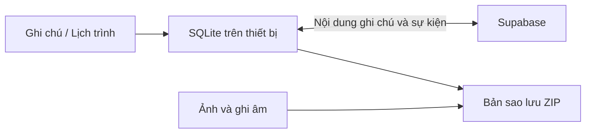

# Ghi chú

**Ghi lại ý tưởng, sắp xếp lịch trình, giữ dữ liệu trong tầm tay.**


Ứng dụng ghi chú và lịch trình bằng Kotlin, dùng giao diện Android native và lưu dữ liệu cục bộ. Ghi chú, sự kiện, widget, trợ lý Gemini và sao lưu nằm trong cùng một ứng dụng; đồng bộ Supabase là tính năng tùy chọn.

[Tính năng](#tính-năng) · [Build](#build) · [Bắt đầu sử dụng](#bắt-đầu-sử-dụng) · [Dữ liệu](#dữ-liệu-và-đồng-bộ) · [Mã nguồn](#mã-nguồn)

## Tính năng

| Nhóm | Có trong ứng dụng |
| --- | --- |
| Soạn thảo | Ghi chú theo khối, định dạng, checklist, ảnh, ghi âm và hoàn tác |
| Sắp xếp | Thư mục, tìm kiếm, giao diện ghi chú và khóa riêng tư |
| Lịch trình | Xem lịch, tạo sự kiện, nhắc nhở và sự kiện lặp lại |
| Widget | Danh sách ghi chú, ghim một ghi chú và lịch trình trên màn hình chính |
| Trợ lý AI | Gemini, đề xuất nội dung và các thao tác qua giao diện xác nhận |
| Công cụ bổ sung | Bản đồ tư duy, quét QR, xuất/chia sẻ ghi chú |
| Dữ liệu | Lưu cục bộ, đồng bộ Supabase, sao lưu và khôi phục bằng ZIP |

## Build

**Yêu cầu:** JDK 17, Android SDK 36; thiết bị chạy Android 11/API 30 trở lên. Dự án có Gradle Wrapper nên không cần cài Gradle riêng.

```powershell
git clone https://github.com/Tthanh2k6/GhiChu.git
cd GhiChu
```

Tạo `local.properties` tại gốc repo, đặt `sdk.dir` theo đường dẫn SDK trên máy, ví dụ:

```properties
sdk.dir=C:/Users/your-user/AppData/Local/Android/Sdk
```

```powershell
.\gradlew.bat :app:assembleDebug
.\gradlew.bat :app:testDebugUnitTest
adb install -r app/build/outputs/apk/debug/app-debug.apk
```

Trên macOS/Linux dùng `./gradlew` thay cho `.\gradlew.bat`. APK debug được tạo tại `app/build/outputs/apk/debug/app-debug.apk`.

## Bắt đầu sử dụng

1. Tạo ghi chú hoặc sự kiện; thao tác cơ bản dùng được khi không có mạng.
2. Thêm widget từ màn hình chính của điện thoại. Với widget ghim một ghi chú, chọn ghi chú muốn hiển thị.
3. Cấu hình Gemini trong ứng dụng nếu muốn dùng trợ lý AI.
4. Đăng nhập phần đồng bộ khi cần chia sẻ nội dung giữa các thiết bị.
5. Xuất bản sao lưu ZIP để mang theo cả ảnh và ghi âm.

## Dữ liệu và đồng bộ



- **Cục bộ trước:** thay đổi được ghi vào `ghichu.db`; đồng bộ đẩy phần chưa gửi rồi lấy thay đổi từ máy chủ.
- **Đồng bộ:** chạy khi mở ứng dụng và khi ứng dụng xuống nền. Bản sửa sau được ưu tiên khi hai thiết bị sửa cùng một bản ghi.
- **Phạm vi:** đồng bộ hiện giữ nội dung ghi chú và lịch trình; file ảnh, ghi âm cần đi qua bản sao lưu ZIP.
- **Khôi phục:** thay thế dữ liệu hiện tại và khởi động lại ứng dụng, không ghép hai bộ dữ liệu.

Mã nguồn đã có cấu hình Supabase mặc định trong [`DongBo.kt`](app/src/main/kotlin/com/ghichu/DongBo.kt). Repo chưa kèm script dựng bảng `sync_items`; để tự vận hành backend, cần bổ sung schema và chính sách truy cập phù hợp với client. Không coi việc clone repo là đã có một máy chủ đồng bộ riêng.

## Mã nguồn

Thư mục chính: [`app/src/main/kotlin/com/ghichu`](app/src/main/kotlin/com/ghichu).

| Thành phần | Vai trò |
| --- | --- |
| `ManHinhChinhActivity.kt`, `SuaGhiChuActivity.kt`, `SoanThao.kt` | Danh sách và trình soạn ghi chú |
| `KhoDuLieu.kt`, `KhoGhiChu.kt` | Lưu trữ dữ liệu |
| `ManLichTrinh.kt`, `SuaSuKien.kt`, `NhacNho.kt` | Lịch trình và nhắc nhở |
| `GhiChuWidget.kt`, `GhiChuMotWidget.kt`, `LichTrinhWidget.kt` | Widget màn hình chính |
| `Gemini.kt`, `AiDeXuat.kt`, `AiApDung.kt` | Tích hợp trợ lý AI |
| `DongBo.kt`, `DongBoTuDong.kt`, `SaoLuu.kt` | Đồng bộ và sao lưu |

Giao diện sử dụng API Android trực tiếp; thư viện ZXing hỗ trợ đọc QR, JUnit hỗ trợ kiểm thử JVM. Cấu hình release hiện dùng khóa debug, phù hợp build cá nhân; cần cấu hình khóa phát hành riêng khi phân phối bản chính thức.

---

**Trần Trung Thành** · [@Tthanh2k6](https://github.com/Tthanh2k6)
