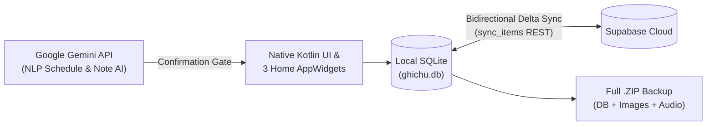

# GhiChu — AI-Powered Rich-Text Notes, Schedule & AES-256 Vault (Pure Kotlin Android)

<div align="center">
  <p align="center">
    
    
    
    
    
    
  </p>
</div>

---

## ✨ Overview

**GhiChu (`com.ghichu`)** is an ultra-lightweight (**`<3 MB APK`**) native Android productivity application engineered in **pure Kotlin directly on the Android SDK** (zero AndroidX, Jetpack, or Google Play Services bloat). It unifies multimedia rich-text notes, weekly/monthly schedules, a **Google Gemini AI** assistant, an **AES-256-GCM** encrypted private vault, bidirectional **Supabase** cloud sync, and **3 Home-Screen AppWidgets**.

| Module | Key Capabilities |
| :--- | :--- |
| **Rich-Text Editor & Mind Maps** | Block-based formatting, interactive checklists, inline images, voice recordings, undo/redo stack, and visual mind-map blocks. |
| **Schedule & Smart Reminders** | Weekly/monthly calendar views, recurring events, university timetable slot conversion (`T1..T16`), and exact alarm notifications. |
| **Google Gemini AI Assistant** | Natural-language schedule parsing, note summarization, and action proposals gated by an interactive user confirmation dialog (`AiDeXuat.kt` / `AiApDung.kt`). |
| **AES-256-GCM Private Vault** | Hardware-backed PBKDF2/SHA-256 PIN derivation and authenticated `AES-256-GCM` encryption for sensitive notes. |
| **3 Home-Screen AppWidgets** | Notes list widget (`GhiChuWidget`), single pinned note widget (`GhiChuMotWidget`), and upcoming schedule widget (`LichTrinhWidget`). |
| **Local-First Sync & ZIP Backup** | Instant offline SQLite storage (`ghichu.db`) with background delta sync to **Supabase** (`sync_items`) plus full `.zip` archive export/import including audio & image attachments. |

---

## 🏗️ Data & Synchronization Architecture



---

## 🚀 Build & Run

**Prerequisites:** JDK 17, Android SDK 36 (`minSdk = 30` / Android 11+).

```powershell
git clone https://github.com/Tthanh2k6/GhiChu.git
cd GhiChu
```

Create a `local.properties` file in the repository root pointing to your Android SDK:

```properties
sdk.dir=C:/Users/your-user/AppData/Local/Android/Sdk
```

Build the debug APK and run unit tests:

```powershell
.\gradlew.bat :app:assembleDebug
.\gradlew.bat :app:testDebugUnitTest
adb install -r app/build/outputs/apk/debug/app-debug.apk
```

---

## 📂 Core Source Map (`app/src/main/kotlin/com/ghichu`)

| Source Files | Responsibility |
| :--- | :--- |
| [`ManHinhChinhActivity.kt`](app/src/main/kotlin/com/ghichu/ManHinhChinhActivity.kt), [`SuaGhiChuActivity.kt`](app/src/main/kotlin/com/ghichu/SuaGhiChuActivity.kt), [`SoanThao.kt`](app/src/main/kotlin/com/ghichu/SoanThao.kt) | Main workspace, rich-text editor, and custom markup/Quill Delta parser |
| [`KhoDuLieu.kt`](app/src/main/kotlin/com/ghichu/KhoDuLieu.kt), [`KhoGhiChu.kt`](app/src/main/kotlin/com/ghichu/KhoGhiChu.kt) | SQLite persistence layer and AES-256-GCM encryption |
| [`ManLichTrinh.kt`](app/src/main/kotlin/com/ghichu/ManLichTrinh.kt), [`SuaSuKien.kt`](app/src/main/kotlin/com/ghichu/SuaSuKien.kt), [`NhacNho.kt`](app/src/main/kotlin/com/ghichu/NhacNho.kt) | Calendar views, recurring events, and alarm scheduling |
| [`GhiChuWidget.kt`](app/src/main/kotlin/com/ghichu/GhiChuWidget.kt), [`GhiChuMotWidget.kt`](app/src/main/kotlin/com/ghichu/GhiChuMotWidget.kt), [`LichTrinhWidget.kt`](app/src/main/kotlin/com/ghichu/LichTrinhWidget.kt) | 3 Android home-screen AppWidgets |
| [`Gemini.kt`](app/src/main/kotlin/com/ghichu/Gemini.kt), [`AiDeXuat.kt`](app/src/main/kotlin/com/ghichu/AiDeXuat.kt), [`AiApDung.kt`](app/src/main/kotlin/com/ghichu/AiApDung.kt) | Google Gemini API client, prompt engineering, and confirmation gate |
| [`DongBo.kt`](app/src/main/kotlin/com/ghichu/DongBo.kt), [`DongBoTuDong.kt`](app/src/main/kotlin/com/ghichu/DongBoTuDong.kt), [`SaoLuu.kt`](app/src/main/kotlin/com/ghichu/SaoLuu.kt) | Supabase bidirectional REST sync engine and `.zip` backup/restore |

---

**Author:** **Trung Thanh Tran** (*Trần Trung Thành*) · [GitHub `@Tthanh2k6`](https://github.com/Tthanh2k6) · [Upwork Profile](https://www.upwork.com/freelancers/~01ee7c2348cb4b62fe)
